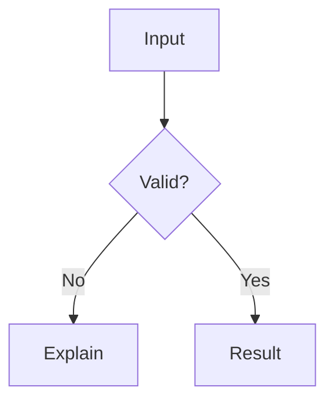

# ORIZ.IN

A static-first knowledge, tools, and reference platform. ORIZ.IN combines original technical writing with working browser utilities — no account wall, no application server, and no mandatory third-party analytics.

Production domain: [https://oriz.in](https://oriz.in)  
Repository: [github.com/chirag127/oriz.in](https://github.com/chirag127/oriz.in)  
Publisher: [Chirag Singhal](https://oriz.in/author/chirag-singhal/)

## What is in this release

- **128 published articles** organised into **11 live domains**, **36 complete-guide categories**, and ordered series.
- **53 published browser tools**, each mapped to a tested shared engine and a live category.
- **15 domains defined** across Money & Work, Technology & AI, Life & Learning, and World & Ideas; four domains remain in preparation.
- A validated **domain → category → series → article** hierarchy with nested folders, mega-menu navigation, a persistent left library tree, and a contextual right rail.
- Five ordered learning paths, a **87-term glossary**, and searchable reference datasets.
- 13 verified public API notes with CORS, authentication, pricing, rate-limit context, and example responses.
- The India-first finance library imported from `chirag127/arac`, with overlapping articles merged and future dates normalised.
- Static JSON exports, RSS, sitemap, robots, Open Graph images, and a generated build report.
- About, contact, privacy, terms, editorial, corrections, accessibility, copyright, and cookie pages.
- Author/hire page, donation link, and optional AdSense/analytics integrations that are disabled by default.

The current build report is generated at `dist/build-report.json` by `scripts/postbuild.mjs`.

## Technology and deliberate choices

| Area | Choice | Why |
| --- | --- | --- |
| Framework | Astro 7, static output | Pre-rendered HTML, minimal JavaScript, easy Cloudflare Pages deployment |
| UI islands | React 19 + TypeScript | Complex interactive tools only; static content stays Astro/Markdown |
| Styling | Custom CSS custom-property design system | Zero runtime CSS dependency, consistent editorial identity, explicit accessibility tokens |
| Mathematics | KaTeX at build time | Real mathematical typesetting with no math library shipped to the browser |
| Diagrams | Mermaid, lazy-loaded only where needed | Text diagrams in Git; the source remains available as an accessible fallback |
| Markdown extensions | `@astrojs/markdown-remark` unified processor | `remark-math`, rehype KaTeX, heading anchors, and responsive table wrapping |
| Search | Build-time metadata index + small TypeScript client | No paid search service or backend; progressive fallback to directories |
| Sanitization | DOMPurify for user Markdown; sandboxed iframe for the playground | User-entered content is never trusted as executable site code |
| Charts/images | No chart library; SVG/CSS visuals; Sharp for brand images | Lower JavaScript and fewer dependencies |

Tailwind CSS and shadcn/ui were evaluated and deliberately not adopted. They would add a second styling system, React component dependencies, and client/runtime cost to an Astro-first site whose interface is mostly custom tool controls. The current design system keeps the CSS explicit, small enough to audit, and independent of a utility-class compiler. This decision can be revisited if the interactive surface grows into a full React application.

## Requirements

- Node.js **22.23.4 or newer** (developed on Node 24).
- npm with a committed lockfile (`package-lock.json`).
- Microsoft Edge for the optional local browser QA. Chrome is intentionally not used. Set `EDGE_PATH` if Edge is installed elsewhere.
- SOPS and GPG only when using the encrypted local environment workflow.
- No external service credentials are needed for local development.

## Local development

```bash
npm ci
npm run dev
```

Open the URL printed by Astro (normally `http://localhost:4321`).

Production build:

```bash
npm run build
# astro check
# astro build
# scripts/postbuild.mjs: link/metadata/sitemap checks, _headers, ads.txt, build-report.json
```

Preview the built output:

```bash
npm run preview
```

## Scripts

| Command | Purpose |
| --- | --- |
| `npm run dev` | Local Astro development server |
| `npm run check` | Astro + TypeScript diagnostics |
| `npm test` | Vitest unit tests for formatting, finance, dates, networking, colors, statistics, SQL, cron, hashing, and other tool logic |
| `npm run build` | Type-check, production build, post-build validation, and build report |
| `npm run build:fast` | Production build + post-build validation without repeating the type check |
| `npm run preview` | Serve `dist/` locally |
| `npm run verify` | Type-check + unit tests + production build |
| `npm run test:browser` | Build, start a private Astro preview, and run Edge QA (all tool pages, articles, APIs, interactions, mobile checks, axe accessibility) |
| `npm run test:csp` | Build, apply the generated `_headers`, and verify CSP, JSON-LD, Mermaid, the sandboxed playground, search, and static data under Edge |
| `npm run test:external` | Check external links in the built HTML (network required; not part of normal CI) |
| `npm run env:decrypt` | Restore the local `.env` from the SOPS-encrypted `.env.sops` |
| `npm run env:encrypt` | Re-encrypt the local `.env` to `.env.sops` after changes |

Browser QA is headless Edge. It starts its own preview server and writes reports and screenshots to `.scratch/`. It does not open a visible browser.

External link checking (network required, not part of CI by default):

```bash
npm run test:external
```

## Repository map

```text
src/
  components/        Astro UI, icons, SEO head, cards, header/footer, React tool UI
  content/
    library/         Nested articles: <domain>/<category>/<series>/<NN>-<slug>.md
    guides/          Complete-guide Markdown: <domain>/<category>.md
  content.config.ts  Content collection schema and folder-derived IDs
  data/
    taxonomy.ts      Shelf, domain, category, and series registry
    tools.ts         Tool registry and engine options
    apis.ts          Verified API registry
    learning-paths.ts
    glossary.ts
    tags.ts          Display labels for common tags; tags themselves are free-form
    profile.ts       Publisher identity, social links, support link
    projects.ts      Selected GitHub projects and open API family status
    references/      HTTP, MIME, Git, Docker, regex reference data
  layouts/           Base, article, legal layouts
  lib/               Tested pure logic, content validation, search schema helpers, SEO
  pages/             Static routes, data endpoints, RSS, image endpoints
  scripts/           Article enhancement, search, filters, progress, copy controls
  styles/global.css  Design tokens and UI styles
scripts/
  postbuild.mjs              Build validation and report
  browser-check.mjs          Puppeteer-core Edge QA
  run-browser-qa.mjs         Starts a private preview and runs QA
  check-csp.mjs              Applies _headers and validates CSP behavior
  check-external-links.mjs   Network reference check
tests/                       Vitest unit tests
```

## Content architecture

The library is three levels deep and validated at build time:

```text
domain → category (complete guide) → series → article
```

- A domain is a broad area such as Money & Finance or Technology.
- A category is a complete-guide page such as Gold or Loans & Credit.
- A series is an ordered run of articles inside a category.
- An article lives at `/<domain>/<category>/<article-slug>/`; the series is shown in breadcrumbs and navigation but is not part of the URL.
- `/articles/<slug>/` and `/categories/<slug>/` are legacy redirects; canonical content lives under the domain paths.

## Content authoring

### Add an article

Create `src/content/library/<domain>/<category>/<series>/<NN>-<slug>.md`. The folder path determines the taxonomy, the two-digit prefix determines the series order, and the filename (without the prefix) is the stable article slug.

The glob collection validates this frontmatter:

```yaml
---
title: "A clear, specific title"
description: "A unique meta description, 50–240 characters."
pubDate: 2026-10-25
updatedDate: 2026-10-26        # optional, must be >= pubDate
author: "Chirag Singhal"
type: guide                    # article | guide | tutorial | reference | explainer | documentation
tags: ["json", "validation"]    # free-form lowercase tags, max 8
difficulty: beginner            # optional
toc: true
related: ["another-article"]   # optional published article ids
learningPaths: []               # optional path slugs
references:
  - title: "Primary source"
    url: "https://example.com/"
disclaimer: "Optional educational note."   # optional
---
```

Draft articles set `draft: true` and are excluded from routes, search, exports, and category counts. The build verifies folder taxonomy, series order, live categories, disclaimers on finance/legal content, related and prerequisite references, learning-path membership, duplicate titles, and missing tool docs.

Markdown supports GFM tables, KaTeX math (`$...$` and `$$...$$`), and Mermaid fenced blocks:

````markdown

````

### Add or change a domain, category, or series

Edit `src/data/taxonomy.ts` and add the corresponding folder and guide. Every live category requires a guide file in `src/content/guides/<domain>/<category>.md` and at least one article. Planned domains are listed only on `/library/` and are not indexable until they have a guide and published content.

### Add a tool

1. Add metadata to `src/data/tools.ts` with an existing category and engine.
2. Use an existing engine/component where possible. New engines require a React component and a loader mapping in `src/components/react/ToolLoader.tsx`.
3. Add unit tests for any new pure logic in `src/lib/` under `tests/`.
4. The route `/tools/<slug>/` and its directory/listing entry are generated from the registry. There is no per-tool page file.

### Add an API entry

Add a verified record to `src/data/apis.ts`. Keep the provider, auth, CORS, rate-limit, pricing, license, example, verification date, and notes accurate. Do not invent endpoints or a free tier. API pages are generated from the registry.

### Add a learning path or glossary term

Edit `src/data/learning-paths.ts` or `src/data/glossary.ts`. Learning-path steps are validated against published articles and tools during the build.

## Architecture notes

- **Registries, not duplicate lists.** Navigation, tool listings, categories, learning paths, API pages, search records, sitemaps from built routes, and public JSON exports derive from the same validated data.
- **Static-first.** There is no server runtime, database, user account system, or dynamic API. All computations in tools happen in the browser.
- **Small client surface.** Astro ships no framework runtime for static pages. Each interactive tool is a React island whose engine component is dynamically imported on that page. Mermaid is loaded only on pages with diagrams or the Mermaid editor.
- **Tool logic is separate from presentation.** The tested modules in `src/lib/` can be exercised without rendering a React component.
- **Build-time validation.** Invalid content/registry references, duplicate tool slugs/titles, missing docs, invalid sitemap targets, broken internal links, missing metadata, duplicate indexable titles, draft leakage, invalid JSON-LD, and missing image alt text fail the build.
- **Data flow for tools.** Input values are held in React state and processed locally. They are not sent to ORIZ.IN. Search queries remain in the browser; the search page fetches a static metadata index.

## Search

`/search-index.json` is generated at build time from published article metadata, headings, short plain-text excerpts (up to 1,600 characters per article), tools, categories, APIs, learning paths, and glossary terms. It intentionally does **not** contain full article bodies, credentials, analytics data, or drafts. The search client supports partial matching, ranking, type/category filters, URL query parameters, keyboard navigation, and empty states. It is a metadata/heading search, not a full-text search engine; this keeps the index compact as the site grows.

## SEO, feeds, and public data

- Canonical URLs, unique titles/descriptions, Open Graph/Twitter metadata, JSON-LD (Article, SoftwareApplication, ProfilePage/Person, WebAPI, BreadcrumbList, Organization/WebSite, DefinedTermSet, DataCatalog).
- `sitemap-index.xml` and a sitemap containing canonical indexable pages only (`/search/` and `404` excluded).
- `robots.txt` references the sitemap and does not block assets.
- `/rss.xml` contains the latest published article metadata.
- Static data endpoints, licensed for reuse as metadata:
  - `/data/articles.json`
  - `/data/categories.json`
  - `/data/tools.json`
  - `/data/apis.json`
  - `/data/learning-paths.json`
  - `/data/glossary.json`
  - `/search-index.json`

The responses use version `1.0`, include a generated timestamp and counts, and expose CORS with `Access-Control-Allow-Origin: *` for `/data/*` and `/search-index.json` on Cloudflare Pages. Article bodies are not exported. Treat the schema as a documented starting contract, not an uptime guarantee.

## Local environment and encrypted secrets

`.env` is local and gitignored. A SOPS+age-encrypted copy, `.env.sops`, can be committed so the environment configuration can be synchronized through Git. The age private key lives outside Git; a password-protected backup is kept locally under the gitignored `.secrets/` directory. The owner-supplied passphrase is not committed and is not written into `AGENTS.md`.

```bash
npm run env:decrypt   # restore .env if it is absent
npm run env:encrypt   # update .env.sops after editing .env
```

SOPS's age backend is key-based and does not accept a raw passphrase as the decryption credential. The passphrase protects the local age-key backup, and SOPS+age encrypts the environment. On another machine, copy the protected key backup or the age key through a secure channel; a fresh clone alone cannot decrypt the environment by design. Full agent instructions and the security rules are in [AGENTS.md](AGENTS.md). Never print `.env`, `.secrets/`, or decrypted values in logs or chat.

## Optional analytics and advertising

All integrations are off by default and require valid configuration. Copy `.env.example` to `.env` for local testing; use Cloudflare Pages environment variables in production. Never commit real credentials.

| Variable | Effect |
| --- | --- |
| `PUBLIC_ANALYTICS_ENABLED=true` | Enables configured analytics providers |
| `PUBLIC_GA4_ID=G-...` | Loads GA4 page-view measurement when analytics is enabled |
| `PUBLIC_CLARITY_ID=...` | Loads Microsoft Clarity when analytics is enabled; tool interfaces are masked |
| `PUBLIC_ADSENSE_ENABLED=true` | Enables the article-end AdSense slot |
| `PUBLIC_ADSENSE_CLIENT=ca-pub-...` | Publisher ID; also generates `ads.txt` in the build |
| `PUBLIC_ADSENSE_SLOT=...` | Ad slot ID |

No fake IDs are shipped. With the defaults, no analytics or advertising script is requested. Enabling GA4, Clarity, or AdSense can introduce cookies/identifiers and may require notice and consent depending on the visitor’s jurisdiction; a generic banner is not automatically legal compliance. The privacy and cookie pages document the current data flow. Ad placements are labelled and excluded from tool controls.

The generated CSP in `dist/_headers` adds the relevant Google/Microsoft domains only when the corresponding integrations are enabled.

## Security and privacy

- Tools process input locally; no server receives tool input.
- Theme preference and optional learning-path progress use `localStorage`, not cookies. Clearing site data removes them.
- Markdown previews are sanitized with DOMPurify; remote images/scripts/forms and inline styles are removed. The HTML playground runs in a sandboxed iframe with an opaque origin and a restrictive child CSP that blocks network access.
- Services are statically hosted over HTTPS. `dist/_headers` sets HSTS, `X-Content-Type-Options`, `Referrer-Policy`, `Permissions-Policy`, `X-Frame-Options`, COOP, and a Content Security Policy.
- The CSP allows `'unsafe-inline'` for scripts and styles because the static build includes inline JSON-LD and style attributes. This is a documented trade-off; external script sources are otherwise restricted, `object-src` is `none`, and framing/forms are tightly limited. Review and tighten the policy if the inline surface changes.
- No secrets belong in this repository or any `PUBLIC_*` variable. Treat everything in a public Git repository as public.
- There is no account system, no database, no comments, and no first-party visitor tracking.

## Author, donation, and job-search configuration

- Identity, social links, support URL, and professional copy live in `src/data/profile.ts`.
- Selected projects and the open API family live in `src/data/projects.ts`.
- The author/hire page is `/author/chirag-singhal/`; contact is `/contact/`. The header, homepage, footer, and article author box link to it.
- Donations use the external Buy Me a Coffee URL from `profile.ts`; `/support/` explains what support funds without inventing audience metrics.
- Publisher details are sourced from the public GitHub profile and repositories, reviewed 25 October 2026. Update them when the public record changes.

## Deployment: Cloudflare Pages

The repository produces a static `dist/` directory. No Cloudflare Functions, SSR, database, or paid plan is required.

1. Push the repository to GitHub.
2. In Cloudflare, open **Workers & Pages → Create → Pages → Connect to Git**.
3. Select the `oriz.in` repository.
4. Set:
   - **Production branch:** `main`
   - **Build command:** `npm run build`
   - **Build output directory:** `dist`
   - **Framework preset:** Astro
   - **Node version:** `24` (or any version satisfying `>=22.23.4`); set `NODE_VERSION=24` if the dashboard does not detect it.
5. Add optional environment variables from the table above. Leave them unset for analytics/ads-off defaults.
6. Deploy. The build writes `_headers`, generated images, sitemap, feeds, JSON endpoints, and `build-report.json`.
7. Add `oriz.in` as the custom domain and follow Cloudflare’s DNS instructions. **Do not change DNS or production configuration without the owner’s authorization.**

Cloudflare Pages' file-count and asset-size limits should be re-checked before major growth. This build is still compact (554 files and 19.54 MiB total). The largest asset is the lazily loaded Mermaid chunk at about 1.4 MiB. Keep an eye on generated file count as articles and tools grow; the post-build report fails above 20,000 files and warns near 15,000.

GitHub Actions CI (`.github/workflows/ci.yml`) runs type checks, unit tests, the production build, and Edge browser QA. It does not deploy; Cloudflare Pages deploys from the repository integration. GitHub Actions usage remains subject to the account's current free allowances. Cloudflare Pages can also connect directly to the repository for deployments; no paid CI service is required.

### Google Search Console (owner step)

1. Add the `oriz.in` domain property in Google Search Console.
2. Verify ownership using the DNS record Google provides. Do not change unrelated DNS records.
3. Submit `https://oriz.in/sitemap-index.xml`.
4. Use URL Inspection for representative new pages; request indexing only when appropriate.
5. Monitor indexing, crawl errors, canonical selection, and performance over time.

ORIZ.IN cannot promise that pages will be indexed or ranked. This README records the setup; it does not claim that Search Console verification has been performed.

### Optional AdSense after approval

AdSense is intentionally disabled in this release. If the owner is approved later:

1. Set `PUBLIC_ADSENSE_ENABLED=true`, `PUBLIC_ADSENSE_CLIENT`, and `PUBLIC_ADSENSE_SLOT` in Cloudflare Pages.
2. Redeploy. The build adds the ad script only on article pages and writes `ads.txt` from the configured publisher ID.
3. Confirm the ad is clearly labelled, does not resemble a tool control, and does not cause layout shifts.
4. Apply the consent and privacy requirements that apply to the site's actual audience and jurisdiction. A banner alone is not automatically compliant.
5. Re-run the CSP check and browser QA. The generated CSP adds common Google ad domains only when the integration is enabled.

### Accounts deferred

There are no accounts. If a concrete feature later needs cross-device synchronization or private saved data, evaluate a managed service such as Supabase against its current free-tier limits, inactivity policy, data-processing terms, upgrade costs, threat model, and the actual user benefit before adding it. Do not add accounts merely to make the architecture look complete.

## Testing and current evidence

- `npm test`: 110 Vitest assertions across text, finance, math, statistics, CSV/JSON, colors, units, networking, dates/time zones, MD5/SHA hashes, random sampling, SQL, cron, JWT decoding, and the emergency-fund and prepayment models.
- `npm run test:browser`: Edge headless QA against the built site. It loads every tool, article, API, category, and learning path page; checks toolbar/meta/alt/overflow; performs search, JSON formatting, theme, and mobile-menu interactions; and runs axe WCAG 2 A/AA checks on the full set of tool, article, API, and core pages in light mode plus key pages in dark mode. Reports and screenshots go to `.scratch/`.
- `npm run build`: post-build checks internal links and anchors, canonical/title/description presence, duplicate titles, sitemap membership, JSON-LD parsing, draft leakage, images without alt text, file-count limits, and output size. Broken internal links or metadata errors fail the build.
- `node scripts/check-external-links.mjs`: checks external references in the built HTML. Social networks may block bots; a small bot-protected set is reported separately rather than treated as broken.
- `npm run test:csp`: serves `dist/` with the generated `_headers` and verifies CSP behavior in Edge, including JSON-LD, React islands, Mermaid, the sandboxed playground, search, and the data endpoints.

Local Edge measurements from the final QA pass: homepage LCP around 220 ms with CLS 0; the JSON formatter tool had CLS around 0.065 and the Mermaid editor around 0.061; a finance article with KaTeX and Mermaid had an LCP around 210 ms. These are local lab measurements, not field data or a Lighthouse score.

Latest automated evidence (30 October 2026): 122/122 unit tests passed; the production build passed post-build checks with 0 errors and 0 warnings across 314 HTML routes (271 published pages, 128 articles, 53 tools, 36 categories, 11 live domains, and 13 APIs), with 41 legacy redirects generated; Edge QA covered 23 core pages, all 53 tools, all 128 articles, all 13 APIs, all 36 category guides, all 11 live domains, and all 5 learning paths with 0 page errors, 0 test failures, and 0 axe WCAG 2 A/AA violations; the CSP/header test passed; 497 unique external links were checked with 0 confirmed broken; 16 government/exchange URLs that block automated requests are reported as unverified.

No third-party accessibility certification, Google indexing, or AdSense approval is claimed.

## Known limitations

- Search indexes metadata, headings, and short article excerpts, not full article text. This is a deliberate index-size trade-off.
- Mermaid renders client-side on diagram pages; diagrams use native SVG text labels and scroll horizontally when wider than the article column. The text source is the accessible fallback if rendering fails. Vite reports a >500 KiB warning for its lazily loaded browser chunk (about 1.4 MiB in this build); it is requested only on pages with diagrams. Pre-rendering at build time is the next optimisation if this becomes a real-world performance problem.
- KaTeX CSS is included on article pages even when a specific article has no equation.
- The HTML/CSS/JS playground has no console capture and blocks network access by design.
- External APIs can change after their verification date; the API registry is a research aid, not a service-level commitment.
- Most of the owner's 80+ “Oriz Free Public APIs” repositories are scaffolds, not complete datasets. The author and developer pages state this explicitly. The FII/DII pipeline repository is linked for its code, but its hosted deployment needs review before being promoted as a live API.
- Analytics, ads, comments, accounts, and a newsletter are not enabled. There is no backend for them.
- No Cloudflare deployment has been performed from this environment; DNS and production configuration are owner-controlled.
- Full third-party API endpoint health is checked manually at the recorded verification dates, not on every build.
- Browser QA is a strong automated signal, not a substitute for testing with real assistive technologies.

## License

- Source code: MIT. See [LICENSE](LICENSE).
- Original editorial content: CC BY 4.0, unless a page says otherwise. See the [copyright page](https://oriz.in/copyright/) for attribution guidance.
- Brand name and logo are not licensed for use in a way that implies endorsement.
- Third-party dependencies, APIs, data, and trademarks retain their own licenses and terms.

## Contributing

This is primarily the publisher's project. Corrections and reproducible bug reports are welcome through the public issue tracker or by email. Do not submit secrets, private data, or copied third-party content. Please read the editorial and corrections policies before proposing content changes.
