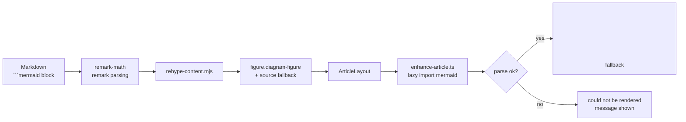

# Diagram rendering

How diagrams, math and tables travel from Markdown to the browser, and where the
pipeline loses information.

## The pipeline



The critical property: **the failure branch is silent at build time**. The build
succeeds, the page returns 200, and the reader sees a message instead of a
diagram. Only a browser check catches it.

## What is supported

| Feature | Plugin | Notes |
| --- | --- | --- |
| Mermaid | `src/lib/rehype-content.mjs` + `enhance-article.ts` | Rendered client-side, lazy-loaded |
| KaTeX math | `remark-math` + `rehype-katex` | `throwOnError: false`, so bad math renders literally |
| Tables | `rehype-content.mjs` | Wrapped in a keyboard-focusable scroll region |
| Heading anchors | `rehype-slug` + `rehype-autolink-headings` | Drives the table of contents |

`rehype-katex` runs with `throwOnError: false`, which means malformed math does
not break the page — it renders the source literally. That is forgiving, but it
also means a typo is invisible unless the output is actually read.

## Legibility rules

Mermaid sizes its SVG in user units. A wide graph scaled to fit a narrow column
renders text below a readable size. The CSS enforces a minimum:

- `.mermaid-diagram svg { min-width: min(100%, 520px) }` — never shrink below legibility.
- `text, .label { font-size: 14px; fill: var(--text) }` — high contrast in both themes.
- The wrapper scrolls horizontally, so shrinking is never necessary.

## Verification is mandatory

```bash
node scripts/check-diagrams.mjs       # static, fast, no browser
node scripts/check-diagrams-live.mjs  # authoritative, needs dev server + sctl
```

The live check navigates every article containing a diagram and asserts
`figure count == svg count` and `placeholder count == 0`.

## Related

- [Article standard](article-standard.md)
