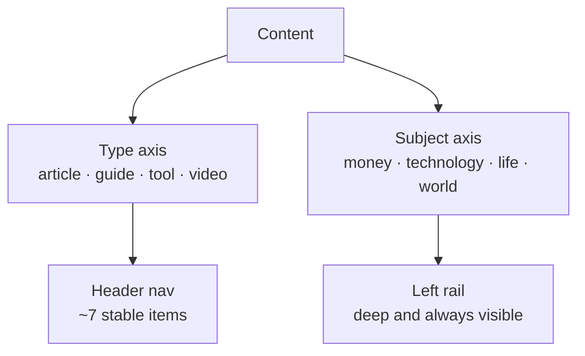
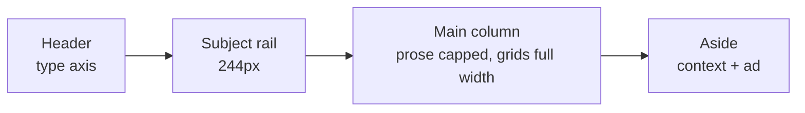

# Navigation shell

The site holds many content *types* across many *subjects*. Keeping those as two
independent axes is what lets navigation scale.

## Two axes, not one

A visitor arrives knowing one or the other. Conflating them into a single
"Library" menu works at a hundred items and collapses at ten thousand.

## The frame

| Region | Holds | Width | Collapses at |
| --- | --- | --- | --- |
| Header | Type navigation | Full bleed | Never |
| Subject rail | Shelf → domain → category | 244px | 980px |
| Main | Content | Fluid, prose capped at 72ch | Never |
| Aside | TOC, related, ad | 280px | 1240px |

**The aside collapses before the rail.** The rail is navigation; the aside is a
convenience. Losing the aside first preserves wayfinding as long as possible.

## Why the aside never holds navigation

Two navigation rails compete for authority and neither becomes the one people
learn. The aside is deliberately limited to context and advertising.

## Full-bleed frame

Outer margins are removed so the frame reaches both viewport edges; a minimal
`--page-gutter` keeps text off the window edge. One token controls the whole
frame — header, breadcrumbs and shell all key off it, so their left edges can
never drift apart.

## Accessibility floor

- The rail is a `<nav>` with an accessible name.
- Sticky positioning with `overscroll-behavior: contain`.
- Visible keyboard focus (3px outline) on every rail link.
- Rail hidden on print and below 980px, where the header mega-menu carries subjects.

## Related

- [Article standard](article-standard.md)
