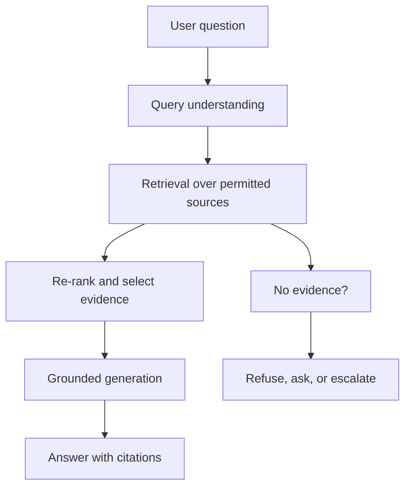

A retrieval-augmented generation system is not “a chatbot with your PDFs”. It is a search system, an evidence contract, and a generation policy joined together. When the answer is wrong, the language model is often blamed, but the document needed to answer the question may never have been retrieved, may have been split in half, or may have been visible to a user who should not have seen it.

That distinction matters even more in an Indian product context. A support assistant for a D2C brand may need to answer questions in English, Hindi, and Hinglish; a financial-operations assistant may need to keep customer records inside a particular processing boundary; a field-service tool may need to work over an unreliable mobile connection. RAG is an architecture for these problems, but only if retrieval is treated as a real subsystem.

This guide walks through the design choices in the order they affect reliability.

## What RAG actually does

RAG adds a retrieval step before generation:



The retrieval layer searches an index built from documents, records, or web pages. The selected evidence is inserted into the generator's context, and the generator is asked to answer only from that evidence. The result works best when the answer is genuinely present in the corpus and the retrieval system can find it.

Use RAG when:

- answers depend on a changing, private, or domain-specific corpus;
- users need citations to source material;
- access rules differ between users or tenants;
- the model should not be expected to memorise every internal policy.

Use ordinary search, SQL, or a deterministic calculation when the question is a lookup or a formula. A vector index is a poor substitute for `SELECT status FROM orders WHERE id = ?`. A calculator is a poor substitute for a model that is asked to do arithmetic. Choose the smallest mechanism that answers the question honestly.

## The evidence model comes first

Before choosing a vector database, decide what one “document” is and what it means to retrieve it.

For a support corpus, a document might be:

- a product page;
- one FAQ answer;
- a troubleshooting procedure;
- a policy paragraph with a version and effective date;
- an order record scoped to a customer.

For a regulatory or financial context, a chunk is not enough on its own. The system also needs metadata: source, version, effective date, jurisdiction, owner, access scope, and whether the document is superseded. A perfect semantic match to an outdated circular is a bad retrieval.

A practical evidence schema:

| Field | Why it exists |
| --- | --- |
| `source_id` | Stable identity for deduplication and citations |
| `title` and `section` | Human-readable citation and debugging |
| `text` | The retrievable content |
| `version` and `effective_at` | Prevents answering from an outdated source |
| `tenant_id` or `access_group` | Enforces isolation before any text reaches the model |
| `language` | Supports routing and multilingual evaluation |
| `source_url` | Lets the user inspect the evidence |
| `checksum` | Detects silent ingestion changes |

If you cannot explain why a retrieved passage is allowed to influence the answer, the RAG design is incomplete.

## Chunking is a product decision

A common mistake is choosing a chunk size from a tutorial and applying it to every collection. The right unit depends on the question:

- policy questions often need a complete clause with its heading and effective date;
- troubleshooting steps should keep the numbered sequence intact;
- product specifications may be best retrieved as a table row plus its column headings;
- long articles may need parent-child retrieval: retrieve small passages, then pass a larger surrounding section to the generator.

| Strategy | Strength | Failure mode |
| --- | --- | --- |
| Fixed token windows | Simple and predictable | Splits procedures and loses headings |
| Paragraph or section chunks | Preserves human structure | Sections vary greatly in length |
| Parent-child chunks | Precise search with richer context | More indexing and storage complexity |
| Table-aware chunks | Keeps row meaning | Requires format-specific parsing |
| Semantic chunks | Tries to follow meaning | Inconsistent boundaries and higher build cost |

Always store the heading path with a chunk. A passage that begins “the limit is ₹2 lakh” is dangerous if it loses the sentence explaining which category and year the limit belongs to.

Overlap is a mitigation, not a cure. Duplicating text increases storage, retrieval competition, and the chance that the same evidence appears three times. Prefer clean section boundaries with the document title and heading included in the embedded text.

## Retrieval is more than cosine similarity

Embeddings are good at semantic recall and weak at exact identifiers, negation, dates, and rare names. A production retriever usually combines methods.

### Hybrid search

Run lexical retrieval and vector retrieval, then combine the ranks. Lexical search catches an order number, a section code, a product SKU, or a name that an embedding smooths away. Vector search catches paraphrases and multilingual intent. Reciprocal rank fusion is a simple, explainable way to combine them.

### Metadata filters

Filters are not optional decoration. They enforce tenant boundaries, language preferences, document status, and time validity. Apply them inside the database query, not after the model has already seen prohibited text. For row-level permissions, the safest pattern is to construct the query from server-side policy, never from client-supplied tenant IDs.

### Re-ranking

A fast first-stage retriever may return 50 candidates; a slower cross-encoder or hosted reranker selects the best 5–10. This can improve ordering, but it adds latency and another vendor or model to evaluate. Measure retrieval quality before adding a reranker.

### Diversity

If five nearly identical chunks dominate the context, the generator gets repetition instead of coverage. Maximal marginal relevance can trade a little relevance for diversity. It is useful for broad “what are the policy options?” questions, less useful for a precise lookup.

## Generation is a contract

The model prompt should make the evidence contract explicit:

- answer only from the supplied evidence;
- cite every material claim using the provided source identifiers;
- say when evidence is missing or conflicting;
- do not invent dates, amounts, URLs, or policy names;
- escalate high-risk or ambiguous cases.

A short output schema is often better than a long free-form answer. For support, return:

```json
{
  "answer": "string",
  "citations": ["source_id"],
  "confidence": "high | medium | low",
  "needs_human": false
}
```

Validate that returned citation IDs exist in the retrieved evidence. Do not trust the model to cite correctly just because it produced plausible-looking brackets.

Temperature is not a quality setting. A low temperature makes output more repeatable; it does not make retrieval complete or make an unsupported claim true.

## A small, testable pipeline

The following Python sketch is intentionally provider-neutral. It shows the pieces worth testing; it is not a complete package.

```python
from dataclasses import dataclass
from typing import Sequence


@dataclass(frozen=True)
class Evidence:
    source_id: str
    title: str
    text: str
    version: str


def build_context(evidence: Sequence[Evidence], max_chars: int = 12000) -> str:
    blocks = []
    used = 0
    for item in evidence:
        block = f"[{item.source_id}] {item.title}\n{item.text}"
        if used + len(block) > max_chars:
            break
        blocks.append(block)
        used += len(block)
    return "\n\n".join(blocks)
```

The function has a clear contract: only permitted evidence enters, each block retains a source identifier, and the context has a hard budget. A retriever and a generator can be swapped around it without changing that contract.

For a Postgres-backed prototype, `pgvector` can keep vectors beside the records and permissions you already manage. A separate vector service may be appropriate when scale or hybrid-search features justify the operational cost. The database choice should follow the consistency, isolation, and backup needs of the documents—not the other way round.

## Access control before generation

A RAG system can leak data in at least three ways:

1. The retriever searches documents the user is not allowed to see.
2. A permitted document contains another customer's personal data.
3. The answer is logged in full at the application layer.

Prevent the first by scoping the query with server-derived permissions. Prevent the second by minimising and redacting sensitive fields before indexing or before generation. Prevent the third by defining logging rules before launch: usually the question, selected source IDs, latency, and outcome are enough; raw customer text may need stricter retention and access controls.

Citations must respect the same permissions. A citation to a document the user cannot open is both a security problem and a bad user experience.

## India-specific constraints worth designing for

### Multilingual and code-mixed queries

Users may ask in English, Devanagari Hindi, transliterated Hindi, or a mixture such as “mera order refund kab aayega?”. A single English-centric embedding may retrieve poorly for all but the first form. Build evaluation sets in the languages your users actually use, and consider language-specific normalisation or query expansion where evidence supports it. Do not assume a translated query has the same intent as the original.

### Data-processing terms and residency

If customer records, support conversations, or financial data enter a model provider's system, document what data leaves your environment, where it is processed, how long it is retained, and whether it is used for training. India's Digital Personal Data Protection Act, 2023 and any applicable sector rules may create obligations that depend on your role as a data fiduciary or processor, the categories of data, and your contracts. This is a legal review, not a prompt-engineering task. Keep the retrieval index and the model provider's processing boundary in the same review.

### Cost in rupees, not vague “API calls”

Estimate cost per request from the number of input tokens, output tokens, retries, and embedding calls. A simple formula:

$$
\text{cost} = \sum_{\text{requests}} \left( \text{tokens}_{in} \times p_{in} + \text{tokens}_{out} \times p_{out} \right) + \text{indexing cost}
$$

Measure a representative request distribution. A demo with one short question can hide the cost of a 30-chunk context and long answers. Use a cheaper model for retrieval support tasks, cache stable answers where appropriate, and cap context size. Do not pretend a paid model is free because the tier includes a credit.

### Latency on real networks

Retrieval and re-ranking add round trips. For mobile users on variable networks, return a useful status and a timeout policy. A slow, highly reranked answer can be worse than a quick answer that says it is still looking. Keep the first token fast, stream when the product benefits from it, and avoid making every question wait for five sequential model calls.

## Failure modes and what to do

| Symptom | Likely layer | First response |
| --- | --- | --- |
| Answer cites no source | Generation contract | Reject and ask for evidence; check prompt and validator |
| Source is relevant but incomplete | Chunking or ranking | Inspect parent document and chunk boundaries |
| Exact order ID not found | Retrieval modality | Add lexical search and metadata filters |
| Two policies conflict | Corpus governance | Track version/effective date and surface the conflict |
| Users see another tenant's data | Access control | Stop rollout; scope queries and rotate exposed credentials |
| Cost triples on launch | Context size or retries | Measure token distribution and cap context |

## A launch checklist

1. Define the unit of evidence and its metadata.
2. Build a small evaluation set from real, consented questions.
3. Measure retrieval recall separately from answer quality.
4. Enforce permissions before retrieval and test cross-tenant access.
5. Require citations and validate them in code.
6. Decide when the system must refuse or escalate.
7. Document data processing, retention, and provider terms.
8. Measure latency and cost in realistic conditions.
9. Keep an offline evaluation for every prompt or index change.
10. Add human review for high-impact decisions.

RAG is useful when it behaves like a research assistant with a narrow library and a visible evidence trail. That requires more engineering than attaching a vector database to a chat box—and that engineering is the part worth doing.

Read the companion guide, [Evaluating LLM Applications Without Fooling Yourself](/ai-data/ai-engineering/evaluating-llm-applications/), before treating a successful demo as a quality result.
