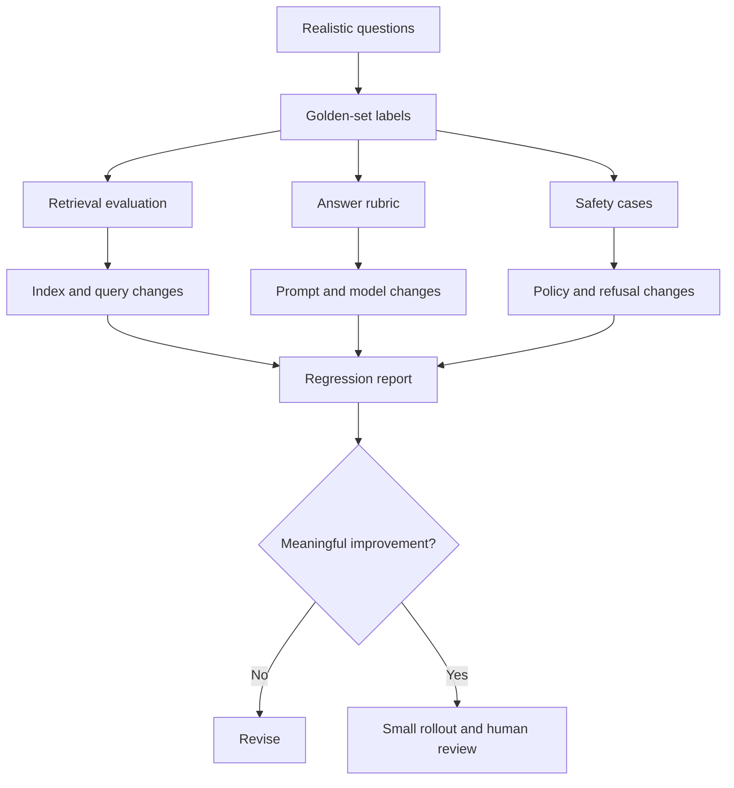

A language model demo can look excellent for the wrong reasons. The questions are friendly, the documents are clean, the output is judged by the same person who wrote the prompt, and the one failure is explained away as an edge case. A production system needs a less flattering measurement: does it retrieve the right evidence, answer the actual question, refuse when it should, and do all of that within the product's cost and latency budget?

Evaluation is not a single score. It is a set of experiments with different questions, different data, and different consequences. Separating those experiments is the fastest way to stop improving the wrong layer.

## What the evaluation should cover

For a retrieval-augmented assistant, at least four layers matter:

| Layer | Question | Example metric |
| --- | --- | --- |
| Retrieval | Did we find the evidence needed to answer? | Evidence recall@k |
| Answer | Is the answer correct and grounded in the evidence? | Rubric pass rate |
| Safety and policy | Did it refuse, escalate, or protect data appropriately? | Policy violation rate |
| Operations | Is it fast, affordable, and stable? | p95 latency, cost/request, error rate |

An end-to-end thumbs-up mixes these together. If an answer is wrong, you cannot tell whether the retriever missed the policy, the prompt ignored context, the model invented a number, or the user was asking a different question. Separate diagnostics make the next change cheaper.



## Build a golden set from real questions

A useful golden set is not a random collection of prompts generated by another model. It is a small, carefully labelled sample of the questions and tasks real users bring.

Start with 40 to 100 cases. That is enough to expose major failures, not enough to prove that the system works for every customer. If you have no production traffic, use support emails, sales questions, internal help-desk tickets, or structured interviews with the people who will use the product. Obtain the appropriate permission and remove personal data before storing examples.

Each case should include:

- the original question, including language and spelling;
- the permitted source documents, or the evidence IDs;
- an expected answer or an answer rubric;
- acceptable alternative answers;
- refusal or escalation expectation;
- risk level and loss if wrong;
- the date the case was added and the source of the case.

Avoid cleaning up the question too much. A user asking “mere order ka refund nahi aaya, kya karu?” is testing language handling, intent recognition, and retrieval at the same time. If you normalise every question into textbook English, you evaluate a product nobody uses.

### Cover the Indian language mix deliberately

For an Indian audience, a golden set built only in English can pass while real users receive poor answers in Hindi or Hinglish. Include:

- fully English questions;
- Devanagari questions;
- romanised/Hinglish questions;
- mixed-script entity names and addresses;
- transliterated names with spelling variation;
- questions containing an exact ID or reference number;
- questions where the correct answer is “I do not have enough information”.

Record the language tag, but do not assume that every speaker of a language uses the same vocabulary. A Bengaluru support agent and a Tier-3 customer may describe the same issue differently. Label what matters to the product, not a national stereotype.

## Metrics that correspond to decisions

### Retrieval recall

Before measuring generated answers, ask whether the right evidence was available. For each case, define the set of evidence that would be sufficient. Then measure how often at least one sufficient passage appears in the top *k* retrieved results, and how often the complete set appears.

A retrieval recall failure is usually cheaper to diagnose than a hallucination. Inspect the query, the index, the filters, and the chunk boundaries. Try lexical search, a different embedding model, or a reranker. Do not change the generation prompt to compensate for missing evidence.

### Answer quality with a rubric

A single “correct/incorrect” label is too coarse for many tasks. Use a small rubric:

| Criterion | Question | Weight |
| --- | --- | --- |
| Groundedness | Is every material claim supported by the retrieved evidence? | High |
| Correctness | Does the answer resolve the question under the business rules? | High |
| Completeness | Does it omit a necessary condition, amount, or exception? | Medium |
| Clarity | Can the intended reader act on it? | Medium |
| Refusal | Does it avoid guessing when evidence is missing? | High |

A pass should mean “usable for this risk level”, not “contains some of the right words”. For high-impact cases, require a human label. For low-risk tasks, a rubric plus automated checks can reduce review cost while still making the uncertainty visible.

### Safety and policy cases

Keep a separate set for:

- requests involving another customer's personal data;
- attempts to bypass access controls or extract system instructions;
- financial, legal, or medical questions that require escalation;
- incorrect but confident claims about fees, deadlines, or eligibility;
- prompts in multiple languages that attempt the same policy bypass.

A safety evaluation is not a prompt-injection word list. It is a set of behaviours the product must exhibit, tested with the same interfaces real users can access.

### Operational metrics

Record p50 and p95 latency, error rate, timeout rate, and cost per successful answer. A system that answers well 90% of the time but times out on long questions may still be unusable. Define budgets before launch and include them in the release decision.

## Score with humility

Suppose 32 out of 40 evaluation cases pass. It is tempting to report “80% accuracy”. The point estimate is 80%, but a small sample carries substantial uncertainty. Using a Wilson 95% confidence interval, 32/40 corresponds to roughly 65%–89.5% in the population of similar cases. The interval is not a prophecy; it is a reminder that 40 cases cannot distinguish a mediocre system from a strong one with much precision.

For binary pass rates, report the numerator, denominator, and an interval. For latency, report a high percentile, not only the mean. For cost, report a representative distribution and the assumptions behind token counts.

Avoid comparing two prompts on ten hand-picked examples and declaring a winner. Use the same case set, randomised ordering where relevant, and a decision rule written down before the experiment. If a difference is small relative to the uncertainty, collect more cases or acknowledge that the result is inconclusive.

LLM-as-judge can help with scale. It can compare two answers, apply a rubric, or flag unsupported claims. It is also a model with biases: it may prefer longer answers, its own style, or a particular language. Calibrate the judge against human labels on a sample, use a rubric with specific criteria, randomise answer order, and keep a human-reviewed subset. Never let a model-generated score become an unquestioned quality gate.

## A small evaluation harness

The code below is deliberately deterministic and provider-neutral. It shows the skeleton of an offline harness; the model call and human labels are pluggable.

```python
from dataclasses import dataclass
from statistics import mean


@dataclass(frozen=True)
class Case:
    case_id: str
    question: str
    language: str
    must_cite: tuple[str, ...]
    expected_behavior: str


def evidence_recall(retrieved: list[str], required: tuple[str, ...]) -> float:
    if not required:
        return 1.0
    hits = set(retrieved).intersection(required)
    return len(hits) / len(required)


def evaluate(cases: list[Case], run_case) -> dict:
    rows = []
    for case in cases:
        output = run_case(case)
        rows.append(
            {
                "id": case.case_id,
                "language": case.language,
                "recall": evidence_recall(output["evidence_ids"], case.must_cite),
                "answer_pass": output["judge_label"] == "pass",
                "citation_failures": [
                    source
                    for source in output["citations"]
                    if source not in output["evidence_ids"]
                ],
            }
        )
    return {
        "cases": rows,
        "case_count": len(rows),
        "answer_pass_rate": mean(row["answer_pass"] for row in rows),
        "mean_evidence_recall": mean(row["recall"] for row in rows),
        "citation_failures": sum(len(row["citation_failures"]) for row in rows),
    }
```

The exact model and judge are not the point. The important properties are stable case IDs, a separate retrieval diagnostic, a label with a rubric, and a report that a reviewer can audit. Store the evaluation dataset and the code together. A score without the dataset is a rumour.

For a real system, also log the model version, prompt version, index build timestamp, and retrieval configuration. A quality change is meaningless if you cannot say what changed.

## Calibrate human review, then automate selectively

Human review is expensive, so use it where it has the highest value:

- high-risk cases;
- a random sample of all cases to estimate overall quality;
- disagreements between automated judges;
- new languages or document types;
- any release that changes access rules or refusal behaviour.

Write a one-page labelling guide with examples and edge cases. Have two reviewers label a subset independently and discuss disagreements. If reviewers interpret “correct” differently, the metric is measuring their disagreement as much as the system.

Automate what you can verify deterministically: schema validity, citation IDs, required disclaimers, refusal on missing evidence, and forbidden data exposure. Use model judges for nuance only after calibration.

## Make evaluation part of releases

A useful rhythm for a small team:

1. Run the offline evaluation on every prompt, model, or index change.
2. Block a release if a high-severity safety case regresses, even when the average score rises.
3. Compare the candidate with the current production configuration on the same case set.
4. Roll out to a small cohort and monitor real failures, latency, and cost.
5. Add anonymised failure cases to the golden set with a label and a date.
6. Remove or revise cases that no longer represent the product.

Do not chase a single score. Track the distribution of failures by language, topic, document type, and risk. A 90% average can hide a 50% failure rate on the language your most valuable customers use.

## India-specific evaluation questions

Beyond the language mix, ask:

- Does the system respect the data-processing terms of every model and vector provider involved?
- Are prompts, retrieved documents, and answers handled according to the company’s obligations under the DPDP Act, 2023 and any applicable sector rules?
- Does the answer stay correct when the user writes an amount in lakhs rather than digits?
- Are dates interpreted correctly when a user writes `03/04/2026`?
- Do city, state, and PIN code variants resolve to the same entity?
- Does the cost per answer remain viable at rupee pricing and realistic traffic?
- Does a low-bandwidth user get a useful failure or timeout message?

These are product questions as much as model questions. A model that scores well on a generic benchmark but fails them is not ready.

## The honest summary

Evaluation is the work of deciding what “good” means, gathering evidence, and keeping the uncertainty visible. It is not a badge. If you cannot reproduce a result, explain the sample, or show the failures, you do not yet have a measurement.

Build a small golden set, separate the layers, use rubrics that match the risk, report intervals, and let human review decide the cases that matter. That will not make a weak system strong. It will stop a strong-looking demo from becoming a costly production surprise.

For the retrieval architecture being evaluated, read [Retrieval-Augmented Generation, Built for Real Product Data](/ai-data/ai-engineering/rag-retrieval-augmented-generation/).
