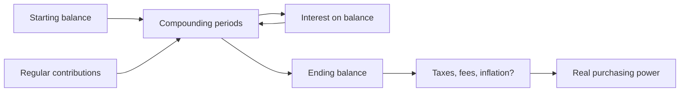

Compound interest is interest earned on interest. That sentence is simple, but the consequences are easier to believe when you see the arithmetic. The core model assumes a constant rate, which is useful for understanding and dangerous when mistaken for a forecast.

The [compound interest calculator](/tools/compound-interest/) lets you change the assumptions. This article explains what those assumptions are doing.

## The basic formula

For a starting balance \(P\), a nominal annual rate \(R\), compounding \(k\) times per year, and \(t\) years:

$$
A = P \left(1 + \frac{R}{k}\right)^{kt}
$$

The term inside the parentheses is the growth factor for one compounding period. Raising it to the total number of periods applies that growth repeatedly.

With a 6% nominal annual rate compounded monthly, \(k = 12\). One month's growth factor is:

$$
1 + \frac{0.06}{12} = 1.005
$$

A starting balance of 5,000 after ten years becomes:

$$
5000 \times (1.005)^{120} \approx 9{,}096.98
$$

The same rate compounded annually would produce \(5000 \times 1.06^{10} \approx 8{,}954.24\). Monthly compounding is slightly higher because interest is added to the balance sooner and then earns its own interest.

## Frequency is not magic

The difference between monthly and annual compounding is real but modest. The more frequent the compounding, the closer the result approaches continuous compounding:

$$
A = Pe^{Rt}
$$

as the compounding frequency increases without bound. A higher stated frequency does not create value from nothing. It changes the timing of interest credits.

Be careful when comparing products. A nominal annual rate of 6% compounded monthly is not the same as a 6% effective annual rate. The effective annual rate for monthly compounding is:

$$
\left(1 + \frac{0.06}{12}\right)^{12} - 1 \approx 6.168\%
$$

Ask which rate a product is quoting. "6%" alone is incomplete.

## Contributions change the shape

A single starting balance grows smoothly. Regular contributions add another layer: each contribution starts compounding from the date it is made.

For contributions made at the end of each compounding period, the future value is:

$$
A = P(1+i)^N + C\frac{(1+i)^N - 1}{i}
$$

where \(i\) is the per-period rate, \(N\) is the number of periods, and \(C\) is the contribution per period. If \(i = 0\), the second term becomes simply \(CN\).

This is why early contributions matter disproportionately in long projections. A contribution made in year 1 has more time to compound than the same amount in year 20. The calculator's yearly schedule makes the timing visible instead of hiding it in one final number.

## A constant return is an assumption, not a promise

The formula assumes the same rate every period. Real investments do not behave that way. Returns vary, and a negative year affects the base on which later gains are calculated. Two portfolios with the same average return can end with different balances because the order and size of gains and losses differ.

That is why a compound interest projection is best used as a sensitivity tool:

- What happens if I save 100 more per month?
- What happens if the average return is 2 percentage points lower?
- How much of the final balance came from contributions rather than interest?
- What if inflation averages 3%?

The last question matters. A nominal balance that looks impressive can buy less in the future. If you want a rough real return, subtract an inflation assumption from the nominal return, but remember that both vary and the approximation is imperfect over long periods.

## Taxes and fees

The model has no tax or fee line. In reality:

- interest or gains may be taxed as they accrue, on withdrawal, or not at all, depending on the account and jurisdiction
- fund expense ratios and advisory fees reduce the return
- transaction costs and spreads affect contributions and withdrawals
- penalties may apply to early withdrawal from some accounts

A 1% annual fee sounds small until it compounds against you for decades. Add a fee assumption when comparing long-term scenarios, or treat the projection as a ceiling rather than a realistic outcome.

## How to read the schedule

When you open the [compound interest tool](/tools/compound-interest/), notice three columns:

1. **Contributions** shows money you added during that year.
2. **Interest** shows the change in balance minus those contributions.
3. **Balance** is the projected value at year end.

If the interest share is flat or falling, contributions are dominating. If it grows rapidly near the end, compounding is doing the heavy lifting. Neither pattern is inherently good; they describe different stages of a plan.

The [SIP calculator](/tools/sip-calculator/) applies a similar idea to fixed monthly investments with a constant expected return. Its assumptions are stated on the page because a projection without assumptions is a sales pitch, not a calculation.

## The most useful takeaway

Compounding rewards time and consistent contributions, but only if the assumptions about return, fees, taxes, and inflation are not doing hidden work. Use the formula to compare decisions fairly. Keep the uncertainty visible.

A projection can help you save more deliberately. It cannot tell you what the market will do, and it should never be presented as a guarantee.
