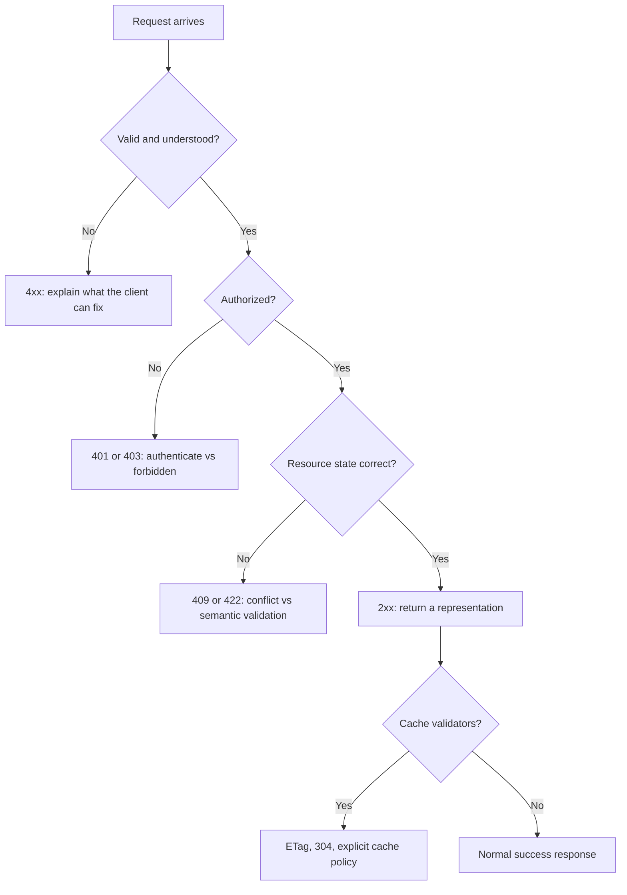

A status code is not a decorative number attached to an error message. It is the machine-readable part of an HTTP response: the part proxies may cache, clients may retry, and monitoring systems may count. A response that says `200 OK` while the body says "something went wrong" forces every consumer to parse prose to discover the outcome.

This guide focuses on practical semantics: what the classes mean, where developers commonly choose the wrong code, and how to make a response useful without inventing a private dialect of HTTP.

## The five classes

The first digit is the headline:

| Class | Meaning | Typical use |
| --- | --- | --- |
| 1xx | Informational | Interim protocol messages |
| 2xx | Success | The request was received, understood, and accepted |
| 3xx | Redirection | Further action or another representation is needed |
| 4xx | Client error | The request cannot be fulfilled as sent |
| 5xx | Server error | The server failed to fulfill a valid request |

The distinction between 4xx and 5xx matters operationally. A wave of 4xx responses after a client release points at the client or its input. A wave of 5xx responses points at the server and usually deserves an alert. Returning `500` for a missing required field hides a fixable client bug inside pages for the on-call engineer.



## Codes that get confused

### 401 versus 403

`401 Unauthorized` means authentication is missing or invalid. It is a challenge: the response should explain how to authenticate, usually through `WWW-Authenticate`. `403 Forbidden` means the server understands the identity (or does not need it) but refuses access. A logged-in reader trying to edit another person's article belongs in 403 territory. A request with no session at all belongs at 401.

Do not use 404 as a secret replacement for every authorization problem without a reason. For sensitive resources, hiding existence with 404 can be a deliberate privacy decision, but it should be consistent and documented.

### 301 and 308 versus 302 and 307

All four redirect. The difference is permanence and method preservation:

- `301` is permanent and may be cached for a long time.
- `302` is temporary but historically permissive about changing a POST into a GET.
- `307` is temporary and requires the method to be preserved.
- `308` is permanent and requires the method to be preserved.

For a moved GET page, 301 is usually right. For a login or form endpoint that temporarily lives elsewhere, 307 avoids surprising method changes. A careless permanent redirect can be much harder to correct than a temporary one because clients may remember it.

### 400 versus 422

`400 Bad Request` covers malformed syntax and requests the server cannot safely parse. `422 Unprocessable Content` (previously called Unprocessable Entity) says the syntax was valid but the values could not be processed. In JSON APIs, 422 is often used for field-level validation failures. Be consistent: clients should not have to guess which of the two your API uses for the same class of problem.

### 502 versus 504

Both usually involve a gateway or proxy. `502 Bad Gateway` means an upstream returned something unusable. `504 Gateway Timeout` means the upstream did not respond in time. From the client's perspective the distinction may be small, but it tells operators where to look. Neither response is fixed by retrying forever.

## Design the response, not just the number

A useful error response includes:

1. The status code that matches the outcome.
2. A stable machine-readable error code or type.
3. A human-readable message that does not leak stack traces.
4. Field errors when the failure is validation-related.
5. A correlation or request identifier for server errors.
6. `Retry-After` when the client can safely try again later.

For example:

```json
{
  "type": "https://oriz.in/problems/validation",
  "title": "Request validation failed",
  "status": 422,
  "errors": [
    { "field": "email", "message": "Enter a valid email address." }
  ]
}
```

This shape is not a standard; it is an example of a consistent one. If you want a documented convention, look at RFC 9457, which standardises Problem Details for HTTP APIs.

## Caching and conditional requests

Status codes are part of caching behavior. `200` responses can carry `ETag` and `Last-Modified`; a client can then send `If-None-Match` or `If-Modified-Since` and receive `304 Not Modified` with no body. `204 No Content` is useful when the request succeeded but there is nothing to return, such as a successful delete with no representation.

Be precise about methods. A `GET` should be safe and idempotent. `PUT` and `DELETE` are idempotent, while `POST` is not necessarily. Status choices should not imply guarantees the implementation does not provide.

> A successful HTTP exchange is a contract. If the status code says one thing and the body says another, every tool built on top has to compensate for the disagreement.

## A quick decision habit

When you are unsure, ask:

- Did the server understand the request? If not: 400.
- Is authentication missing or invalid? 401.
- Is the identity known but the action not allowed? 403.
- Is the target absent? 404.
- Does the request conflict with current state? 409.
- Is the payload syntactically fine but semantically invalid? 422.
- Did a valid request fail because of the server or an upstream? 5xx.

Keep a searchable [HTTP status reference](/tools/http-status-reference/) nearby while building. The point is not memorising every number; it is learning to let the protocol carry meaning honestly.
