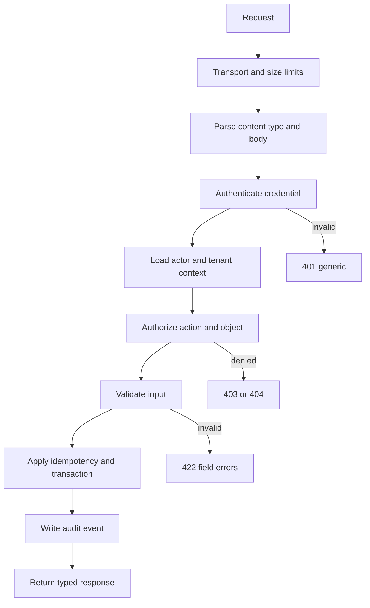
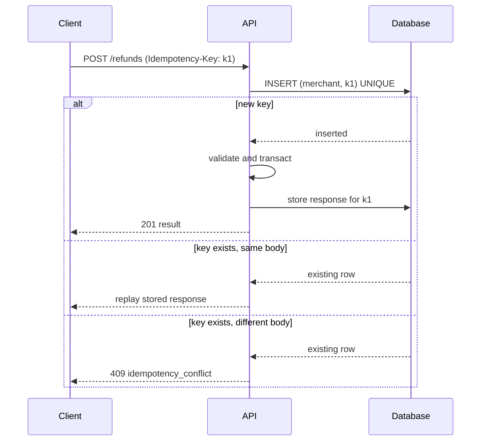

The most common API security failure is not a broken cipher. It is an endpoint that correctly checks whether someone is logged in, then returns an invoice belonging to a different customer because the query used the ID from the URL and forgot the tenant. The second most common is a token that is decoded but never verified, or verified with whatever algorithm the token itself requests.

Secure API design is mostly the discipline of keeping three questions separate:

- **Who is calling?** Authentication.
- **May this actor do this to this specific object?** Authorization.
- **What happens when the request is repeated, malformed, or hostile?** Protocol and failure design.

A framework can help with all three. It cannot answer them for you.

## Start with the request path

Every protected request should pass through the same ordered decisions:



The order matters. Parsing a huge body before authenticating gives anonymous callers an easy way to consume memory. Authorizing before validating avoids telling an unauthorised caller which fields would have been accepted. Returning `403` for an object that does not exist can still leak existence; sometimes `404` is the safer response for resources the actor cannot see.

Write the order down and implement it once in middleware or a shared handler. Security that is copied into twenty route files will diverge.

## Authentication: sessions and tokens solve different problems

A browser session and an API access token are both credentials, but they have different threat models.

| Property | Server session | JWT access token |
| --- | --- | --- |
| State | Stored server-side | Self-contained claims |
| Revocation | Immediate by deleting session | Hard before expiry; needs a denylist or short lifetime |
| Browser storage | HttpOnly cookie | Often memory; cookies also possible |
| Cross-service use | Needs shared session store | Convenient with a trusted issuer |
| Failure mode | Session fixation, CSRF | Algorithm confusion, stale claims, leakage |
| Best fit | First-party web app | Service-to-service or short-lived access |

For a first-party web application, a server-side session in an `HttpOnly`, `Secure`, `SameSite=Lax` cookie is often the simpler and safer default. The browser JavaScript never sees the session identifier, and logout can revoke it immediately. It brings CSRF concerns, which are manageable with `SameSite`, origin checks, and a CSRF token for state-changing requests.

A JWT is useful when several services need to validate an access token without a shared session lookup, or when a third-party client needs a short-lived bearer credential. It is not automatically more secure, and “stateless” is not a synonym for “safe”.

### Verifying a JWT correctly

A JWT has three base64url-encoded segments: header, payload, and signature. Anyone can decode the first two. The payload is not encrypted. Putting a customer's PAN, a password, or an internal secret in a JWT is a data leak waiting for a log file.

The server must verify, not merely decode:

1. **Signature** against a trusted key.
2. **Algorithm** against an explicit allowlist, never the token's `alg` value.
3. **Issuer** (`iss`) and **audience** (`aud`) against expected values.
4. **Expiry** (`exp`), not-before (`nbf`), and issued-at (`iat`) with a small clock tolerance.
5. **Key ID** (`kid`) mapping to the correct key during rotation.
6. **Token type and scope**, if your system distinguishes access, refresh, and ID tokens.

With the `jose` library in Node.js:

```ts
import { createRemoteJWKSet, jwtVerify } from 'jose';

const jwks = createRemoteJWKSet(new URL('https://auth.example.in/.well-known/jwks.json'));

export async function requireAccessToken(
  authorization: string | undefined,
): Promise<{ sub: string; tenantId: string; scopes: string[] }> {
  if (!authorization?.startsWith('Bearer ')) {
    throw new AuthError('missing credential');
  }

  const token = authorization.slice('Bearer '.length);

  const { payload, protectedHeader } = await jwtVerify(token, jwks, {
    issuer: 'https://auth.example.in/',
    audience: 'https://api.example.in/',
    algorithms: ['RS256'],
    clockTolerance: '5s',
  });

  if (protectedHeader.typ !== 'at+jwt') {
    throw new AuthError('wrong token type');
  }

  if (typeof payload.sub !== 'string' || typeof payload.tenant_id !== 'string') {
    throw new AuthError('missing required claims');
  }

  return {
    sub: payload.sub,
    tenantId: payload.tenant_id,
    scopes: Array.isArray(payload.scope) ? payload.scope.map(String) : [],
  };
}
```

The `algorithms` allowlist is essential. A verifier that accepts the token's chosen algorithm can be tricked into using a symmetric algorithm with a public key as the secret, or into accepting `none` in a poorly written library. Modern libraries usually protect against this, but explicit configuration is still the right habit.

Never trust a `role: "admin"` claim from a token issued to the public, or a tenant ID that the client can edit. The issuer is part of your trust boundary. If the issuer is a third party, its claims are only as trustworthy as its registration and consent process.

For client-side inspection, the [JWT decoder](/tools/jwt-decoder/) shows the header and payload without verifying anything. That is useful for debugging and dangerous as a security decision. The tool says so directly; treat any decoder the same way.

### Refresh tokens and revocation

A short access-token lifetime limits the damage of a leaked token, but it does not make revocation unnecessary. For high-consequence actions, check a server-side session or token version at the time of the action, not only at login.

Refresh tokens should be:

- stored in an `HttpOnly` cookie for browser clients, or a secure OS keychain for native clients;
- rotated on every use, with reuse detection that revokes the token family;
- bound to the client where the platform supports it;
- invalidated on password change, logout, and suspicious activity.

If a stolen refresh token can mint access tokens forever, the access-token lifetime is mostly theatre.

## Authorization: the object is part of the decision

Role-based access control answers “can a support agent issue refunds?” Attribute-based and relationship-based models answer “can this agent refund this payment for this merchant?” Most real systems need the second question, at least for sensitive objects.

The safest pattern is to make the authorization predicate part of the query:

```ts
// Do not fetch first and check ownership in a separate step.
const result = await db.query(
  `SELECT id, status, amount_paise, created_at
     FROM payments
    WHERE id = $1
      AND tenant_id = $2
      AND (owner_id = $3 OR $4 = true)`,
  [paymentId, actor.tenantId, actor.userId, actor.canReadAllPayments],
);
```

If the row is absent, return a generic not-found response. This avoids a second query, avoids leaking existence, and makes it much harder to forget the tenant condition. A separate `if (payment.tenantId !== actor.tenantId) throw` is still useful as defence in depth, but it should not be the only check.

For complex relationships, a policy function can centralise the rule:

```ts
type Action = 'payment:read' | 'payment:refund' | 'customer:read';

async function can(
  actor: Actor,
  action: Action,
  resource: { tenantId: string; ownerId?: string },
): Promise<boolean> {
  if (actor.tenantId !== resource.tenantId) return false;
  if (actor.permissions.includes(action)) return true;
  if (action === 'payment:read' && resource.ownerId === actor.userId) return true;
  return false;
}
```

The function is intentionally boring. Authorization logic should be testable with a matrix of actors and resources, not scattered across controllers.

### The authorization test matrix

At minimum, test each sensitive endpoint with:

| Actor | Expected |
| --- | --- |
| Unauthenticated | `401`, no data |
| Authenticated, wrong tenant | `404` or `403`, no data |
| Authenticated, same tenant, insufficient role | `403`, no mutation |
| Authenticated, owner | Success |
| Authenticated admin | Success, audit event written |
| Expired token | `401`, no data |
| Token with wrong audience | `401`, no data |
| Token with `alg: none` or wrong algorithm | `401`, no data |

These tests catch the failures that code review often misses, especially after a refactor changes how the actor context is loaded.

## Validate input, but do not trust validation for authorization

Input validation protects parsers, databases, and downstream services. It is not a permission system. A payload can be perfectly valid JSON, match every schema constraint, and still describe an action the caller may not perform.

Use allowlists rather than denylists. Reject unknown fields on sensitive endpoints rather than silently accepting them, or a client may set a field such as `role` or `tenant_id` that the server later uses. Enforce maximum body size, string length, array length, and numeric range before doing expensive work.

```ts
const refundSchema = z.object({
  amountPaise: z.number().int().positive().max(100_000_000),
  reason: z.enum(['duplicate', 'fraud', 'customer_request', 'other']),
  note: z.string().trim().max(500).optional(),
}).strict();
```

Validation errors should identify the field and the rule, but not echo secrets or internal identifiers:

```json
{
  "error": {
    "code": "validation_failed",
    "message": "One or more fields are invalid.",
    "fields": [{ "path": "amountPaise", "rule": "positive" }],
    "requestId": "req_01J9..."
  }
}
```

Do not return a stack trace, a SQL fragment, or the name of an internal table. Those are gifts to an attacker and usually useless to a legitimate client.

## Idempotency: make retries safe by construction

Networks time out. Mobile connections drop. A user taps “Pay” twice. A payment provider retries a webhook. If a write endpoint is not idempotent, every one of these events can create a duplicate charge or a duplicate refund.

An idempotency key is a client-generated identifier for a logical operation. The server stores it with the request fingerprint and the response:



Implementation rules:

- Enforce uniqueness on `(merchant_id, idempotency_key)` in the database, not only in application memory.
- Store a hash of the canonical request body. The same key with a different body is a conflict, not a replay.
- Store the final status and response. A request still in progress can return `409` with a retry hint, or `202` if the API is asynchronous.
- Expire keys after a documented window. A 24-hour window is common; choose based on the operation's retry behaviour.
- Do not let a client choose keys that collide across merchants.

A unique constraint is the only reliable arbiter under concurrency. Two requests can both read “no existing key” before either writes; the database resolves the race.

## State machines and optimistic concurrency

A refund should not be applied twice because two workers read `status = 'captured'` and both proceeded. Make the state transition conditional:

```sql
UPDATE payments
   SET status = 'refunded',
       refunded_paise = $1,
       updated_at = now()
 WHERE id = $2
   AND tenant_id = $3
   AND status = 'captured'
   AND refunded_paise = 0
 RETURNING id, status, refunded_paise;
```

If zero rows are returned, the transition did not happen. The API should report a conflict or return the current state, not assume success. This pattern is simpler and more reliable than a distributed lock for most single-database operations.

For partial refunds, track `refunded_paise` and enforce the invariant `refunded_paise <= captured_paise` in the same transaction that inserts the refund record. Database constraints are not bureaucracy; they are the last line of defence when application code is wrong.

## Rate limiting and abuse resistance

Rate limiting is not only about denial-of-service. It also limits credential stuffing, OTP guessing, enumeration, and expensive search queries.

Use several dimensions:

- per IP address for anonymous traffic;
- per authenticated user and tenant;
- per API key or OAuth client;
- per sensitive action, such as login, OTP verification, and refund.

A token bucket or sliding window is adequate for most applications. Return `429 Too Many Requests` with `Retry-After`, and make the limit visible in documentation. Do not silently drop requests; a client that cannot distinguish throttling from a bug will retry harder.

For login and OTP endpoints, apply limits that do not reveal whether an account exists. The response for an unknown account and a wrong password should be indistinguishable in shape and, ideally, in timing. Account enumeration is often the first step in a targeted attack.

## CORS, CSRF, and browser boundaries

CORS is a browser read restriction, not an authentication mechanism. `Access-Control-Allow-Origin: *` with credentials is invalid, and reflecting arbitrary origins is a vulnerability. Maintain an allowlist of exact origins for browser clients.

If you use cookie authentication:

- set `HttpOnly`, `Secure`, and an appropriate `SameSite` value;
- check the `Origin` header on state-changing requests;
- use a CSRF token for cross-site form posts where `SameSite` alone is insufficient;
- do not expose a state-changing `GET` endpoint.

If you use bearer tokens in JavaScript, remember that any XSS on the page can read them. An `HttpOnly` cookie does not make XSS harmless, but it removes one direct exfiltration path. Content Security Policy, output encoding, and dependency discipline still matter.

## Secrets, passwords, and API keys

Passwords should be hashed with a memory-hard algorithm such as Argon2id, with parameters reviewed for your hardware. Never use a general-purpose hash such as SHA-256 for passwords. Never log a password, even on a validation error.

API keys should be:

- generated with a cryptographically secure random source;
- shown once at creation;
- stored as a hash, with a short non-secret prefix for identification;
- scoped to the minimum permissions and tenant;
- rotatable without downtime;
- revocable immediately.

Application secrets belong in a secret manager or an encrypted environment file, not in the repository. A public repository is not a place for a “temporary” key, even in a branch that will be deleted later; Git history is durable.

## Error contracts that do not leak

A consistent error shape helps clients and reduces the temptation to invent ad-hoc responses. A practical contract:

| Status | Meaning | Client action |
| --- | --- | --- |
| `400` | Malformed request syntax | Fix the request |
| `401` | Missing or invalid credential | Re-authenticate |
| `403` | Authenticated but not permitted | Do not retry |
| `404` | Not found or deliberately hidden | Do not retry |
| `409` | State or idempotency conflict | Reconcile, then retry if appropriate |
| `422` | Semantically invalid fields | Fix fields and resubmit |
| `429` | Rate limited | Back off using `Retry-After` |
| `500` | Unexpected server failure | Retry with backoff, if safe |
| `503` | Dependency unavailable | Retry with backoff |

Every response should include a request ID. Log the internal detail under that ID, not in the response body. This gives support a path to investigate without exposing schema names and stack frames to the caller.

Be careful with `401` versus `403`. A `401` should include a `WWW-Authenticate` header when the scheme is known. A `403` should not invite the client to retry with the same credential. Some applications deliberately use `404` instead of `403` for resources the actor cannot see; document the choice and apply it consistently.

## Webhooks and third-party callbacks

A webhook is an unauthenticated HTTP request until you authenticate it. Two common mechanisms:

1. **HMAC signature** over the raw request body, using a shared secret and a timestamp to limit replay.
2. **Asymmetric signature** with a public key published by the provider.

Verify against the raw bytes, before JSON parsing and before any normalisation. Parse the timestamp and reject events outside a small window. Make processing idempotent using the provider's event ID. Return a success response only after the event has been durably accepted, or the provider will retry.

```ts
import { createHmac, timingSafeEqual } from 'node:crypto';

export function verifyWebhook(rawBody: Buffer, signatureHex: string, secret: Buffer): boolean {
  const expected = createHmac('sha256', secret).update(rawBody).digest();
  const provided = Buffer.from(signatureHex, 'hex');

  return provided.length === expected.length && timingSafeEqual(provided, expected);
}
```

A timing-safe comparison matters when an attacker can send many guesses. It is not a substitute for a strong secret or a timestamp check.

For Indian payment integrations, the exact signature scheme is provider-specific. Read the provider's current documentation and test against its sandbox. Do not copy a signature snippet from another provider and assume it applies.

## Logs, audit trails, and personal data

Security logs should answer who did what, when, from where, and with what result. They should not contain access tokens, passwords, full card numbers, Aadhaar numbers, PAN, or complete request bodies.

```json
{
  "event": "payment.refund.succeeded",
  "actorId": "usr_8f21",
  "tenantId": "tnt_03",
  "resourceId": "pay_44b1",
  "requestId": "req_01J9...",
  "amountPaise": 49900,
  "at": "2026-10-26T09:14:03.120Z"
}
```

Audit events for money movement should be append-only and access-controlled. If an operator can edit the audit log, it is not an audit log.

Under India's Digital Personal Data Protection Act, 2023, personal data handling carries obligations around purpose, minimisation, retention, and security. A security design that logs everything “just in case” is difficult to defend. Collect what you need, retain it for a stated period, and restrict access.

## A review checklist

Before shipping an API that touches money or personal data:

- [ ] Every protected route loads the actor from a verified credential.
- [ ] Token verification uses an algorithm allowlist, issuer, audience, and expiry.
- [ ] No JWT payload contains secrets or unnecessary personal data.
- [ ] Object access includes tenant and ownership conditions in the query.
- [ ] Authorization has a negative-test matrix, including wrong-tenant cases.
- [ ] Sensitive writes require idempotency and enforce uniqueness in the database.
- [ ] State transitions are conditional, not read-then-write.
- [ ] Input schemas reject unknown fields and enforce size limits.
- [ ] Errors are consistent, generic where necessary, and include a request ID.
- [ ] Rate limits cover login, OTP, search, and money operations.
- [ ] Webhooks verify raw-body signatures and deduplicate by event ID.
- [ ] Logs redact credentials and personal data.
- [ ] Secrets are outside Git and rotate without a code change.
- [ ] TLS, HSTS, cookie flags, CORS, and CSRF behaviour are tested.

Security is not a feature that can be added at the end. It is the set of decisions that determine what the system refuses to do. The best-designed APIs make those refusals explicit, testable, and boring.
