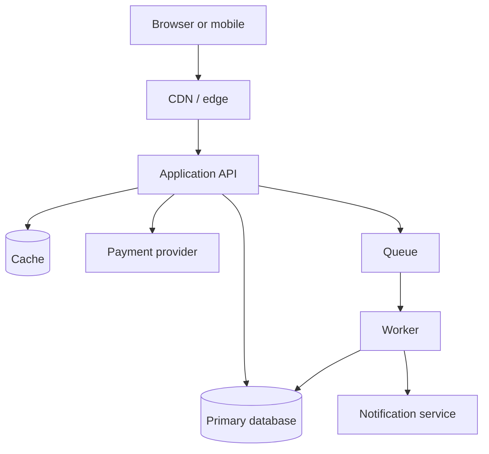
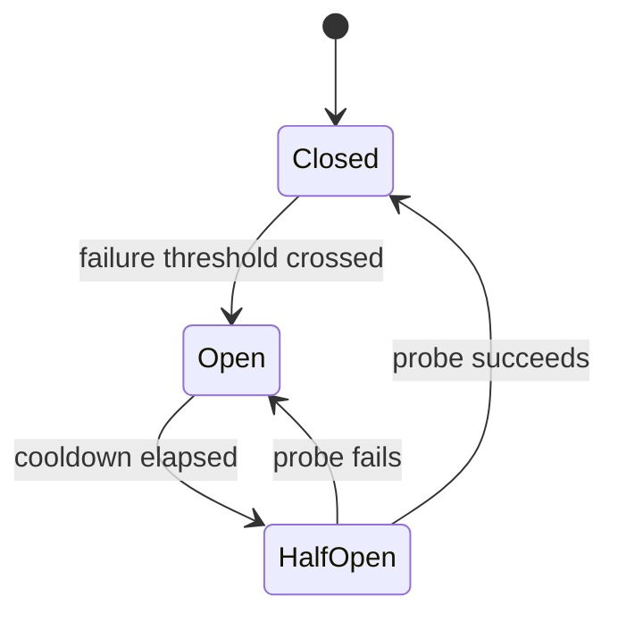
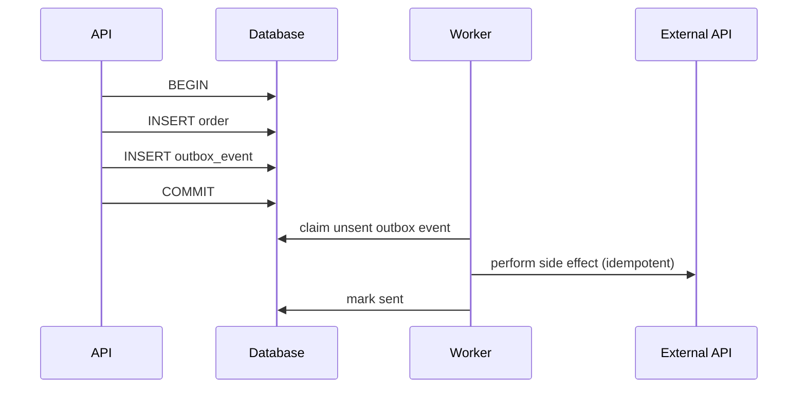

A small team cannot buy reliability by adding a platform department. It can, however, decide what reliability means for the product, spend engineering time where failures hurt, and stop treating every incident as an unforeseeable act of nature. The useful mental model is a budget: users give you a certain tolerance for failure, and you spend it on changes, dependencies, and traffic.

This guide is about the mechanics that make that budget real: service-level objectives, deadlines, retries, queues, caches, and observability. The examples are deliberately modest, because most systems that need this advice are not hyperscale systems. They are a handful of services, one database, a CDN, and a team that also has features to ship.

## Decide what “working” means

“The API is up” is not a user journey. A user journey is a sequence with a business outcome:

- A customer opens a product page and sees a price.
- A signed-in user submits a payment and receives a definite result.
- An operator opens the refund queue and sees today's requests.

For each journey, define a service-level indicator (SLI): a measured ratio of good events to valid events. Then set a service-level objective (SLO): the target ratio over a window.

| Journey | SLI | Illustrative SLO |
| --- | --- | --- |
| Product page | Successful HTML responses with price data under 1 s | 99.9% over 30 days |
| Payment submission | Requests that reach a definite success or failure within 10 s | 99.95% over 30 days |
| Refund queue | Fresh queue view rendered under 2 s | 99.5% over 30 days |
| Webhook ingestion | Events durably accepted under 5 s | 99.9% over 30 days |

Those numbers are examples, not recommendations. A payment flow may deserve a tighter target; an internal analytics page may deserve a looser one. The point is to write them down and measure them consistently.

An error budget converts the target into time:

| SLO | Allowed failure in a 30-day month |
| --- | --- |
| 99.5% | About 3 hours 36 minutes |
| 99.9% | About 43 minutes |
| 99.95% | About 21 minutes |
| 99.99% | About 4 minutes 19 seconds |

The budget is not permission to fail; it is a shared language for trade-offs. If a month is calm, you can spend some remaining budget on a risky migration. If the budget is exhausted, the policy should say what changes: freeze non-essential deploys, prioritise reliability work, and review the largest sources of burn.

Write the policy down. “We will be careful” is not a policy.

## Map the dependencies and their budgets

A request rarely depends on one service. It depends on a database, a cache, an identity provider, a payment gateway, an SMS provider, and perhaps an object store. Each dependency has its own latency and failure behaviour.



Draw this for your own system, including the dependencies you do not control. Then assign a deadline budget to each path. If the user is willing to wait 3 seconds for a checkout page, the API cannot spend 3 seconds on each of four sequential dependencies. It needs a total budget and a plan for what to skip.

Two questions expose most design problems:

1. What is the user's deadline, and what is the slowest acceptable response?
2. Which dependency can fail without failing the journey?

A product page can often render without recommendations. A payment confirmation cannot proceed without the payment provider, but it can return a clear pending state and reconcile asynchronously. Reliability is partly the art of deciding which parts are allowed to disappear.

## Timeouts: propagate a deadline, do not guess a number

A timeout that is longer than the caller's patience is not a timeout; it is a resource leak with a delay. A timeout that is shorter than the callee's normal work creates false failures and retries.

Propagate a single deadline from the edge, and let each hop derive its remaining budget:

```ts
type Deadline = { readonly expiresAt: number };

function remainingMs(deadline: Deadline): number {
  return Math.max(0, deadline.expiresAt - Date.now());
}

async function callWithDeadline<T>(
  deadline: Deadline,
  fn: (signal: AbortSignal) => Promise<T>,
): Promise<T> {
  const remaining = remainingMs(deadline);
  if (remaining <= 0) throw new Error('deadline exceeded before call');

  const controller = new AbortController();
  const timer = setTimeout(() => controller.abort(), remaining);

  try {
    return await fn(controller.signal);
  } finally {
    clearTimeout(timer);
  }
}
```

The client should send a deadline or timeout header, or the server should derive one from the request type. The server should not start a 10-second database query when 400 milliseconds remain. It should return a useful response, or fail fast and let the caller decide.

Set distinct timeouts for connection establishment, reads, and the overall operation. A connect timeout of a few hundred milliseconds is often reasonable inside a data centre; a read timeout depends on the query. Whatever the values, measure them against real latency distributions rather than copying a number from a tutorial.

A timeout is not a cancellation guarantee. Aborting an HTTP request may stop waiting for the response while the remote service continues the work. For writes, combine deadlines with idempotency keys so a timed-out request can be retried or reconciled safely.

## Retries: a small, bounded, jittered tool

Retries turn a transient blip into a success, and they turn an overloaded dependency into a larger outage. The difference is discipline.

Retry only when:

- the operation is idempotent, or carries an idempotency key that the server enforces;
- the failure is likely transient (connection reset, `429`, `502`, `503`, `504`);
- the remaining deadline allows another attempt;
- the retry budget has not been exhausted.

Do not retry:

- `400`, `401`, `403`, `404`, or `422` without changing the request;
- a non-idempotent write with no key;
- indefinitely, or with an unbounded cap;
- immediately, in lockstep with every other client.

A practical implementation uses exponential backoff with full jitter:

```ts
function sleep(ms: number, signal?: AbortSignal): Promise<void> {
  return new Promise((resolve, reject) => {
    if (signal?.aborted) return reject(signal.reason);
    const timer = setTimeout(() => {
      signal?.removeEventListener('abort', onAbort);
      resolve();
    }, ms);
    const onAbort = () => {
      clearTimeout(timer);
      reject(signal?.reason);
    };
    signal?.addEventListener('abort', onAbort, { once: true });
  });
}

async function retryWithJitter<T>(
  operation: (attempt: number) => Promise<T>,
  options: { maxAttempts: number; baseMs: number; capMs: number; signal?: AbortSignal },
): Promise<T> {
  let lastError: unknown;

  for (let attempt = 1; attempt <= options.maxAttempts; attempt += 1) {
    try {
      return await operation(attempt);
    } catch (error) {
      lastError = error;
      if (attempt === options.maxAttempts) break;

      const ceiling = Math.min(options.capMs, options.baseMs * 2 ** (attempt - 1));
      const delay = Math.random() * ceiling;
      await sleep(delay, options.signal);
    }
  }

  throw lastError;
}
```

Full jitter spreads retries across the backoff window instead of synchronising every client on the same schedule. A retry budget (for example, retries may not exceed 10% of successful requests) prevents a retry loop from doubling traffic during an incident.

Add a circuit breaker for dependencies that fail persistently. The breaker moves from closed to open after a threshold of failures, rejects calls immediately for a cooldown period, then allows a limited number of probes before closing again.



Be careful with breaker thresholds. A breaker that opens on a single timeout can cause more failures than it prevents; a breaker that never opens is just a comment. Measure the dependency's normal error rate and choose thresholds that distinguish a blip from a real outage.

## Queues: move work, do not hide failure

A queue is appropriate when work can be completed asynchronously and the user does not need the result immediately: sending email, generating a report, syncing a CRM, processing a webhook, or reconciling a payment.

A queue introduces new failure modes:

- the producer succeeds and the consumer never runs;
- the consumer runs twice;
- the queue grows faster than it drains;
- poison messages retry forever;
- the worker dies after the side effect but before acknowledging.

Use the transactional outbox pattern for database-backed work:



The order and the event commit atomically, so a crash cannot produce an order with no event. The worker still needs an idempotency key for the external call, because “mark sent” can fail after the side effect succeeded.

Consumers should be idempotent by design. A common approach is a processed-events table with a unique constraint on the provider's event ID, written in the same transaction as the business change. If the event is already present, acknowledge it without repeating the effect.

Monitor queue depth and age, not just consumer errors. A queue that is 50,000 messages deep and growing at 200 messages per minute is an incident even if no worker has thrown an exception. Set a maximum age and alert when it is exceeded. Apply backpressure at the producer when the queue is saturated; accepting unbounded work only delays the failure and makes it larger.

Dead-letter queues are useful only if someone reviews them. A dead-letter queue with no owner and no alert is a quieter way to lose data.

## Caching: correctness first, speed second

Caching is a bet that the same answer will be needed again before it changes. The bet needs an invalidation plan.

Use cache-aside for read-heavy data:

1. Read from the cache.
2. On a miss, read from the source.
3. Write the value with a TTL and a versioned key.
4. Invalidate or version the key when the source changes.

A cache key should include everything that changes the answer: tenant, user, locale, currency, feature flags, and a schema or content version. A key that omits the tenant is a data leak, not a performance optimisation.

| Data | Cache? | Key considerations |
| --- | --- | --- |
| Public article HTML | Yes, at the edge | URL, locale, content version |
| Product catalogue | Yes, short TTL | Store, currency, inventory freshness |
| User profile | Carefully | User ID, tenant, authorisation scope |
| Payment status | Short TTL or no cache | Payment ID, tenant, consistency needs |
| Authorisation decision | Usually no | Policy version, actor, resource |
| Personalised dashboard | Private cache only | `private`, short TTL, no shared CDN |

Set `Cache-Control` deliberately:

- Public, shared content: `public, max-age=..., s-maxage=..., stale-while-revalidate=...`
- Authenticated responses: `private, no-store` unless you have a specific, tested reason.
- API responses that must be fresh: `no-store`.

`stale-while-revalidate` improves perceived latency but means some users see slightly old data. That is a product decision, not a free win.

### Stampede protection

When a popular key expires, many concurrent requests can miss and hit the database at once. The result is a traffic spike exactly when the cache was supposed to protect the origin.

Two practical mitigations:

- **Single-flight:** the first miss fetches; other callers wait for the same promise.
- **Locking:** one process acquires a short lock; others serve stale data or wait briefly.

```ts
const inFlight = new Map<string, Promise<unknown>>();

async function cached<T>(key: string, load: () => Promise<T>): Promise<T> {
  const existing = inFlight.get(key);
  if (existing) return existing as Promise<T>;

  const promise = load().finally(() => inFlight.delete(key));
  inFlight.set(key, promise);
  return promise;
}
```

This works inside one process. Across processes, use a cache that supports atomic set-if-absent, or accept a small number of duplicate loads. The correct level of complexity depends on the cost of the origin query and the size of the traffic spike.

Add TTL jitter so a large set of keys does not expire at the same instant. A few percent of randomness is usually enough.

## Databases and connection pools

Many “API reliability” incidents are database incidents. Practical safeguards for a small team:

- Set a statement timeout and a transaction timeout. A query that can run forever will eventually do so.
- Size the connection pool to the database's capacity, not to the number of application instances times a hopeful number. Pool exhaustion often looks like a slow API.
- Use indexes for the queries that run on every request; verify with `EXPLAIN` rather than intuition.
- Keep transactions short and do not perform network calls inside them.
- Make migrations backward-compatible during deploys: add columns before code uses them, and remove old columns after code stops reading them.
- Test restore, not only backup. A backup that has never been restored is a hope.

Read replicas can reduce load, but they introduce replication lag. A user who writes a profile and immediately reads it from a replica may see the old value. Route reads that require consistency to the primary, or make the UI tolerate the lag explicitly.

## Observability: measure the journey, not the vanity

A useful minimum:

- **Structured logs** with request ID, actor ID (or a pseudonymous identifier), route, status, latency, and dependency timings. Redact credentials and personal data.
- **Metrics** for request rate, error rate, duration percentiles, saturation, queue depth, cache hit ratio, and dependency health.
- **Traces** for a sampled subset of requests, so a slow checkout can be decomposed across services.
- **Synthetic checks** from locations your users actually use, including an Indian region if that is your market.

The four golden signals for a service are latency, traffic, errors, and saturation. For resources, the USE method (utilisation, saturation, errors) is a useful complement. Pick a small set and keep it stable; a dashboard with two hundred panels is usually a dashboard nobody reads.

Alert on symptoms that affect the SLO, not on every CPU spike. A multi-window burn-rate alert is a good pattern: page when the error budget is being consumed much faster than the target allows. For a 99.9% SLO, a burn rate of 14.4 over one hour consumes about 2% of the monthly budget; pairs of long and short windows reduce both false positives and slow detection.

Every alert should link to a runbook with:

- what the user is experiencing;
- how to confirm the cause;
- the safest mitigation (rollback, feature flag, drain, failover);
- who to escalate to;
- how to verify recovery.

If the runbook says “investigate”, it is not a runbook yet.

## Load shedding and graceful degradation

Under extreme load, the system must decide what to stop doing. Without a decision, it degrades randomly and fails everything.

Prioritise journeys explicitly:

| Priority | Example | Under pressure |
| --- | --- | --- |
| Critical | Payment confirmation, login | Keep capacity, shed lower priorities |
| Important | Order history, refunds | Degrade non-essential detail |
| Best effort | Recommendations, analytics | Disable or queue |
| Internal | Prefetch, batch exports | Pause |

Implement concurrency limits at the edge and in workers. Return `503` with `Retry-After` when the limit is reached, rather than letting request queues grow without bound. A fast, honest rejection is often better than a slow timeout that holds a connection for thirty seconds.

For read paths, serve a cached or simplified page. For write paths, accept the request into a durable queue and return a pending state, provided the user interface can represent it truthfully.

## India-specific conditions worth testing

Reliability targets that are measured only from a developer's laptop miss the conditions many Indian users experience:

- Mobile networks with variable latency, packet loss, and frequent handoffs.
- Festival and sale events that produce sharp, predictable traffic peaks.
- Third-party outages in payment, SMS, or identity providers that are outside your control.
- State-level or provider-level differences in connectivity.
- Data localisation and cross-border processing constraints that affect where a dependency can live.

Test with throttled connections, not only fast Wi-Fi. Test the checkout flow when the payment provider is slow but not down. Test what the UI shows when a request times out after the payment may have succeeded. “Unknown” is a real state, and it needs a recovery path: reconciliation, a status endpoint, and a support process.

None of this requires a second region on day one. It requires honest handling of uncertainty and a dependency map that includes providers you do not operate.

## A practical rollout order

If the system currently has none of this, do not attempt a platform programme. A sequence that delivers value quickly:

1. Add request IDs and structured logs for the three most important journeys.
2. Measure availability and p95 latency for those journeys for two weeks.
3. Set one SLO and a simple error-budget policy.
4. Add deadlines to the slowest dependency calls.
5. Make the most dangerous retries idempotent, then bound them.
6. Add queue-age and queue-depth alerts if a queue exists.
7. Add cache keys, TTL jitter, and stampede protection to the hottest read path.
8. Write runbooks for the top three alerts.
9. Run a restore drill and a dependency-failure game day.
10. Review incident actions monthly and remove alerts nobody acts on.

The order is not sacred, but starting with observability avoids optimising a system you cannot see.

## The reliability review

Before a launch, ask:

- Which user journeys have an SLO, and where is the budget?
- What is the total deadline, and which dependency gets which share?
- Which retries are safe, and what stops a retry storm?
- What happens when the queue is full, the cache is cold, or the database is slow?
- Can the system shed low-priority work without failing checkout?
- Do alerts correspond to user pain, and does each have a runbook?
- Has a restore been tested this quarter?
- Can a new engineer explain the dependency map without opening the code?

Reliability is not a product of heroics during incidents. It is a product of small, explicit decisions made before them. A budget makes those decisions visible, and a deadline makes them enforceable.
