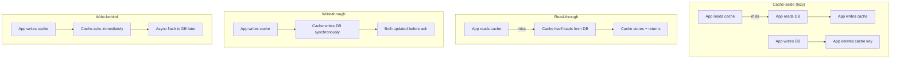
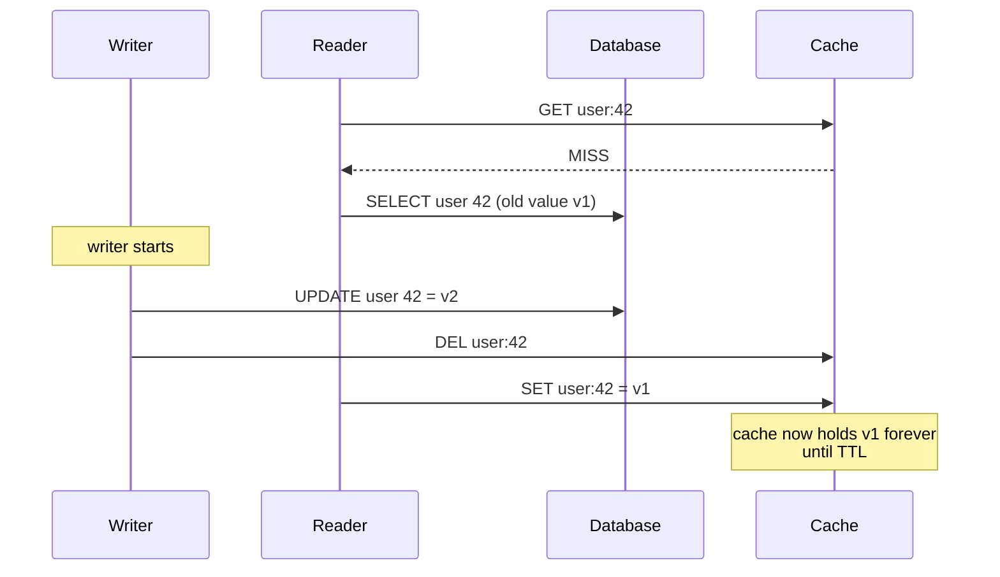
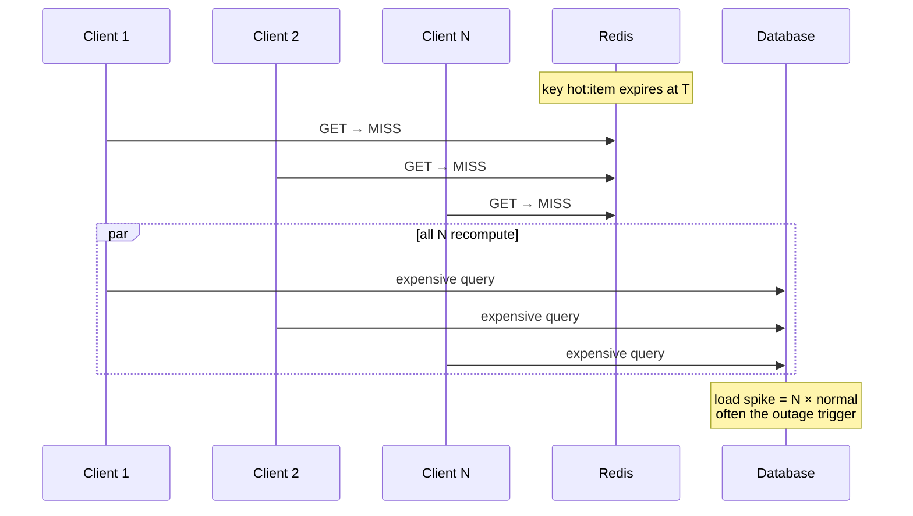
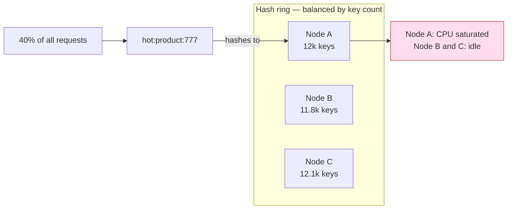
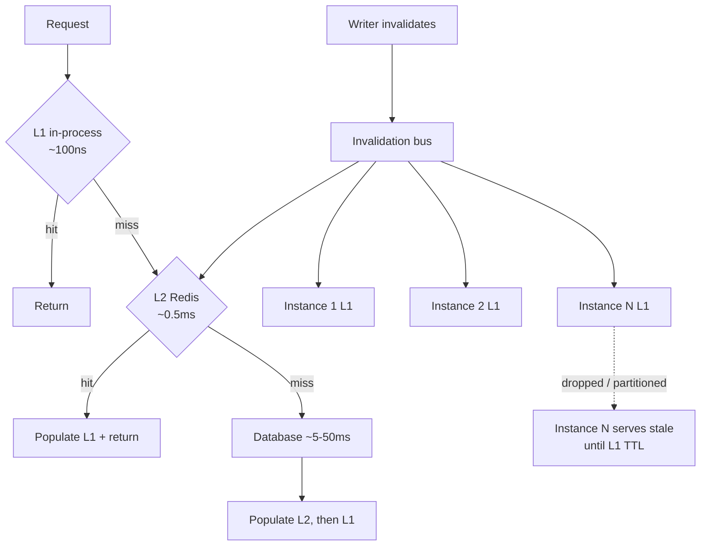
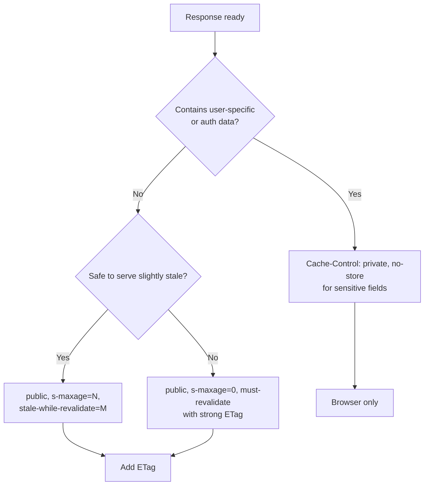

A cache is not a performance optimisation bolted onto a correct system. It is a *second copy of the truth*, held
in a place where the rules for reading and writing are different from the primary store, and every strategy below
is really a choice about which inconsistency you are willing to tolerate and for how long.

This article assumes you know what a TTL is and have written `GET`/`SET` against Redis or memcached. It starts
where that ends: the races, the arithmetic, and the failure modes that turn a cache into an outage amplifier.

## The read and write paths are the whole story

Every caching strategy is defined by three decisions: what happens on a **read miss**, what happens on a
**write**, and who is allowed to **populate** the entry. That is it. Everything else is consequence.



**Cache-aside** puts the coordination in application code. It is the default because it is honest: the
application knows exactly which keys it touched, and the cache stays a dumb key-value store. Its cost is that
every service must implement the same logic correctly, and the read-write race is now *your* problem.

**Read-through** moves the load into the cache client or a library. Operationally nicer, because the miss path
is uniform. The trap: the cache layer now needs a database connection pool, and a cold cache means the cache
layer itself becomes a heavy database client.

**Write-through** keeps the cache authoritative on writes. Consistency is good, but write latency now includes
the database write plus the cache write, and the cache holds entries nobody will read — a waste of memory if the
working set is a small fraction of written rows.

**Write-behind** acks at cache speed and flushes asynchronously. Fastest writes, best burst absorption, and the
only strategy where an unflushed cache is *data loss* rather than a stale read. Use it for counters, view
counts, session activity — not for anything an invoice depends on.

### The honest comparison

| Strategy | Read latency | Write latency | Staleness window | Complexity | Primary failure |
| --- | --- | --- | --- | --- | --- |
| Cache-aside | low on hit, high on miss | DB only | up to TTL, plus race | low | stale after write, double-delete race |
| Read-through | low, uniform miss | DB only | up to TTL | medium | cache layer becomes a DB client |
| Write-through | low | DB + cache | ~0 | medium | write amplification, cold entries |
| Write-behind | low | lowest | none, but lossy | high | data loss on unflushed flush |
| Refresh-ahead | low, no miss spike | DB only | small, bounded | high | predicts wrong keys, wasted work |

**Refresh-ahead** is a different shape: keep serving the cached value while an asynchronous task refreshes it
before expiry. It removes the miss spike entirely for keys that are read often enough to justify it, but the
predictor has to be right, and a wrong prediction burns database capacity on keys nobody wants.

## Invalidation is hard for a boring reason

The cache and the database have no shared clock and no transaction spanning both. So consider the canonical
sequence:



The reader read `v1` before the update committed, then wrote it to the cache *after* the writer's delete
landed. The cache is now permanently stale relative to the database — not for milliseconds, but for the full TTL.
This is the single reason "delete on write" is not sufficient, and it does not require a distributed system to
happen; two goroutines in one process reproduce it reliably.

Common partial fixes and why each is incomplete:

### Delete-then-write, or write-then-delete

Order matters but neither order is safe. Write-then-delete loses to the race above. Delete-then-write loses to a
different race: a reader that misses *before* the delete, reads the old DB value, and writes the cache after the
new value is committed. Delaying the second delete is the usual band-aid:

```ts
await db.update(sql, params);
await cache.del(key);
// redeliver the delete later, hoping to catch a racing re-population
setTimeout(() => cache.del(key), 500);
```

This is a probabilistic damper, not a guarantee. It reduces the size of the window; it does not remove it.

### Outbox-driven invalidation

The robust version removes the application from the critical path. Write the invalidation *into the same
transaction as the data change*, then let a relay apply it to the cache.

```sql
BEGIN;
UPDATE users SET plan = 'pro' WHERE id = 42;
INSERT INTO cache_invalidations (key, created_at)
VALUES ('user:42', now());
COMMIT;
```

A relay reads `cache_invalidations` and issues the `DEL`. Because the invalidation is atomic with the write, no
committed write can lose its invalidation — the failure mode becomes *delayed* invalidation (replay from the
outbox) rather than *missing* invalidation. This is the same transactional-outbox pattern used for event
publication, applied to cache keys, and it is the only variant that survives a process crash mid-write.

### Versioned keys

The alternative to deleting is never reusing a key. Embed a version or a content hash in the key, and old
entries become unreachable garbage collected by TTL:

```
user:42:v17
user:42:v18
```

Readers must resolve the current version first, which is itself a lookup — usually satisfied by a per-entity
version counter held locally with a short TTL, or by a monotonic column read from the primary. The upside is
enormous: versioned keys make invalidation *monotonic and race-free*, because writing an old version never
overwrites a newer one. The downside is a second lookup on the hot path and a memory regime where stale entries
must expire. Immutable artefacts (rendered fragments, signed URLs, bundled assets) are ideal for this.

## Stampedes: the miss path is a concurrency problem

A cache stampede (thundering herd) is what happens when a popular key expires and every concurrent request
decides, independently and simultaneously, to recompute it.



The load is not proportional to traffic; it is proportional to *traffic at the instant of expiry*, which is why
stampedes look like sudden cliffs rather than gradual degradation. Age-based expiry makes this worse by
*coordinating* the cliff: a key populated at the top of the hour expires at the top of the hour, along with
every sibling key populated by the same batch job.

There are four mitigations, and they compose:

| Mitigation | What it fixes | Cost | Fails when |
| --- | --- | --- | --- |
| Request coalescing (singleflight) | duplicate work within one process | near zero | multiple processes, or long compute |
| Per-key lock (distributed) | duplicate work across processes | lock latency + lease handling | lock holder dies; needs lease TTL |
| Jittered TTL | synchronised expiry cliffs | trivial | doesn't fix a genuinely single hot key |
| Probabilistic early expiration | cliff at expiry time | small extra recompute | needs a beta tuned to compute cost |

### Request coalescing

Singleflight collapses concurrent misses for the same key into one execution. In Go this is
`golang.org/x/sync/singleflight`; the shape is identical in any language:

```ts
const inflight = new Map<string, Promise<unknown>>();

function getOrLoad<T>(key: string, load: () => Promise<T>): Promise<T> {
  const existing = inflight.get(key);
  if (existing) return existing as Promise<T>;

  const p = load()
    .finally(() => inflight.delete(key));
  inflight.set(key, p);
  return p;
}
```

This is per-process. Ten pods mean ten recomputations, not one. Singleflight is the cheapest possible win and it
is not sufficient alone.

### Probabilistic early expiration

The elegant mitigation: let a request recompute *before* expiry with a probability that rises as the deadline
approaches. Each concurrent reader independently gambles, so exactly one usually wins the race.

$$
\text{recompute if}\quad t_{\text{now}} - t_{\text{start}} \;\geq\; TTL - \beta \cdot \ln(U), \quad U \sim \mathcal{U}(0,1]
$$

Here $\beta$ scales with the cost of recomputation (roughly, the time it takes to recompute a value). As
$t_{\text{now}}$ approaches the TTL, the threshold is crossed for more draws of $U$, so refreshes cluster just
before the deadline and the cached value is effectively never allowed to fully expire. This is XFetch, and its
virtue is that it requires no locks, no coordination, and no shared state — it works because the randomness is in
the *decision*, not in the data.

The kernel of the formula is worth describing plainly: the probability of refreshing early grows exponentially as
the remaining TTL shrinks, and the exponent is calibrated so that the expected refresh happens around one
recomputation-time before expiry.

### Jitter and jittered TTLs

If 10,000 keys are populated at 02:00 with a 3600 s TTL, they all expire at 03:00. Add jitter:

```ts
const ttl = baseTtl + Math.floor(Math.random() * jitterSeconds);
await redis.set(key, value, 'EX', ttl);
```

The smoothing matters more than the mean: with a 10% jitter over 600 keys, expiry spreads across 360 seconds
instead of one, reducing the instantaneous miss rate by roughly two orders of magnitude. This is the same
argument as jittered retry backoff, and it is equally non-optional.

### Per-key locks

For genuinely expensive recomputation (a multi-second aggregate), coordination must cross processes:

```java
// SET key value NX PX 30000 — the lock must have a TTL, always
Boolean acquired = redis.set(lockKey, token, SetParams.setParams().nx().px(30_000));
if (!acquired) {
    // serve stale, or short-sleep and re-read the cache
}
```

Two hard requirements: the lock carries a **TTL** so a crashed holder cannot block reads forever, and the unlock
must be **conditional on the token** (a Lua compare-and-delete), because a lock can expire while its holder is
still working. Unconditional `DEL` on a lock releases someone else's lock.

## Hot keys: why consistent hashing does not save you

Consistent hashing distributes *keys* uniformly. It says nothing about *request distribution*. A single key
receiving 40% of traffic lands on exactly one node, and that node melts regardless of how beautiful the ring is.



Mitigations, in order of practicality:

1. **Split the hot key** into `hot:777:shard:0..N` with a random shard on read and a fan-out write. Works for
   values that are additive or interchangeable; useless for a single large object.
2. **Local L1 cache** in process, so the vast majority of reads never reach Redis. This is the real answer for
   read-mostly hot keys, and it converts a Redis hot key into an L1 problem with a known invalidation cost.
3. **Replicate the key** to a read replica set and pick randomly, accepting replication lag.
4. **Request-level admission control** so a hot key's traffic is shaped before it becomes a herding event.

## Penetration, negative caching, and their interaction

**Cache penetration** is requests for keys that do not exist. The cache can never serve them, so every request
lands on the database.

| Attack | Mechanism | Cache effect | Fix |
| --- | --- | --- | --- |
| Penetration | random nonexistent IDs | 100% miss forever | negative cache, bloom filter |
| Breakdown | one hot key expires | mass simultaneous miss | coalescing, early expiry |
| Avalanche | mass expiry or cache node loss | everything misses | jitter, circuit breaker, tiering |

Negative caching — storing "this key does not exist" with a shorter TTL — turns a penetration attack from
*every request hits the DB* into *every request hits the cache*. Two caveats:

- The negative entry must have a **short TTL**, or a newly created row stays invisible for the full TTL of the
  miss. 30–60 seconds is typical.
- The negative entry must be **deleted on create**, which means your write path must invalidate keys that had no
  row. This is the part people forget: `INSERT` handlers commonly invalidate the key they just wrote, but not the
  negative entry keyed identically. It is the same key, so a plain `DEL` suffices — but only if the insert path
  performs it at all.

A **bloom filter** in front of the cache handles the same attack with far less memory when the key universe is
large, at the cost of false positives (which only cause a harmless extra DB read) and no ability to enumerate.
Rejecting malformed IDs at the edge is cheaper than both, and catches the naive version of the attack entirely.

## Redis specifics that change behaviour

Abstract cache theory stops at the moment you pick an implementation. Redis has three properties that surprise
people.

### TTL granularity and lazy expiry

Redis expires keys **lazily on access** plus a **background sampling cycle** that removes some expired keys per
100 ms. A key past its TTL is logically expired — reads return nothing — but it may still occupy memory. Under
memory pressure with `noeviction`, an expired-but-unsampled key still counts against `maxmemory`, which is a
real source of "why is my cache full of expired keys".

Precision is milliseconds via `PX`, but replication and AOF propagate expiry as a `DEL` when it happens, so
replicas can serve a key slightly past its logical TTL — expiry is not a synchronisation primitive.

### Keyspace notifications are not a reliable invalidation channel

Keyspace notifications (`notify-keyspace-events`) publish `expired` events over pub/sub. Two properties make them
unsuitable as a correctness mechanism: pub/sub is **fire-and-forget** (no delivery guarantee to a disconnected
subscriber), and the `expired` event fires only when the key is actually removed, which for lazily-expired keys
may be much later or never. Treat them as telemetry. Use an explicit invalidation channel or a versioned key if
you need a guarantee.

### Eviction policies and what they do under pressure

| Policy | Victim selection | Keys evictable | Behaviour under memory pressure |
| --- | --- | --- | --- |
| `noeviction` | none | none | Writes fail with OOM errors; cache becomes a write outage |
| `allkeys-lru` | least recently used, any key | all | Steady state, but no permanent entries survive |
| `volatile-lru` | LRU among keys with a TTL | only those with TTL | Persistent keys are safe; writable space shrinks to the TTL'd set |
| `allkeys-random` | random, any key | all | Cheap, degrades uniformly; no hot-key protection |
| `volatile-ttl` | soonest TTL first | only those with TTL | Can evict useful keys early; fine for pure TTL caches |

The important consequence: **`volatile-*` policies create a second capacity ceiling**. If 70% of your memory is
held by keys without a TTL, then once TTL'd keys fill the remaining 30%, Redis starts evicting them while the
persistent 70% sits untouchable — and write commands can begin failing at what looks like far less than
`maxmemory`. Choose `allkeys-lru` when the cache is purely a cache, and never let configuration-only keys live in
the same instance by accident.

## Multi-tier caching and the fan-out problem

L1 in-process + L2 shared is the standard latency ladder: L1 costs ~100 ns, L2 ~0.5 ms, database ~5–50 ms. The
price is that L1 is replicated state, one copy per process, and it cannot be deleted by anyone but its owner.



The fan-out is three problems at once:

1. **Delivery is best-effort.** A pub/sub invalidation that misses one pod leaves that pod stale for its L1 TTL.
   Therefore L1 TTLs must be **short in absolute terms** — 1–5 seconds, not 60 — because the TTL, not the bus, is
   the actual staleness bound. The bus is an optimisation; the TTL is the contract.
2. **Ordering is not guaranteed across channels.** A delete followed by a set can arrive inverted. Version-stamped
   invalidations (`{key, version}`) let receivers reject out-of-order messages by comparing against their
   current version.
3. **Cold-start amplification.** After a deploy, every pod's L1 is empty, so L2 sees a burst of misses
   simultaneously. Warm-up, graceful shutdown, and staggered restarts matter more with L1 in the picture.

## HTTP caching: the semantics you already have

For API responses going through a CDN or a browser, you should not be inventing caching rules — HTTP defines
them precisely, and getting them right is usually cheaper than any application-level cache.

| Directive | Scope | Meaning |
| --- | --- | --- |
| `private` | browser only | Shared caches (CDN) must not store the response |
| `public` | any cache | Authenticated-agnostic responses may be stored by shared caches |
| `s-maxage=60` | shared caches | Overrides `max-age` for CDNs; lets you have CDN 60s and browser 0s |
| `stale-while-revalidate=30` | any cache | Serve stale for 30 s while revalidating in the background |
| `must-revalidate` | any cache | Never serve stale after expiry, even if the origin is unreachable |

`stale-while-revalidate` is the HTTP-level equivalent of refresh-ahead, and it is the single highest-leverage
directive for read-heavy API endpoints: it converts expiry into a background revalidation instead of a
synchronised miss for every client.

Validators are where precision matters:

- **`ETag` + `If-None-Match`** is exact. The origin compares opaque strings and returns `304 Not Modified`. Safe
  for any representation, including ones with sub-second granularity.
- **`Last-Modified` + `If-Modified-Since`** has **one-second resolution**. Modifications within the same second
  are invisible, so a resource updated twice in one second can be served stale indefinitely if the client caches
  the `304`. Prefer `ETag`; use `Last-Modified` only as a fallback companion.

A well-formed response combining them:

```
HTTP/1.1 200 OK
Cache-Control: public, s-maxage=60, stale-while-revalidate=30
ETag: "v17-9f2c1a"
Vary: Accept-Encoding
```

`Vary` matters more than it looks: a shared cache that ignores it will happily serve a gzip-encoded body to a
client that did not ask for one, or worse, serve a response keyed on the wrong variant.

### The decision order for an HTTP response



## Measuring hit ratio honestly

A hit ratio is a ratio of *requests*, but the thing you are trying to protect is *database load* and *user
latency*. Those are not the same denominator, and the gap is where broken caches hide.

Consider a cache serving 1,000,000 requests/minute at a 98% hit ratio. Sounds healthy. Now weight by cost: the
2% misses might be exactly the fan-out queries that take 800 ms each and account for 70% of database CPU. The
hit ratio is excellent and the cache is doing almost nothing where it matters.

The metric that actually tracks the goal is a **cost-weighted hit ratio**:

$$
H_{\text{cost}} = \frac{\sum_{i \in \text{hits}} c_i}{\sum_{i \in \text{all}} c_i}
$$

where $c_i$ is the cost of serving request $i$ from the origin. If $H_{\text{cost}}$ is far below the raw hit
ratio, your cache is retaining cheap keys and evicting expensive ones — usually because the expensive keys are
large and the eviction policy is counting bytes, or because they have short TTLs and keep falling out.

Track these alongside it:

| Metric | Why it matters | Warning sign |
| --- | --- | --- |
| Cost-weighted hit ratio | Ties cache value to origin load | Much lower than raw ratio |
| Miss latency p99 | Misses are what users feel | Misses slower than a direct DB call |
| Eviction rate | Indicates capacity, not policy | Sustained > 0 means the working set does not fit |
| Keys expired vs evicted | Distinguishes design from pressure | Mass expiry = avalanche risk |
| Negative-hit rate | Penetration signal | Rising steadily with traffic |
| Origin QPS during miss storms | Direct stampede detector | Spikes uncorrelated with request rate |

**Evictions are the single most under-read cache metric.** A cache with zero evictions is either correctly sized
or under-loaded; a cache with a constant eviction rate under a stable workload is telling you the working set
exceeds memory, and every policy choice is now a question of *which* keys you lose. If the ones you lose are the
expensive ones, your hit ratio will look fine right up until the database does not.

## Summary

1. **Strategy fixes consistency.** Cache-aside, read-through, write-through, and write-behind differ primarily in
   who owns the miss path and how much staleness you accept — pick that deliberately.
2. **Delete-on-write is not invalidation.** A read that starts before a write and finishes after the delete can
   pin the old value for the full TTL; the race is reproducible in a single process.
3. **Move invalidation into the transaction.** An outbox row written with the data change converts lost
   invalidations into delayed ones, the only failure mode you can actually replay.
4. **Versioned keys beat deletes** for immutable or versioned content, because writing an old version can never
   overwrite a newer one.
5. **Stampedes need layered defences.** Singleflight for in-process duplicates, per-key locks with TTL and
   token-checked release for cross-process, early probabilistic expiration to avoid the cliff, jitter to
   desynchronise it.
6. **Consistent hashing balances keys, not load.** Hot keys require sharding, L1 caching, or replicas — the ring
   will not help.
7. **Negative caching is the penetration defence**, with a short TTL and an explicit delete on insert; Redis
   `volatile-*` eviction policies create a hidden second capacity ceiling.
8. **Measure cost-weighted hit ratio and eviction rate**, not raw hit ratio. A cache can hit 98% of requests and
   protect almost none of your database.
