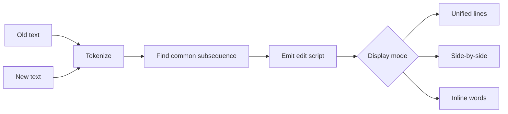

A diff is a story about two versions of the same thing. It says: this part stayed the same, this part was removed, and this part was added. The story is useful precisely because it is smaller than showing both documents in full.

The [text diff viewer](/tools/text-diff/) performs line-level and word-level comparisons locally. This article explains the algorithm underneath and why two reasonable diffs of the same text can look different.

## The long common subsequence

The simplest useful diff is built on a longest common subsequence (LCS). Given two sequences, find the longest sequence of items that appears in both, in the same order, without requiring adjacency.

For lines:

```text
Before:  A  B  C  E
After:   A  C  D  E
```

The longest common subsequence is `A, C, E`. The `B` line was removed and `D` was added. The result is usually displayed as:

```text
  A
- B
  C
+ D
  E
```

The common subsequence does not have to be unique. That matters: there may be several equally long ways to explain the change, and an algorithm must choose one. A different tie-breaking rule can change the diff while preserving the same set of edits.

Dynamic programming computes the LCS length in a table. Let \(L(i,j)\) be the LCS length of the first \(i\) items of the old sequence and the first \(j\) items of the new sequence:

$$
L(i,j) =
\begin{cases}
0 & i = 0 \text{ or } j = 0 \\
L(i-1,j-1) + 1 & a_i = b_j \\
\max(L(i-1,j), L(i,j-1)) & a_i \ne b_j
\end{cases}
$$

Walking back through that table produces the edit script. The table takes time and memory proportional to the product of the two lengths, \(O(nm)\). For two 10,000-line files, that is a very large table.

## How real tools get faster

Myers' difference algorithm, published in 1986, explores edit distance rather than filling the whole product table. Git's diff implementation is based on related ideas and adds heuristics. The important engineering lesson is that algorithms for diffs balance:

- exactness
- memory use
- time on similar files
- deterministic, reviewable output

A tool may decide that a change is better described as one large replacement than several small insertions and deletions. That can be faster or produce a more readable result, but it is still a choice.

## Lines versus words

Line-level diffs are the default for source code because lines are meaningful review units and the output maps cleanly to patches. A single-character edit can make an entire line appear removed and re-added, however, which is noisy.

Word-level diffs expose smaller changes inside rewritten lines. They are useful for prose, but they can produce many tiny fragments and they may ignore whitespace changes that matter in code. Some tools support character-level diffs for the same reason.

Our diff tool deliberately offers two modes rather than pretending one is universally best. In word mode, whitespace is normalized for comparison. That makes a paragraph readable but hides indentation and spacing changes. Use line mode when spacing matters.



## What a diff cannot know

A diff is syntactic. It knows that characters changed, not why. It cannot tell whether:

- a renamed variable is the same concept or a different one
- a moved paragraph is a reorganisation or a deletion plus an unrelated addition
- a one-word contract change is legally significant
- a generated file should be reviewed at all
- two identical edits came from the same cause

Git's diff and rename detection can infer moves or renames, but those are heuristics. Reviews still require a human or a higher-level tool to consider intent.

## Patch formats and context

Unified diffs include a few lines of context around each change. The `@@ -1,4 +1,5 @@` hunk header describes the old and new line ranges. Context makes a patch applicable and reviewable; it also means a diff can become unreadable for very large changes.

Patches are precise about text and fragile about context. If the file changes before a patch is applied, the hunks may no longer match. That is one reason Git stores snapshots rather than only patches internally.

## Practical habits

1. Compare one conceptual change at a time. Huge diffs hide mistakes.
2. Use line mode for code and configuration; use word mode for prose.
3. Treat whitespace changes explicitly; do not let a formatter rewrite unrelated lines.
4. Review generated files separately from hand-written files.
5. Do not assume a diff tool understands moves. Verify renames and refactors.
6. For large inputs, know the tool's limits. Our viewer caps the number of tokens to keep the page responsive.
7. When comparison is ambiguous, inspect the actual files rather than the diff alone.

The [diff viewer](/tools/text-diff/) is a quick second pair of eyes for snippets and drafts. Git remains the right tool for repository history, blame, and patches because it understands commits and context that a text box does not.

A diff is a compressed description of change, not a guarantee of understanding. The usefulness comes from reading both the changes and the unchanged context around them.
