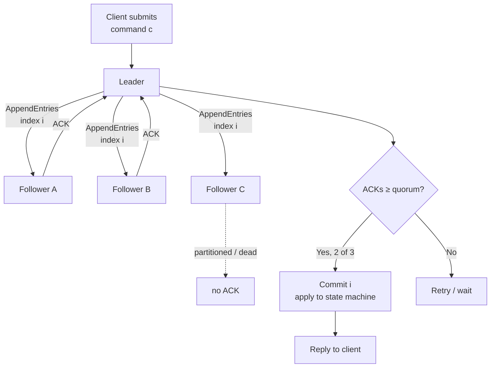
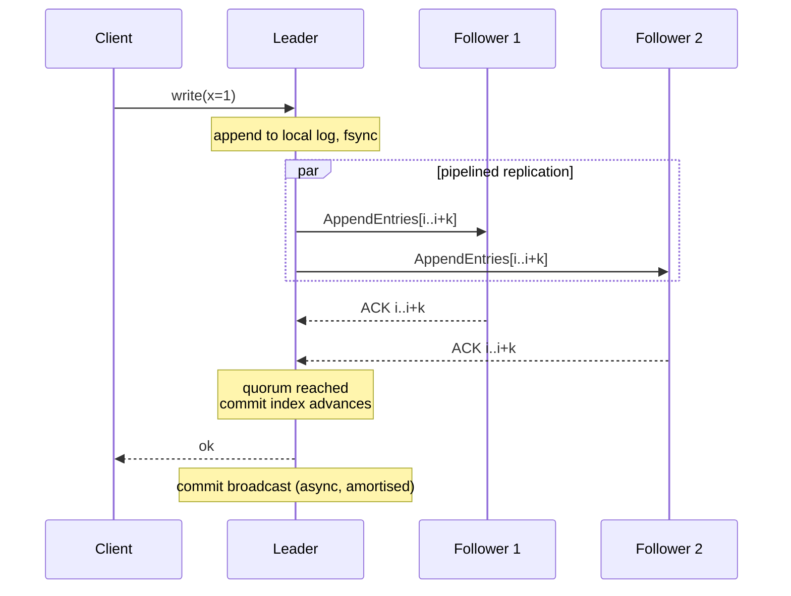
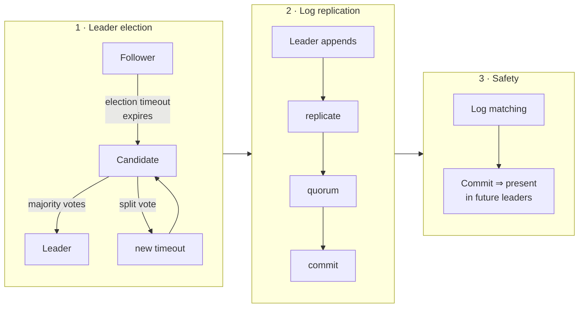
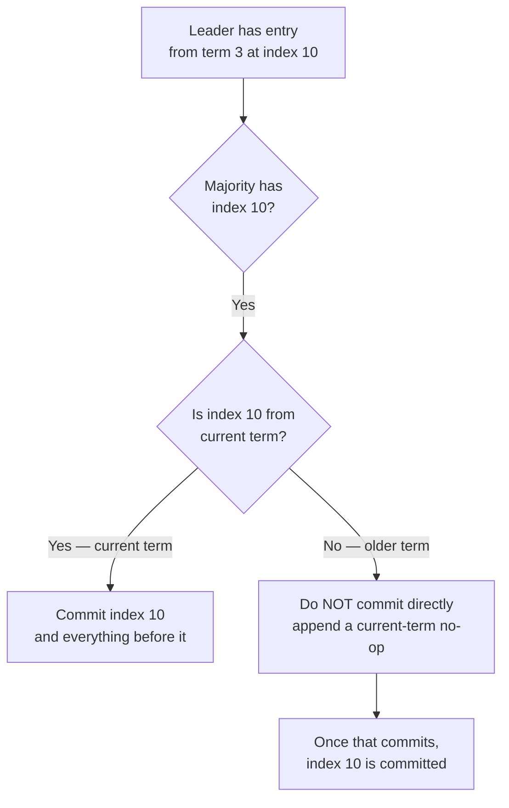
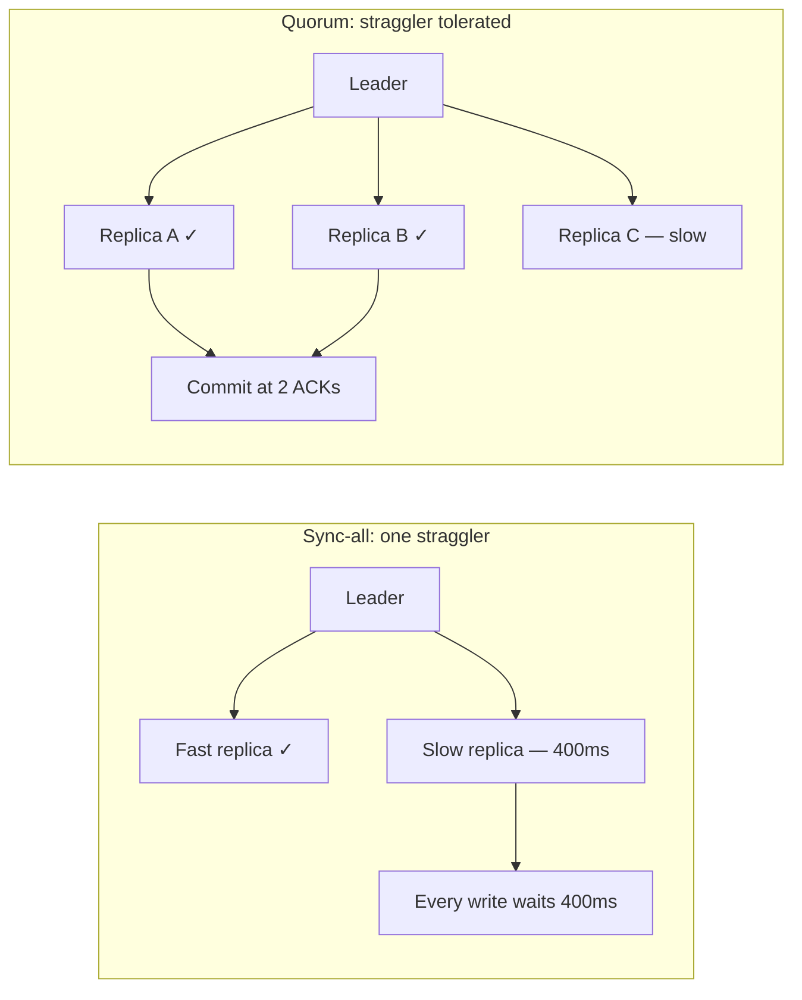

You already know what a replica is and why you want one. The interesting question is the one that separates a
working system from a demo: **how does a set of machines that cannot reliably talk to each other agree on a
single ordering of events, and what does that agreement cost?**

This article works through the arithmetic and the failure modes. Every guarantee in a consensus system is paid
for in round trips, and once you can price a round trip you can predict which systems will be fast and which
will be correct.

## The problem statement, precisely

A replicated state machine stays consistent only if every replica applies the same commands in the same order.
That reduces agreement to a single problem:

1. A client submits command $c$.
2. Some node proposes $c$ at log index $i$.
3. A quorum durably records $c$ at index $i$.
4. Only then may $c$ be applied and its result returned.

Step 3 is where the cost lives. The set must agree on one value per index even when:
- some nodes are dead,
- the network partitions,
- messages arrive out of order,
- and a leader that proposed a value crashes before anyone learns the outcome.

The critical line is `ACKs ≥ quorum`. It is not a performance optimisation — it is the *safety condition*. It
guarantees that any future leader must have seen the committed entry, because any two quorums intersect.

## Why quorums work: the intersection argument

Choose a quorum size $q$ such that any two quorums overlap:

$$
q > \frac{N}{2}
$$

| Nodes $N$ | Majority $q$ | Tolerated failures $f$ | Availability cost |
| --- | --- | --- | --- |
| 1 | 1 | 0 | None, but no durability |
| 3 | 2 | 1 | One node down is fine |
| 4 | 3 | 1 | Same tolerance as 3, more cost — never choose even |
| 5 | 3 | 2 | Two failures tolerated |
| 7 | 4 | 3 | Increasing write latency per extra node |
| 6 | 4 | 2 | Wastes a node; worse than 5 |

Two rules follow that people routinely get wrong:

**Even cluster sizes are strictly worse.** $N=4$ needs 3 ACKs and tolerates 1 failure, exactly like $N=3$ which
needs 2 ACKs and also tolerates 1. You pay an extra node and an extra ACK for nothing. Use odd sizes.

**Failures tolerated is not the same as failures withstood.** A 5-node cluster tolerates 2 *simultaneous*
failures. It does not tolerate 3, and it does not recover availability faster than you can replace nodes.

### Write latency is a function of quorum round trips

A consensus write is not one network round trip. Minimally:

$$
T_{\text{write}} \approx T_{\text{append}} + T_{\text{fsync}} + T_{\text{ack}} + T_{\text{commit-broadcast}}
$$

| Phase | Typical cross-AZ | Dominant factor |
| --- | --- | --- |
| Leader to follower append | 0.5–2 ms | Network RTT |
| Follower fsync to disk | 0.1–10 ms | Disk, and this is the variable one |
| Follower ACK to leader | 0.5–2 ms | Network RTT |
| Commit broadcast | 0.5–2 ms | Often pipelined, so amortised |

This is why consensus throughput improves dramatically with **pipelining** — batching many client commands into
one AppendEntries RPC amortises the round trip. A naive implementation does one RTT per command; etcd and Raft
implementations batch aggressively. The latency floor is still one round trip, and no amount of engineering
removes it.

## Raft's three subproblems

Raft is not one algorithm but three, and understanding the boundary makes failure diagnosis much easier.

### 1. Leader election

Terms are monotonic integers that act as logical clocks. A node that sees a higher term immediately defers.

| State | Persists | Receives | Sends |
| --- | --- | --- | --- |
| Follower | nothing on vote | AppendEntries, RequestVote | nothing proactively |
| Candidate | term, votedFor | votes | RequestVote |
| Leader | term, log | client commands | AppendEntries (heartbeat) |

The election timeout is randomised — typically 150–300 ms — specifically to break ties from split votes. Two
candidates that time out simultaneously split the vote, and randomisation makes repeated collisions
geometrically unlikely.

**Persistence matters and is a common bug.** `currentTerm` and `votedFor` must be fsynced *before* a vote is
cast. A node that votes, crashes, forgets it voted, and votes again can produce two leaders in one term — which
is exactly the split-brain the whole algorithm exists to prevent.

### 2. Log replication and the commit rule

The leader appends and replicates. The subtle safety rule: **a leader may only commit entries from its current
term by counting replicas.** Entries from previous terms reach commitment indirectly, once an entry from the
current term is committed.

That no-op-on-leader-election pattern is why etcd and similar systems append a no-op entry immediately after
election: it lets the new leader safely establish commitment for inherited entries in one round trip rather than
waiting for the next client write.

### 3. Log matching

Two properties carry the safety proof:

1. If two logs contain an entry with the same index and term, they store the same command.
2. If two logs contain an entry with the same index and term, all earlier entries are identical.

Leaders repair followers by walking back until they find the last matching index. This is why a lagging follower
can rejoin without a full snapshot — though if it lags beyond the log retention window it needs one.

## Split-brain and why leases exist

A partitioned leader does not know it is partitioned. It still believes it leads and will happily accept
commands it can never commit. This is why:

| Mechanism | How it prevents split-brain | Cost |
| --- | --- | --- |
| Quorum commit | Minority side cannot commit | Latency of quorum |
| Leader lease | Leader must renew within a TTL | Clock skew dependency |
| Fencing tokens | Downstream rejects stale leaders | Requires cooperating resources |
| `read_index` for reads | Leader confirms it still leads | One round trip per read |

The last row matters more than people expect. A leader can serve a *linearizable read* either by
(a) committing a no-op through the log, or (b) confirming quorum leadership without a log write. Raft's
`ReadIndex` is the second: it costs one round trip but no disk write, which is why read throughput is much
higher than write throughput.

## CAP is not the useful framing

CAP says you cannot have consistency, availability and partition tolerance simultaneously, and since partitions
happen, you choose between C and A during a partition. The problem is that "consistency" in CAP means
linearizability — a much stronger property than most systems need, and "availability" means every non-failed
node responds — which almost nothing satisfies.

The useful framing is **latency and correctness under partial failure**:

| System class | Behaviour during partition | Typical use |
| --- | --- | --- |
| CP (Raft, ZooKeeper, etcd) | Minority refuses writes | Metadata, leader election, config |
| AP (Dynamo-style) | Both sides accept writes, reconcile later | Carts, sessions, likes, telemetry |
| Single-leader with async replicas | Writes proceed, replicas diverge | Read-heavy apps, most RDBMS setups |

Most real systems are the third row and pretend to be the first. An async-replica Postgres primary accepts writes
during a partition and silently accumulates lag; on failover, committed data can be lost. That is a deliberate
trade, but it should be a *known* one.

## Replication styles and their failure modes

| Style | Write latency | Read latency | Data loss on failover | Complexity |
| --- | --- | --- | --- | --- |
| Synchronous, all replicas | Highest | Low | None | Low, but one slow node stalls writes |
| Synchronous, quorum | Medium | Low | None | Medium |
| Async | Lowest | Low | Possible — lag window | Low |
| Chain / log shipping | Low | Low | Possible | Low |

The synchronous-all trap is worth naming: one slow replica in a 3-node synchronous setup stalls every write for
the entire cluster, because the leader waits for the slowest. Quorum-based synchronous replication fixes this by
waiting for *any* majority, which is why quorum is the practical choice.

## Partitioning (sharding) interacts with replication badly

Replication gives durability; partitioning gives scale. Combining them multiplies the failure matrix.

| Combination | Effect on availability |
| --- | --- |
| Replicate + no partition | Quorum tolerates $f$ node failures |
| Partition + no replication | Failure of a shard's node loses that shard's data |
| Replicate each shard | Failures tolerated *per shard*, but probability any shard is degraded grows with shard count |

That last row is the one that bites. If one shard of 100 has a degraded quorum, the *cluster* is degraded even
though 99 shards are healthy:

$$
P(\text{at least one shard degraded}) = 1 - (1 - p)^{S}
$$

For $p = 0.01$ per shard and $S = 100$ shards, the probability at least one shard is degraded is
$1 - 0.99^{100} \approx 63\%$. More shards means more moving parts and a higher chance *something* is degraded at
any moment — the reason large clusters need sophisticated automated repair, not just more redundancy.

### Consistent hashing exists because of resharding

Moving keys between shards is expensive, and naive `hash(key) % N` reshuffles almost every key when `N` changes.

| Strategy | Keys moved when adding 1 node to 4 | Notes |
| --- | --- | --- |
| `hash % N` | ~80% | Catastrophic |
| Consistent hashing (ring) | ~1/N ≈ 25% | Requires virtual nodes for balance |
| Rendezvous (HRW) | ~25% | Simpler, no ring state |
| Range partitioning | Depends on split point | Manual or auto-split |

Consistent hashing with virtual nodes is the standard because a plain ring with one point per node gives poor
distribution. With 200 virtual nodes per physical node, load variance drops to a few percent.

## What to measure in production

Consensus systems fail in characteristic ways. These are the metrics that predict them:

| Metric | Healthy | Warning sign |
| --- | --- | --- |
| Commit latency p99 | Stable, ~1–2 RTT | Rising with cluster size or disk saturation |
| Follower lag | Milliseconds | Seconds means the quorum is one node from loss |
| Election count | ~0/day | Repeated elections = flapping network or slow disk |
| fsync latency p99 | < 10 ms | A spike directly becomes write latency |
| `proposal_failed` rate | 0 | Leader churn |
| Term change rate | Stable | Persistent increases indicate instability |

**fsync latency is the most under-monitored metric in consensus clusters.** Because the write path waits for a
follower fsync, a disk that intermittently takes 200 ms adds 200 ms to every write. A single noisy neighbour on
shared storage can degrade the entire cluster while every CPU graph looks idle.

## Summary

1. **Quorum means intersection.** $q > N/2$ is what makes a future leader guaranteed to contain committed entries.
2. **Use odd cluster sizes.** Even sizes pay for an ACK and tolerate no extra failure.
3. **Every commit costs at least one round trip.** Batching and pipelining raise throughput; latency floor stays.
4. **Term and vote must be fsynced.** Forgetting this allows two leaders in one term.
5. **Leaders cannot commit old-term entries directly.** The no-op-on-election trick resolves it in one RTT.
6. **Reads need proof of leadership too.** `ReadIndex` gives linearizable reads without a disk write.
7. **CAP is not the useful frame.** Ask about latency and correctness under partition, not C-vs-A slogans.
8. **Shard count multiplies failure probability**, so cluster size has a reliability cost, not just a benefit.
