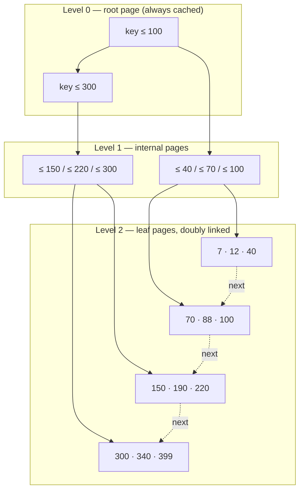
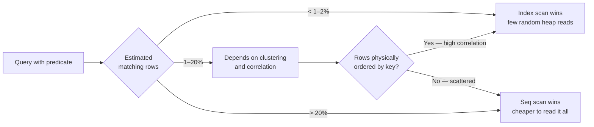
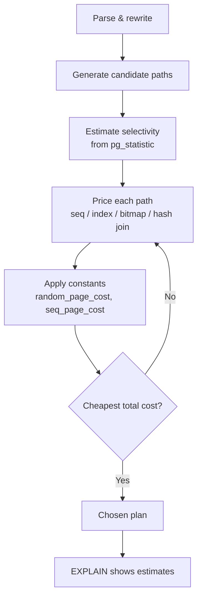
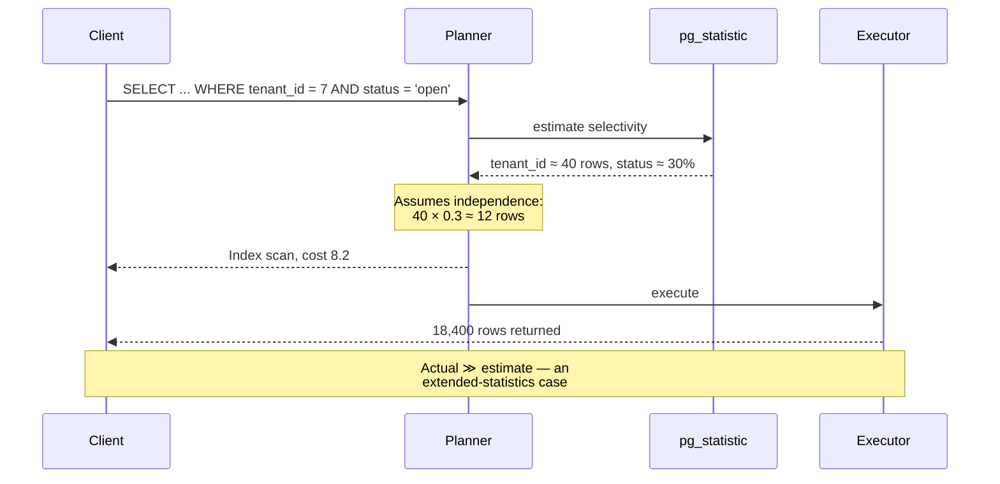
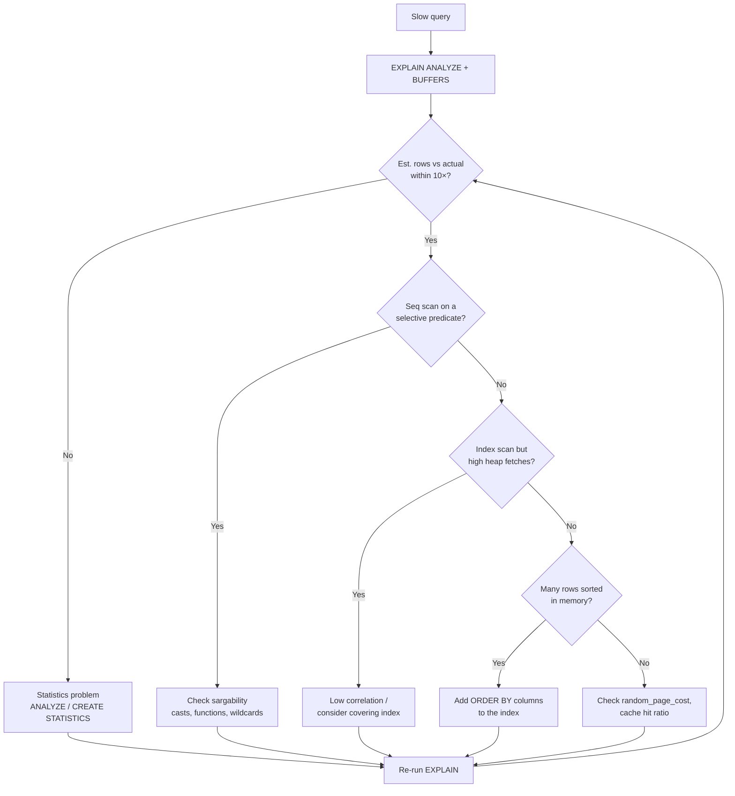

This assumes you already write SQL comfortably and know what an index is *for*. The question here is the one
that actually bites in production: you added an index, the query got slower, and the planner is still choosing
a sequential scan. That is not usually a bug. It is the planner pricing your index as more expensive than
reading the table, and to understand why, you need the physical layout and the cost arithmetic it is using.

## The page is the unit of everything

An index is not an abstract sorted list. It is a set of fixed-size disk pages — 8 kB in PostgreSQL, 16 kB in
InnoDB — and every performance property follows from that one fact. A read does not cost "one row". It costs
one page fault, and the whole design of a B+ tree exists to make the number of page faults logarithmic while
keeping the *leaves* linked for range scans.



Two structural properties matter and they are often confused:

| Property | B-tree (leaves only) | B+ tree (all real DBs) | Consequence |
| --- | --- | --- | --- |
| Values stored in internal nodes | Yes | No, internal nodes hold keys only | Fanout is much higher, tree is shallower |
| Leaf linkage | None | Doubly linked list | Range scans do not revisit the root |
| Height for 10M rows (8 kB pages) | 4–5 | 3–4 | One fewer page fault per lookup |
| Range scan of 1% of rows | Random I/O per row | Sequential walk of leaves | Orders of magnitude faster |

That last row is the whole point of a B+ tree. A point lookup and a range scan are the *same* descent followed
by two different behaviours at the leaf level.

### How deep is the tree, exactly?

Fanout is determined by key size and page size, and it is almost always larger than people assume.

$$
\text{fanout} \approx \left\lfloor \frac{P - H}{K + P_{\text{ptr}}} \right\rfloor
$$

Where $P$ is page size, $H$ the page header overhead, $K$ the key width and $P_{\text{ptr}}$ the pointer width
of a child page. For 8 kB pages, a 16-byte integer key and an 8-byte pointer:

| Page size | Key width | Fanout | Height for 10M rows | Height for 1B rows |
| --- | --- | --- | --- | --- |
| 8 kB | 4 B (int) | ~680 | 3 | 4 |
| 8 kB | 16 B (uuid) | ~340 | 3 | 4 |
| 8 kB | 64 B (text) | ~113 | 4 | 5 |
| 8 kB | 256 B (long text) | ~30 | 5 | 7 |
| 16 kB | 16 B | ~680 | 3 | 4 |

So a *narrow* key buys you a shallower tree. This is the concrete reason a sequential integer primary key beats
a random UUID, and it is not about "UUIDs being slow to generate" — it is that a wider key reduces fanout, which
adds a page fault, and that random insertion order destroys cache locality on top.

## Selectivity: the number the planner actually cares about

An index is worth using when it eliminates enough of the table. The threshold is not fixed, and the reason is
that the two access paths have different shapes:

- **Sequential scan**: reads $N$ pages sequentially. Cost $\approx N$ (with a small factor of ~1.0 per page because of readahead).
- **Index scan**: descends the tree (2–4 pages), then chases one heap page *per matching row*. Cost $\approx \log_F N + M \cdot c_{\text{random}}$, where $M$ is matching rows and $c_{\text{random}} \approx 4$ is the random-I/O penalty.

Break-even happens when $M \cdot c_{\text{random}}$ exceeds $N$, which for a large table lands somewhere between
1% and 20% of rows depending on correlation and clustering.



**Correlation is the variable most people miss.** If the indexed column's physical order matches its logical
order (an append-only `created_at`, say), an index range scan reads nearly sequential heap pages and the random
penalty collapses. Postgres tracks this as `pg_stats.correlation`:

```sql
-- correlation near 1.0  = physical order matches index order (index scan is cheap)
-- correlation near 0.0  = rows scattered (index scan pays the random penalty)
SELECT attname, n_distinct, correlation
FROM pg_stats
WHERE schemaname = 'public' AND tablename = 'events';
```

A freshly loaded table can have correlation near 1.0 while a heavily updated one drifts toward 0.0. That is why
the *same query on the same schema* can flip plan after months of churn.

## Composite indexes and the leftmost-prefix rule

A composite index on `(a, b, c)` is a B+ tree sorted by `a`, then `b`, then `c`. This gives you a strict set of
usable predicates, and it is the single most common source of "why isn't my index used".

| Predicate | Uses `(a, b, c)`? | Why |
| --- | --- | --- |
| `WHERE a = 1` | Yes, full prefix | Leftmost |
| `WHERE a = 1 AND b = 2` | Yes | Full prefix |
| `WHERE a = 1 AND c = 3` | Partial: `a` only | `b` is unconstrained, so `c` cannot be seeked |
| `WHERE b = 2` | No | Skips the leading column |
| `WHERE a > 1 AND b = 2` | Partial: `a` only | After a range, later columns are not orderable for seeking |
| `WHERE a = 1 ORDER BY b` | Yes, and no sort needed | Leaf order already matches |
| `WHERE a IN (1,2) AND b = 3` | Yes, via multiple seeks | Equality on `a` allows per-value descent |

That "range stops the prefix" rule is the one that surprises people. `WHERE a > 1 AND b = 2` cannot seek on `b`
because within `a > 1` the leaves are ordered by `b` *only inside each distinct `a`* — the global order is lost.
The planner may still filter on `b`, but it must visit every row with `a > 1`.

### Column order is a design decision, not a preference

Order follows this precedence:

1. **Equality columns first**, ordered so the most selective equality sits first when two plans are otherwise equal.
2. **Then the range column**, last.
3. **Then `ORDER BY` columns** so a sort is avoided.

```sql
-- Given: WHERE tenant_id = ? AND status = 'open' AND created_at > ? ORDER BY created_at
-- Correct: equality, equality, range (which also satisfies ORDER BY)
CREATE INDEX idx_open_by_tenant
  ON tickets (tenant_id, status, created_at);

-- Wrong: range in the middle blocks the ORDER BY from being satisfiable
CREATE INDEX idx_bad
  ON tickets (tenant_id, created_at, status);
```

## Covering indexes and index-only scans

If every column the query needs is present in the index, the engine never visits the heap. This converts a
likely-random heap read per row into a pure leaf walk, and it is often the largest single win available.

```sql
-- Postgres: INCLUDE columns are stored in leaves but not used for seeking
CREATE INDEX idx_orders_covering
  ON orders (customer_id, created_at) INCLUDE (total_cents, status);

-- Now this needs no heap access at all
SELECT created_at, total_cents
FROM orders
WHERE customer_id = 42
ORDER BY created_at DESC
LIMIT 20;
```

`INCLUDE` exists in PostgreSQL 11+, SQL Server 2005+ and InnoDB (which always implicitly includes the primary
key columns). It keeps the *seeking* key narrow — preserving fanout — while widening the leaf payload.

There is a real cost, and it is the reason you do not cover everything:

| Aspect | Narrow index | Covering index |
| --- | --- | --- |
| Fanout (internal nodes) | High | Unchanged if `INCLUDE` used |
| Leaf page size | Small | Larger, more pages to walk |
| Write amplification per INSERT | Low | Higher — every write touches more leaf bytes |
| Cache residency | Better | Worse; competes for shared_buffers |
| Blocks HOT updates (Postgres) | No | Yes — indexed column change forces new heap tuple |

That last row is a trap. In PostgreSQL, adding *any* indexed column to an index defeats HOT updates for that
column, because the index entry must be repointed. A covering index that includes a frequently-updated column
like `status` can measurably increase bloat and vacuum pressure.

## The planner's cost model, concretely

PostgreSQL's planner is a cost minimiser with tunable constants. Understanding them turns guesswork into
arithmetic.



| Constant | Default | Meaning | When to change it |
| --- | --- | --- | --- |
| `seq_page_cost` | 1.0 | Cost of one sequential page | Baseline; rarely changed |
| `random_page_cost` | 4.0 | Cost of one non-sequential page | Set to ~1.1 on SSD/NVMe |
| `cpu_tuple_cost` | 0.01 | CPU per row processed | Raise for very wide rows |
| `cpu_index_tuple_cost` | 0.005 | CPU per index entry | Rarely changed |
| `effective_cache_size` | 4 GB | Planner's guess of OS cache | Set to ~50–75% of RAM |

**The single highest-value tuning change on modern hardware is `random_page_cost`.** The 4.0 default encodes a
spinning-disk assumption where random I/O costs 4× sequential. On NVMe that ratio is closer to 1.1. Leaving it
at 4.0 makes the planner systematically *overprice* index scans and choose sequential scans on tables that fit
in cache — the classic "it has an index and won't use it" complaint.

```sql
-- Compare estimated vs actual, and see which access path won
EXPLAIN (ANALYZE, BUFFERS, VERBOSE)
SELECT id, total_cents FROM orders
WHERE customer_id = 42 AND created_at > now() - interval '30 days';

-- Estimated-vs-actual divergence in one query
SELECT relname, seq_scan, idx_scan, n_live_tup,
       round(100.0 * idx_scan / nullif(seq_scan + idx_scan, 0), 1) AS idx_pct
FROM pg_stat_user_tables
ORDER BY n_live_tup DESC
LIMIT 20;
```

`BUFFERS` is the underused part. It tells you how many pages came from `shared_buffers` versus disk, which
distinguishes "the plan is right but the cache is cold" from "the plan is genuinely wrong".

## Types that defeat your index

An index on an expression is only usable if the *query* uses the same expression. These silently turn a seek
into a full scan:

| Query pattern | Index on `col` usable? | Fix |
| --- | --- | --- |
| `WHERE lower(email) = ?` | No | `CREATE INDEX ON t (lower(email))` |
| `WHERE col::text = ?` | No | Index the cast, or change the column type |
| `WHERE date_col::date = ?` | No | Range predicate instead of a cast |
| `WHERE col LIKE '%x%'` | No (leading wildcard) | Trigram index (`pg_trgm`) or full-text |
| `WHERE col LIKE 'x%'` | Yes, with `text_pattern_ops` | Correct operator class |
| `WHERE col + 0 = ?` | No | Rewrite without the expression |
| `WHERE nullable_col = ?` | Partial | Partial index `WHERE nullable_col IS NOT NULL` |

Partial indexes deserve a mention because they are underused: if 99% of queries touch `status = 'open'`, index
only those rows and the index becomes dramatically smaller and hotter in cache.

```sql
CREATE INDEX idx_tickets_open
  ON tickets (tenant_id, created_at)
  WHERE status = 'open';   -- index is a fraction of the table
```

## Cardinality misestimation is the real root cause

Most "bad plans" are not the planner being stupid — they are the planner working from wrong numbers. When
statistics are stale or a predicate is correlated, estimates go wrong by orders of magnitude and the chosen plan
follows.



The assumption of independence is what fails on correlated columns. PostgreSQL's `CREATE STATISTICS` fixes it
explicitly:

```sql
-- Teach the planner that tenant_id and status are correlated
CREATE STATISTICS st_tickets_tenant_status (dependencies, ndistinct)
  ON tenant_id, status FROM tickets;
ANALYZE tickets;
```

Without this, any multi-column predicate on correlated columns is misestimated, and no amount of index tuning
fixes a cost model fed wrong inputs.

## Write amplification: the cost you pay on every INSERT

Every index is maintained synchronously on write. This is the trade people forget when adding "just one more
index".

| Indexes on a table | Relative INSERT cost | Relative UPDATE cost (indexed col) |
| --- | --- | --- |
| 0 (heap only) | 1.0× | 1.0× |
| 1 | ~1.5× | ~2.0× |
| 3 | ~2.5× | ~4.0× |
| 6 | ~4.0× | ~7.0× |
| 10 | ~6.0× | ~10× |

Figures are illustrative of the shape, not benchmarks. The mechanism is simple: each index is a separate B+ tree
needing its own page modification, its own WAL record, and its own buffer pin. On write-heavy tables, unused
indexes are pure tax, and they are discoverable:

```sql
-- Never-scanned indexes: candidates for removal
SELECT relname AS table,
       indexrelname AS index,
       idx_scan,
       pg_size_pretty(pg_relation_size(indexrelid)) AS size
FROM pg_stat_user_indexes
WHERE idx_scan = 0
  AND indexrelid NOT IN (SELECT conindid FROM pg_constraint)
ORDER BY pg_relation_size(indexrelid) DESC;
```

## Choosing between index strategies

The strategies are not interchangeable; each has a shape it is best at.

| Strategy | Best for | Avoid when | Notes |
| --- | --- | --- | --- |
| B+ tree | Equality and range on ordered data | Low-cardinality-only columns | Default; the workhorse |
| Hash | Pure equality, wide keys | Ranges, sorts | Not WAL-logged pre-PG10; rarely worth it |
| GIN | Arrays, JSONB, full-text, trigrams | High write rates | Expensive to update |
| GiST | Geometry, ranges, nearest-neighbour | Simple equality | Requires extension types |
| BRIN | Huge append-only tables with natural order | Random order | Tiny, but needs correlation |
| Partial | Skewed predicates | Predicate changes often | Very effective when applicable |
| Covering / `INCLUDE` | Read-heavy, predictable column sets | Hot updated columns | Defeats HOT updates |

BRIN is the one experts reach for and beginners never do. On a billion-row time-series table with natural order,
a BRIN index can be a few hundred kB where a B-tree is tens of gigabytes, because it stores only min/max per
block range:

```sql
-- BRIN: ~kilobytes, ideal for append-only time-series
CREATE INDEX idx_events_brin ON events USING brin (created_at)
  WITH (pages_per_range = 32);
```

It is only useful when physical order correlates with the indexed value — exactly the `correlation` statistic
from earlier. On a randomly-ordered table it degenerates to a scan with extra overhead.

## Diagnostic workflow



The rule to internalise: **fix the estimate before you add the index**. Adding an index to compensate for a
wrong cardinality estimate produces a plan that is fast on today's data and collapses on tomorrow's.

## What actually matters

1. **Pages are the unit of cost.** Index design is about minimising page faults, not "making lookups faster".
2. **Narrow keys give shallow trees.** Sequential integers beat random UUIDs for structural reasons.
3. **Selectivity has a break-even, and correlation moves it.** `pg_stats.correlation` near 1.0 makes index range
   scans nearly sequential.
4. **Range predicates stop the composite prefix.** Equality first, range last.
5. **Covering indexes eliminate heap access** — but defeat HOT updates if you cover a hot column.
6. **`random_page_cost = 4.0` is a spinning-disk assumption.** On NVMe it makes the planner prefer seq scans.
7. **Most bad plans are estimation failures**, not missing indexes. Check estimated vs actual before indexing.
8. **Every index taxes every write.** Dropping never-scanned indexes is often the higher-leverage change.
