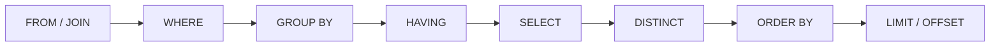

A SQL query is written in one order and evaluated in another. That mismatch is the source of many surprises, especially when a filter that appears early in the text actually applies later in the logical pipeline. Reading a query well means seeing both orders.

Consider a query that returns the top three customers by completed-order value:

```sql
SELECT c.name,
       SUM(o.total) AS revenue
FROM customers AS c
JOIN orders AS o
  ON o.customer_id = c.id
WHERE o.status = 'completed'
GROUP BY c.name
HAVING SUM(o.total) > 1000
ORDER BY revenue DESC
LIMIT 3;
```

## The written order

Most SQL statements read from the top down:

1. `SELECT` chooses output expressions.
2. `FROM` names the row sources.
3. `JOIN` combines another row source using `ON`.
4. `WHERE` filters individual rows.
5. `GROUP BY` groups rows.
6. `HAVING` filters groups.
7. `ORDER BY` sorts the result.
8. `LIMIT` caps the number of returned rows.

That is a useful map of the syntax. It is not the order the database logically uses to compute the result.

## The logical order that explains behavior

A useful teaching model is:

1. `FROM` and joins build the initial row set.
2. `WHERE` removes rows.
3. `GROUP BY` collapses rows into groups.
4. `HAVING` removes groups.
5. `SELECT` computes expressions and aliases.
6. `ORDER BY` sorts the resulting rows.
7. `LIMIT` and `OFFSET` choose a slice.



This explains two common rules:

- A `WHERE` clause cannot filter the result of an aggregate because grouping happens after `WHERE`.
- An alias created in `SELECT` may not be available in `WHERE` in every database, because `WHERE` is evaluated before the select list. `ORDER BY` often can use the alias because sorting happens later.

Dialects differ in what they allow. The logical model is a guide, not a promise about the query planner's physical strategy.

## Joins change the row population

A join is not a decoration. It decides which rows exist before later clauses run.

- **Inner join:** only matching pairs survive.
- **Left join:** keep every row from the left side and fill unmatched right columns with null.
- **Right join:** the mirror of a left join.
- **Full outer join:** keep unmatched rows from both sides.
- **Cross join:** combine every row with every row; often an accident when a condition is missing.

If a filter on the right table is placed in `WHERE` after a left join, it can turn the join into behaviour similar to an inner join. A condition such as `WHERE o.status = 'completed'` removes rows where `o` is null. If the intent is to preserve every customer and only include completed orders, the condition belongs in the join's `ON` clause or must explicitly allow nulls.

This is one of the most common sources of subtly wrong reports. The syntax is valid; the population of rows is not what the author imagined.

## WHERE versus HAVING

Use `WHERE` for row-level conditions, `HAVING` for group-level conditions:

```sql
SELECT customer_id, COUNT(*) AS orders
FROM orders
WHERE status = 'completed'
GROUP BY customer_id
HAVING COUNT(*) >= 5;
```

Putting non-aggregate filters in `HAVING` may work, but it can make the query harder to read and may affect optimisation. Put the condition at the stage where it logically belongs.

## Aggregates and grouping

An aggregate function summarises many rows into one value. When you use one without grouping, the result is a single group. When you use `GROUP BY`, every non-aggregated selected expression should be part of the grouping set, or the result may be ambiguous depending on the database.

`COUNT(*)` counts rows. `COUNT(column)` counts non-null values. `COUNT(DISTINCT column)` counts distinct non-null values. These are different questions. Choose the one that matches the business definition.

## ORDER BY is not a guarantee for joins or duplicates

Sorting the result lets you present it in a chosen order, but it does not define which duplicate row survives a `LIMIT`. If you ask for the "top three" without a complete ordering, ties and arbitrary row order can make results change between runs.

Add a deterministic tie-breaker:

```sql
ORDER BY revenue DESC, c.name ASC
```

Similar thinking applies to `DISTINCT`: it removes duplicate result rows after projection. It is not a substitute for understanding why duplicates appeared.

## EXPLAIN is evidence, not magic

The query planner estimates how to execute a query. `EXPLAIN` shows a plan; `EXPLAIN ANALYZE` executes it and reports actual timing. Plans are database-specific and can change with statistics, data volume, and configuration.

Look for:

- sequential scans over large tables
- nested loops with many iterations
- expensive sorts or hash operations
- rows estimated versus rows actually processed
- filters applied later than expected

An index is not automatically used, and an unused index is not automatically useless. Measure with realistic data.

## Writing for the next reader

Formatting is not only cosmetic. Aligning clauses, one join per group, and meaningful aliases make the logical structure visible:

```sql
SELECT
  c.name,
  SUM(o.total) AS revenue
FROM customers AS c
JOIN orders AS o
  ON o.customer_id = c.id
WHERE o.status = 'completed'
GROUP BY c.name
HAVING SUM(o.total) > 1000
ORDER BY revenue DESC, c.name
LIMIT 3;
```

The [SQL formatter](/tools/sql-formatter/) applies a deterministic layout and the [SQL query explainer](/tools/sql-explainer/) breaks a query into clauses with warnings for patterns such as `SELECT *` or a missing `WHERE` on an update. Neither tool understands your schema or claims to replace `EXPLAIN`; they help you read the text before you reason about the data.

A query is a set of decisions about row populations. Read it in the order the database reasons, and the surprising results become much easier to explain.
