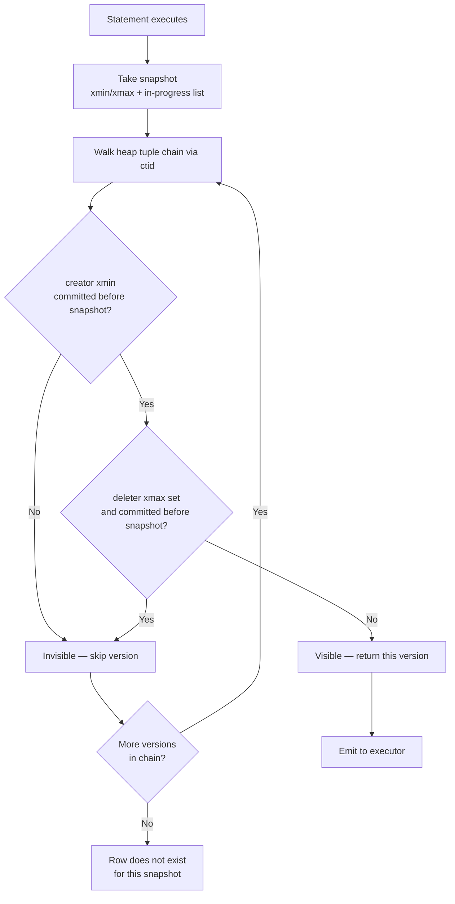
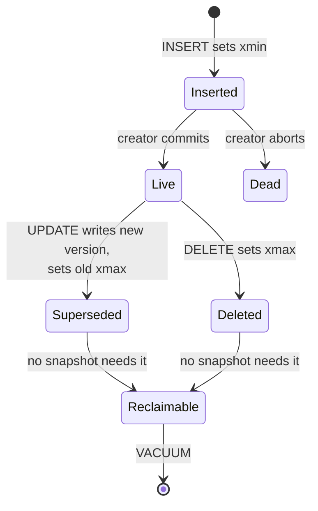
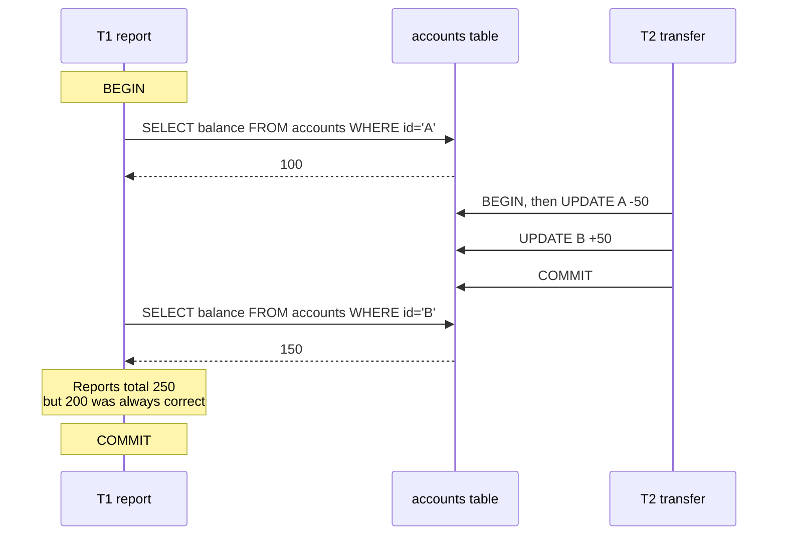
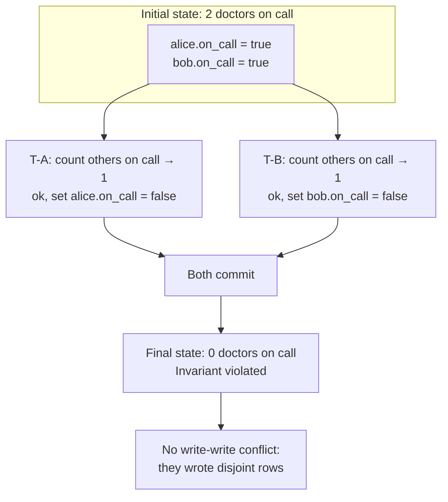
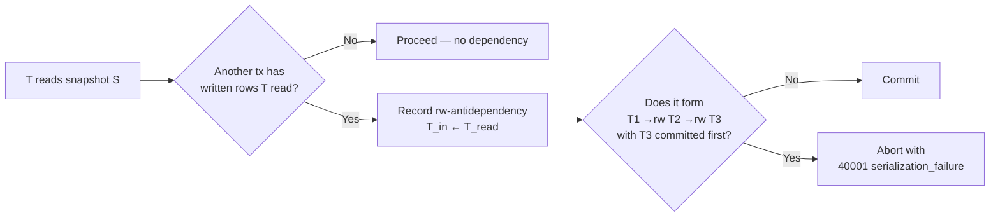
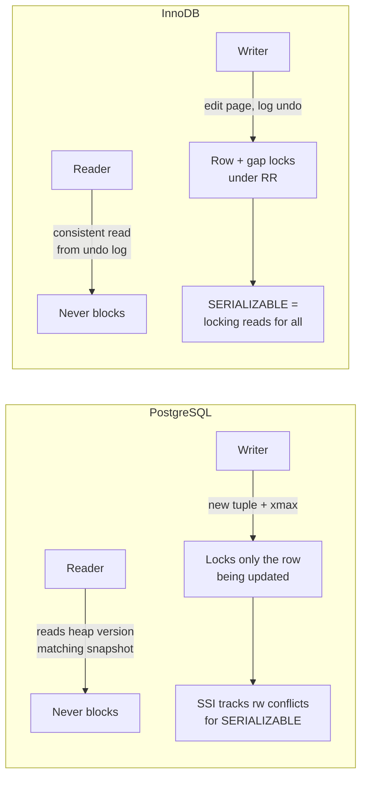
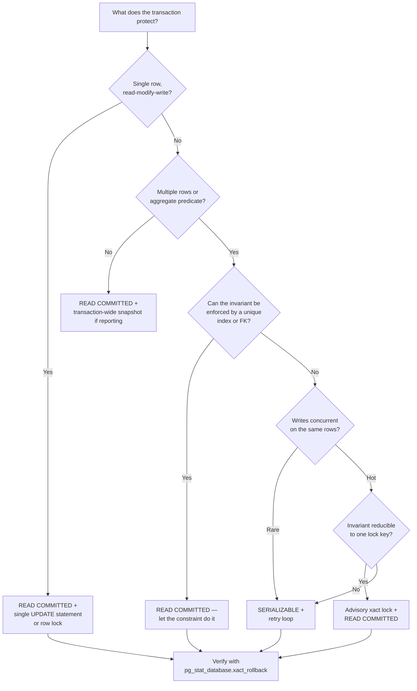

You already know how to write `BEGIN ... COMMIT` and you already set `REPEATABLE READ` somewhere because a
Stack Overflow answer told you to. The problem is that the isolation level names you have been using for years
do not describe what the database actually does, and the anomalies they supposedly prevent are not the anomalies
that break production systems.

This article starts from the visibility machinery, because every isolation guarantee is a statement about which
row versions a statement is allowed to see. Once you can read `xmin` and `xmax`, the isolation ladder stops
being folklore and becomes derivable.

## MVCC: the row is not the row

In an MVCC engine, an `UPDATE` does not overwrite a row. It writes a new row version and leaves the old one in
place, marking its lifetime. In PostgreSQL every tuple carries two transaction IDs in the heap header:

| Field | Meaning |
| --- | --- |
| `xmin` | The transaction that created this version |
| `xmax` | The transaction that deleted or superseded it (0 if live) |
| `ctid` | Physical location of the next version in the UPDATE chain |
| `infomask` | Hint bits: committed, aborted, has a lock, has a newer version |

A row is visible to a snapshot if the creating transaction committed before the snapshot was taken and the
deleting transaction did not. Formally, for a snapshot $S$ with transaction horizon $[x_{\min}, x_{\max})$:

$$
\text{visible}(t) = \bigl(\text{committed}(t.xmin) \land t.xmin \notin S.\text{inProgress} \land t.xmin < S.xmax \bigr) \land \lnot\bigl(\text{committed}(t.xmax) \land t.xmax \notin S.\text{inProgress} \land t.xmax < S.xmax\bigr)
$$

That single predicate is the entire MVCC read path. Everything else — isolation levels, `SELECT FOR UPDATE`,
SSI conflict detection — is built on top of it.



### Confirming it by hand

`xmin` and `xmax` are system columns; you can select them directly.

```sql
BEGIN;
UPDATE accounts SET balance = balance - 100 WHERE id = 1;
SELECT xmin, xmax, ctid, balance FROM accounts WHERE id = 1;
COMMIT;

-- After commit, the new version is live and its xmin is the update's txid
SELECT xmin, xmax, ctid, balance FROM accounts WHERE id = 1;
```

Two things are worth internalising from this experiment. First, the `ctid` changed — the version moved.
Second, the *old* version still physically exists on the page until vacuum reclaims it. That is why
`SELECT count(*)` after a bulk update reads a table roughly twice its logical size, and why a long-running
transaction that holds a snapshot open prevents vacuum from removing versions it might still need. A single
`BEGIN; SELECT 1;` left idle on a monitoring connection can pin `xmin` for hours and let bloat grow without
bound.



## The ANSI isolation ladder is a specification nobody implements

SQL-92 defined four levels by listing three forbidden phenomena. The mapping is not only incomplete — it was
never normative in practice, and every major engine declares levels it does not actually provide.

| Level | Dirty read | Non-repeatable read | Phantom read |
| --- | --- | --- | --- |
| READ UNCOMMITTED | Possible | Possible | Possible |
| READ COMMITTED | Not possible | Possible | Possible |
| REPEATABLE READ | Not possible | Not possible | Possible |
| SERIALIZABLE | Not possible | Not possible | Not possible |

Three concrete problems with this table:

1. **PostgreSQL has no READ UNCOMMITTED.** You may set it; the engine silently upgrades it to READ COMMITTED.
   Dirty reads are impossible in Postgres at any level, so the top row is unreachable.
2. **The table names three anomalies out of six.** Lost update, write skew, and read skew are absent. Write skew
   is the one that actually corrupts data under the level most people use for "safe" reads.
3. **"Phantom read" is described in terms of repeated queries returning different rows**, which conflates a
   read anomaly with a write anomaly. Under snapshot isolation you cannot observe a phantom *by re-reading* —
   but you can still create one by writing.

The ladder is a historical accident: it was a lowest-common-denominator sketch so that engines could claim
compliance. Berenson et al. documented the gap in 1995 and proposed the anomalies-first model that most
serious systems now use internally. The useful mental model is not "levels prevent anomalies" but
"concurrency control mechanisms permit or forbid particular interleavings."

## The six anomalies, precisely

Each anomaly below is defined as an interleaving of two transactions $T_1$ and $T_2$, with the mechanism that
prevents it.

### Dirty read

$T_1$ writes a value; $T_2$ reads it; $T_1$ aborts. $T_2$ acted on data that never existed.

Impossible in Postgres and InnoDB at every level, because readers never see uncommitted versions — they wait on
the writer's lock (InnoDB) or read the pre-image (Postgres). Under `READ UNCOMMITTED` on SQL Server or MySQL's
MyISAM-era behaviour, it is real, which is why you see it in the ladder.

### Non-repeatable read

$T_1$ reads row $r$; $T_2$ updates $r$ and commits; $T_1$ reads $r$ again and sees a different value.

Under Postgres READ COMMITTED each *statement* takes a fresh snapshot, so this is permitted by design. Under
REPEATABLE READ the transaction holds one snapshot for its whole duration and cannot happen.

### Phantom read

$T_1$ runs `SELECT ... WHERE status = 'pending'`; $T_2$ inserts a matching row and commits; $T_1$ re-runs the
query and gets an extra row.

Here Postgres and InnoDB diverge from the ANSI table in opposite directions. Postgres REPEATABLE READ is
snapshot isolation: no new rows become visible, so phantoms cannot be *observed*. InnoDB REPEATABLE READ also
uses consistent reads plus next-key locks on scanned ranges, which additionally blocks the insert. ANSI says
REPEATABLE READ permits phantoms; neither engine does.

### Read skew (asymmetric read)

$T_1$ reads account A (balance 100), then $T_2$ moves 50 from A to B and commits, then $T_1$ reads B (balance
150) and concludes the total is 250, not 200. The two reads come from different points in time and the
invariant between them is broken.

This is the anomaly that makes READ COMMITTED dangerous for any multi-statement report, and it is the reason
backups, `pg_dump`, logical replication snapshots, and analytical rollups all require a single transaction-wide
snapshot.



### Lost update

$T_1$ and $T_2$ both read `counter = 10`, both compute $10 + 1$, both write 11. One increment is lost.

This is the most common production bug in the entire set, and it appears the moment anyone writes
`UPDATE t SET v = v + 1` as separate read-then-write steps in application code.

$$
\text{final} = 10 + 1 = 11 \quad\text{instead of}\quad 10 + 1 + 1 = 12
$$

Snapshot isolation does **not** prevent lost updates by default. Postgres specifically detects the case where
two concurrent transactions update the *same row* under REPEATABLE READ and aborts the second with
`could not serialize access due to concurrent update`. InnoDB under REPEATABLE READ does not — but a plain
`UPDATE ... SET v = v + 1` re-reads the current committed row under a lock, so read-modify-write *inside one
statement* is safe. The danger is read-then-write across statements.

### Write skew

This is the anomaly that justifies SERIALIZABLE, and the one the ANSI ladder omits entirely.

The classic example: a hospital requires at least one doctor on call. Two doctors, Alice and Bob, are both on
call. Both feel unwell simultaneously. Each runs a transaction that checks whether at least two doctors remain
on call, and if so, takes themselves off call. Each sees the *other* doctor still on call, so each proceeds.
The invariant is destroyed and neither transaction violated its own read set.



Reproduce it exactly. Two sessions, Postgres, `REPEATABLE READ`:

```sql
CREATE TABLE doctors (
  name    text PRIMARY KEY,
  on_call boolean NOT NULL
);
INSERT INTO doctors VALUES ('alice', true), ('bob', true);
```

Session 1:

```sql
BEGIN ISOLATION LEVEL REPEATABLE READ;
SELECT count(*) FROM doctors WHERE on_call AND name <> 'alice';  -- returns 1
UPDATE doctors SET on_call = false WHERE name = 'alice';
-- do not commit yet
```

Session 2:

```sql
BEGIN ISOLATION LEVEL REPEATABLE READ;
SELECT count(*) FROM doctors WHERE on_call AND name <> 'bob';    -- returns 1
UPDATE doctors SET on_call = false WHERE name = 'bob';
COMMIT;
```

Session 1:

```sql
COMMIT;
SELECT count(*) FROM doctors WHERE on_call;  -- 0. Invariant broken.
```

Both transactions committed, both saw a consistent snapshot, and the constraint is gone. Note what did *not*
happen: there was no write-write conflict, so Postgres' update conflict detection never fired. The conflict is
between $T_1$'s read set and $T_2$'s write set — the dependency graph contains a cycle, but there is no pair of
writes to the same row.

### The anomaly taxonomy, summarised

| Anomaly | Conc. write same row | Snapshot required | Prevented by SI | Prevented by SERIALIZABLE | Prevented by READ COMMITTED |
| --- | --- | --- | --- | --- | --- |
| Dirty read | No | No | Yes | Yes | Yes (PG, InnoDB) |
| Non-repeatable read | Yes | Yes | Yes | Yes | No |
| Phantom read (observed) | No | Yes | Yes | Yes | No |
| Read skew | No | Yes | Yes | Yes | No |
| Lost update | Yes | No | Partial (PG aborts it) | Yes | No |
| Write skew | No | Yes | **No** | Yes | No |

The two rows that matter are the last two, and only one of them is fixed by snapshot isolation.

## Serializable Snapshot Isolation

SSI is the mechanism Postgres uses for `SERIALIZABLE` and the reason it does not cost you anything until you
actually conflict. It combines two ideas:

1. **Snapshot isolation for reads and writes.** Readers never block, writers never block readers. No lock
   escalation, no `SELECT ... FOR UPDATE` needed.
2. **Pessimistic serialization-graph tracking.** The engine records rw-antidependencies — "this transaction
   read data that another transaction later wrote" — and aborts when the graph grows a dangerous structure.

The dangerous structure is a pattern of three transactions:

$$
T_1 \xrightarrow{rw} T_2 \xrightarrow{rw} T_3 \quad\text{where } T_3 \text{ commits before } T_1
$$

Two consecutive rw-antidependencies with the right commit ordering imply a cycle, and a cycle means the
schedule is not serializable. Detecting it requires tracking committed writers per read row and pivots, which
is why SSI needs the `predicate lock` structures and why it uses significantly more memory per transaction than
plain SI.



### The false-positive problem

SIREAD locks are tracked coarsely — at page level for indexes and, past a threshold, escalated to relation
level, at which point the engine only knows "this transaction read *something* in this table." That coarseness
produces false positives: schedules that are genuinely serializable but that the tracker cannot prove are.

Practically:

| Workload shape | SSI abort rate | Comment |
| --- | --- | --- |
| Point reads/writes on distinct keys | Very low | Typical OLTP |
| Read-only reporting against write traffic | Low, but read-only txs can be aborted | Set `default_transaction_read_only` carefully |
| Range scans over hot tables | Noticeably elevated | Predicate tracking is coarse |
| Long transactions touching many tables | High | Escalated SIREAD locks widen the graph |
| Bulk ETL inside one transaction | Severe | Split into batches |

The mitigation is the same as for any 40001 error: **retry the transaction**. SSI is safe by construction —
it never permits a non-serializable outcome — but it converts potential corruption into potential aborts. Code
that does not retry on `serialization_failure` will fall over the moment concurrency rises, and that failure
mode is frequently misdiagnosed as a database bug.

```sql
-- The retry loop is not optional under SERIALIZABLE
DO $$
DECLARE attempt int := 0;
BEGIN
  LOOP
    BEGIN
      PERFORM transfer(1, 2, 50);
      RETURN;
    EXCEPTION WHEN serialization_failure THEN
      attempt := attempt + 1;
      IF attempt >= 5 THEN RAISE; END IF;
      PERFORM pg_sleep(0.01 * attempt);
    END;
  END LOOP;
END $$;
```

## Locking primitives: what SELECT FOR UPDATE does and does not do

When people hit write skew they usually reach for row locks.

```sql
BEGIN;
SELECT count(*) FROM doctors
 WHERE on_call AND name <> 'alice'
   FOR UPDATE;
```

This works, and here is why: `FOR UPDATE` takes a row-level exclusive lock on every row the query *returns*,
which forces the two sessions to serialize, and the second session then re-evaluates against a fresh state. But
it has two sharp edges.

**It only locks rows that exist.** A query with no matching rows locks nothing, so it provides no protection
against a phantom — an `INSERT` of a matching row is entirely unaffected. For that you need `FOR UPDATE` over a
row you know exists (a parent row, a lock table), or `SERIALIZABLE`.

**It blocks, and blocking is not free.** A lock held across an application round trip becomes a latency
multiplier. On hot rows this serialises writes; the throughput ceiling becomes $1/\text{lock hold time}$.

| Primitive | Concurrency | Blocks on | Survives transaction end | Best for |
| --- | --- | --- | --- | --- |
| `SELECT FOR UPDATE` | Exact rows | Row lock | No | Read-then-write on known rows |
| `SELECT FOR NO KEY UPDATE` | Exact rows, weaker | Row lock, permits FK checks | No | Generic row update |
| `SELECT FOR SHARE` | Multiple readers | Writer | No | Prevent concurrent update |
| `SELECT FOR UPDATE SKIP LOCKED` | Non-blocking queue | Nothing | No | Job queues, `WORK_QUEUE` patterns |
| `pg_advisory_xact_lock(k)` | Arbitrary logical key | Advisory lock | No — auto-released | Invariants spanning no single row |
| `pg_advisory_lock(k)` | Arbitrary logical key | Advisory lock | Yes — must unlock | Rarely correct |
| `SERIALIZABLE` | Everything | Nothing on read | n/a | Anything not reducible to one row |

Advisory locks are the right answer more often than they are used. A doctor-on-call invariant is not
row-scoped — it is scoped to "the on-call roster". `pg_advisory_xact_lock(hashtext('on-call-roster'))` captures
the intent exactly, auto-releases on commit or abort, and costs one lock slot. Because it is advisory, the
database does not verify you hold it; correctness depends on every writer taking it.

```sql
BEGIN;
SELECT pg_advisory_xact_lock(hashtext('on-call-roster'));
SELECT count(*) FROM doctors WHERE on_call AND name <> 'alice';
UPDATE doctors SET on_call = false WHERE name = 'alice';
COMMIT;
```

The cleaner structural fix is to make the invariant checkable by a `CONSTRAINT`, but "at least one row
matching a predicate" cannot be expressed as a table constraint. Materialise the count in a single row and
constrain it, or move to SERIALIZABLE and retry.

## Postgres versus InnoDB: same words, different machine

This is worth stating plainly because it produces real cross-engine bugs. Both engines say `REPEATABLE READ`
on the tin and behave differently.

| Aspect | PostgreSQL | InnoDB (MySQL) |
| --- | --- | --- |
| Old version storage | New tuple in heap, `ctid` chain | Undo log, rollback segments |
| Default level | READ COMMITTED | REPEATABLE READ |
| REPEATABLE READ means | Snapshot isolation, transaction-wide snapshot | Consistent reads from a snapshot **plus** next-key locks on locking reads |
| Plain `SELECT` | Never blocks, never locks | Never blocks, never locks (consistent read) |
| Locking read | `FOR UPDATE` locks live versions | `FOR UPDATE` locks, and in RR also gap locks |
| Snapshot start (RR) | First statement of the transaction | First *consistent read* of the transaction |
| Phantoms under RR | Not observable; possible as write anomaly | Blocked by next-key locks on the scanned range |
| Lost update under RR | Second updater aborted with 40001 | Read-modify-write in one statement is safe |
| Serializable means | SSI — no read locks, aborts on conflict | All reads become locking reads, `LOCK IN SHARE MODE`-like, plus gap locks |
| Vacuum / purge | Needs `VACUUM`, autovacuum, `xmin` horizon | Purge thread; long transactions stall undo truncation |
| Bloat location | Table heap | Undo tablespace (`ibdata` / undo files) |

Two operational consequences follow.

**InnoDB's SERIALIZABLE is essentially pessimistic.** It converts every plain `SELECT` into
`SELECT ... LOCK IN SHARE MODE`, so readers block writers. Throughput can collapse on read-heavy workloads.
Postgres' SSI keeps reads non-blocking and pays in aborts instead. Same word, opposite trade.

**InnoDB's gap locks are a surprise under READ COMMITTED.** Changing InnoDB to `READ COMMITTED` disables gap
locking for searches and joins (it is still used for foreign-key and duplicate-key checks), which reduces
deadlocks — but it also introduces non-repeatable reads and, importantly, statement-based replication
limitations. Many high-throughput MySQL deployments run RC for exactly this reason.



## Choosing an isolation level

The decision is not "highest is safest". It is "what is the cheapest level under which my invariant cannot
break".



The level-by-use-case matrix:

| Use case | Postgres level | Rationale |
| --- | --- | --- |
| Single-row CRUD, ORM default | READ COMMITTED | Per-statement snapshot is enough; no cross-statement invariant |
| Payment ledger with balance invariants | SERIALIZABLE | Balance constraint spans reads and writes on disjoint rows |
| Reporting / analytics read | REPEATABLE READ (read-only) | Read skew is the only risk; no writes, so SSI aborts are rare |
| Bulk load, ETL | READ COMMITTED, batched | Long SIREAD tracking under SERIALIZABLE is expensive |
| Job queue dequeue | READ COMMITTED + `SKIP LOCKED` | Avoids lock convoy entirely |
| Doctor-on-call / capacity check | SERIALIZABLE or advisory lock | Classic write skew |
| Counters | READ COMMITTED + `v = v + 1` | Single statement is atomic; do not read-then-write |
| Cross-table uniqueness on a predicate | SERIALIZABLE | Unique indexes only cover column equality |

Watch `pg_stat_database.xact_rollback` and the `SerializationFailure` error rate after migrating anything to
SERIALIZABLE. If rollbacks exceed a few percent of transactions, the workload has contention that the isolation
level is exposing, not creating — usually a missing lock key or an over-broad read set.

## Summary

1. **MVCC makes readers non-blocking by storing versions**, and `xmin`/`xmax` fully determine visibility. Any
   long transaction pins the vacuum horizon and grows bloat.
2. **The ANSI isolation ladder is incomplete and partly unreachable.** Postgres upgrades READ UNCOMMITTED to
   READ COMMITTED; InnoDB and Postgres both prevent phantoms under REPEATABLE READ despite the table saying
   otherwise.
3. **Snapshot isolation fixes read anomalies**, not write anomalies. Read skew, non-repeatable read, and
   observed phantoms all disappear under a transaction-wide snapshot.
4. **Write skew survives snapshot isolation** because the conflict is between one transaction's read set and
   another's write set, with no write-write pair to detect. The doctor-on-call invariant breaks silently.
5. **Lost updates are only partly covered.** Postgres REPEATABLE READ aborts the second updater with 40001;
   a single `SET v = v + 1` statement is always safe regardless of level.
6. **SSI turns corruption into aborts.** Postgres SERIALIZABLE is non-blocking for readers and safe, but
   produces false positives from coarse SIREAD tracking. A retry loop is mandatory, not defensive.
7. **`SELECT FOR UPDATE` only locks rows that exist**, so it cannot stop a phantom insert. Advisory
   transaction locks are the correct primitive for invariants scoped to something other than a single row.
8. **Postgres and InnoDB share vocabulary, not mechanisms.** Postgres SERIALIZABLE is optimistic SSI; InnoDB
   SERIALIZABLE is pessimistic locking reads. Postgres REPEATABLE READ is snapshot isolation; InnoDB's adds
   next-key locks. Do not port isolation reasoning between engines.
