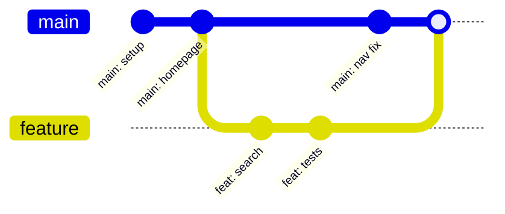
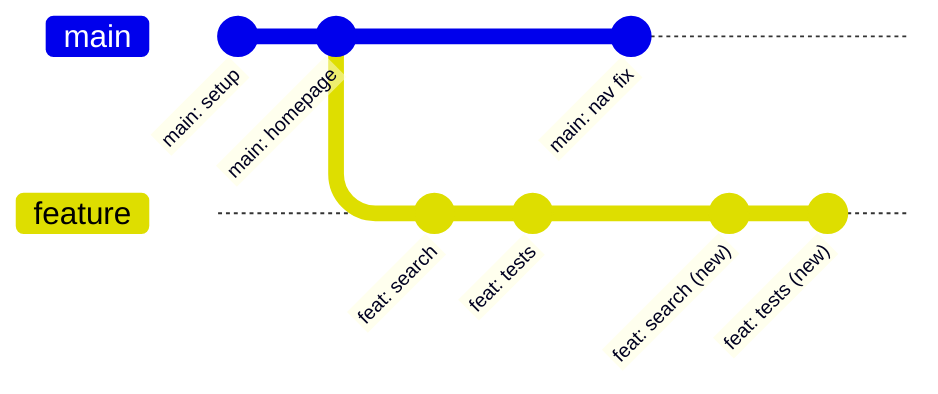

Merge and rebase can both bring changes from one branch into another. They produce different histories, and that difference matters when someone reviews the work six months later. The right choice depends less on ideology and more on whether the commits are shared.

## What a merge does

Imagine a `main` branch and a feature branch that both gained commits:



A merge creates a new commit with two parents. The original commits keep their identities. The graph records that the feature line and the main line existed in parallel, and that they were joined at a specific point. Merge commits can be valuable: they preserve the topology of collaboration.

A fast-forward merge is different. If `main` has not moved since the feature branch started, Git can simply move the `main` pointer to the feature tip. No merge commit is created. Adding `--no-ff` forces a merge commit even when a fast-forward is possible, which can make feature integration visible in history.

## What a rebase does

Rebase replays your commits on top of a new base. Conceptually:



The original feature commits are not literally moved. New commits are created with new hashes and new parent pointers. The old commits still exist in the object database until garbage collection, which is why `git reflog` can often recover them.

The result is a linear history: as if the feature had been written after the latest main commit. That is easier for some teams to read. It also removes the explicit record of when the branches diverged and merged.

## The golden rule

Do not rebase commits that other people have already pulled and based work on, unless you have coordinated the rewrite.

Rewriting shared history changes commit hashes. If a colleague has commits on the old version of a branch, your force-push can create two incompatible histories. Recovering requires reflog knowledge and manual repair. This is why public `main` branches are usually merge-only and personal feature branches can be rebased freely before review.

A practical policy:

- **Local, unpushed commits:** rebase is safe and often convenient.
- **A shared feature branch:** avoid rewriting history after others have pulled it; coordinate first.
- **The protected main branch:** merge reviewed changes; do not rebase shared main history.
- **Cleaning up a pull request:** rebase interactively only on your own branch, then push with an explicit force-with-lease.

`git push --force-with-lease` is safer than `--force` because it refuses if the remote moved in a way you have not seen. It is still a rewrite; safety does not make it appropriate on every branch.

## Conflicts are not a reason to avoid rebase

Both operations can conflict. The difference is when you resolve:

- During a merge, Git combines the two histories and may ask you to resolve a conflict once.
- During a rebase, Git replays each commit and may ask you to resolve conflicts at several points.

If a feature branch has ten commits and only one touched the conflicting lines, rebase may still stop more than once because each replayed commit is evaluated. For a long-lived branch with many small commits, this can be tedious. Squashing locally first can help, but it changes the commits and should be intentional.

## Worked commands

Update a local feature branch with main, keeping a linear history:

```bash
git switch feature
git fetch origin
git rebase origin/main
```

If conflicts occur, resolve the files, stage them, and continue:

```bash
git add <resolved-file>
git rebase --continue
```

To abandon the rebase and return to the pre-rebase state:

```bash
git rebase --abort
```

Merge a completed feature into main:

```bash
git switch main
git pull --ff-only
git merge --no-ff feature
```

Review the graph:

```bash
git log --oneline --graph --decorate --all -20
```

Push a rebased personal branch after verifying the remote state:

```bash
git push --force-with-lease
```

## Squash, fixup, and the review problem

A commit history with messages like "fix tests", "really fix tests", and "address review" is technically linear but not useful. Interactive rebase can squash or reorder commits:

```bash
git rebase -i HEAD~5
```

Do this on your own branch before review, or use your hosting platform's squash-and-merge option. The goal is not a perfect aesthetic graph; it is a history where each commit has a understandable purpose. Some teams prefer a single squashed commit per change. Others value small, atomic commits. Both can work if the policy is explicit.

## How to decide

Choose merge when:

- the branch is shared
- you want to preserve collaboration topology
- a merge commit gives useful context
- the platform's review flow expects merge commits

Choose rebase when:

- commits are local and unshared
- a linear history genuinely improves review
- you are cleaning up your own work
- the team has a documented policy for it

Avoid mixing policies accidentally. A repository where some people force-push shared feature branches and others assume stability is a repository with avoidable confusion.

The [Git command reference](/tools/git-reference/) includes the commands used here with cautions for destructive operations. The best history is not the one with the fewest commits; it is the one a future maintainer can trust.
