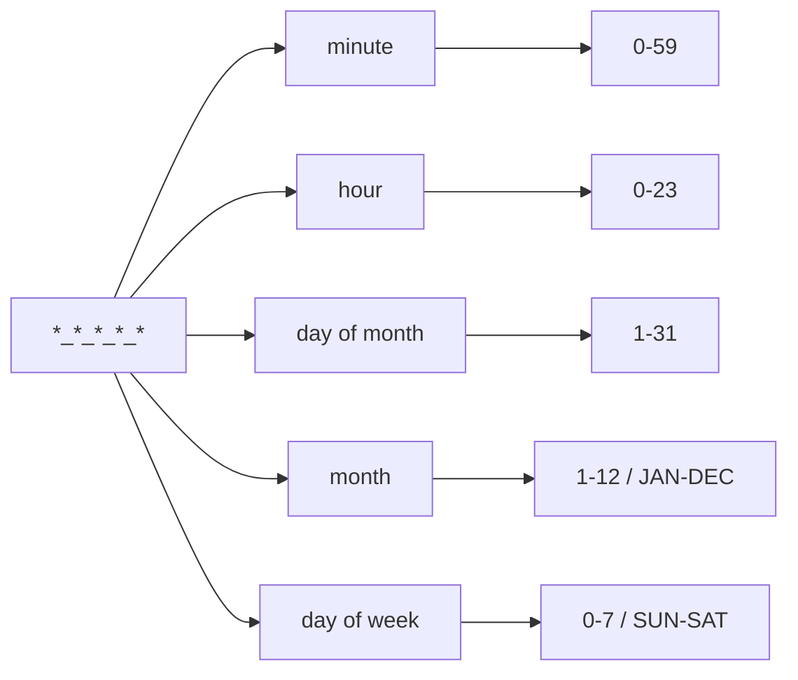

A cron expression is a compact claim about time. At 03:00 on the first day of every month, run the backup. Every fifteen minutes, refresh a feed. On weekdays at 09:00, send the digest. The syntax is small, but its edge cases can produce schedules that run more often than intended, or never at all.

This guide covers standard five-field cron as implemented by common Unix-like systems. It does not cover every daemon's extensions; check the documentation for the scheduler you actually use.

## The five fields

```text
┌──────── minute (0–59)
│ ┌────── hour (0–23)
│ │ ┌──── day of month (1–31)
│ │ │ ┌── month (1–12, or JAN–DEC)
│ │ │ │ ┌ day of week (0–7, or SUN–SAT; 0 and 7 are Sunday)
│ │ │ │ │
* * * * *
```

The order is minute, hour, day of month, month, day of week. It is common to remember it as "minute, hour, day, month, weekday", but the day and weekday interaction is where mistakes begin.

| Expression | Meaning |
| --- | --- |
| `*/15 * * * *` | Every 15 minutes |
| `0 9 * * 1-5` | 09:00 on weekdays |
| `0 0 1 * *` | 00:00 on the first day of every month |
| `30 3 * * 0` | 03:30 every Sunday |
| `0 */6 * * *` | Every six hours at minute zero |

## Operators you need

- `*` matches every value in the field.
- `5` matches exactly one value.
- `1,15,30` matches a list.
- `1-5` matches an inclusive range.
- `*/10` means every tenth value across the field.
- `10-50/10` means 10, 20, 30, 40, 50.

Month and weekday names can make an expression easier to review: `0 9 * * MON-FRI` is clearer to many readers than `0 9 * * 1-5`, provided your cron implementation supports names.



## The day-of-month OR rule

This is the classic surprise. When both day-of-month and day-of-week are restricted, traditional Vixie-style cron treats them with OR semantics. The job runs when either field matches. It does not require both.

For example:

```text
0 0 1 * 1
```

That does not mean "the first day of the month if it is a Monday". It means "the first day of the month, or any Monday". If that is not what you intended, restrict only one of the two fields.

Some schedulers support a question mark or a different rule. Do not assume portability. Document the interpretation, especially when the same expression is copied into Kubernetes, cloud schedulers, or a managed platform.

## Time zones and daylight saving

Cron itself usually knows nothing about a named time zone. The daemon runs in the system's configured time zone, which may be UTC on a server and local time on a laptop. Two environments can therefore interpret the same expression differently.

This matters for:

- jobs that should run at business-hour boundaries
- daily jobs that can run twice or not at all when clocks shift
- reports whose "yesterday" depends on the server's date

Prefer UTC for infrastructure jobs where possible. If a job must run at local midnight, make the time zone explicit in the scheduler or application configuration, and test the daylight-saving transitions.

## The expression may be valid but still useless

`0 0 30 2 *` is syntactically valid. It schedules a run on February 30, which never occurs. A parser may accept it without warning. Always preview the next run times; an expression that has no future matches is usually a mistake.

The reverse surprise is a job that runs far more often than intended. `*/5 * * * *` is every five minutes, not every five hours. `0 */5 * * *` is every five hours at minute zero. The placement of the step operator changes the meaning.

## Scheduling is only half the problem

Once a schedule is correct, production behavior still depends on:

1. **Overlapping runs.** A slow job can overlap its next invocation. Use a lock or a scheduler that forbids concurrent runs.
2. **Missed runs.** Machines restart; the scheduler may not run a missed job. Decide whether the job must catch up.
3. **Retries.** A failed job should be retried safely, with idempotent operations when possible.
4. **Observability.** Log start and finish times, duration, exit status, and a correlation ID. A silent cron job is not a working cron job.
5. **Secrets.** Do not put credentials directly in crontab commands. Environment files should be permission-protected.
6. **Output.** Cron may try to email output. If mail is not configured, logs can disappear or create noise.
7. **Path and environment.** Cron often starts with a minimal environment. Use absolute paths or set the intended PATH explicitly.

## A practical review routine

Before deploying a new expression:

- parse it with a tool you trust
- read the next five run times in the intended time zone
- confirm whether both day fields are restricted
- check what happens across a leap day and a daylight-saving change
- verify overlap protection and failure handling
- add an alert for missed or failed runs

The [cron explainer](/tools/cron-explainer/) shows a field-by-field explanation and previews the next five matches in your browser's local time zone. It supports standard five-field expressions and common macros, not vendor-specific extensions. Use it as a second pair of eyes, then validate in the environment that will actually run the job.

A schedule is not documentation. A sentence next to the expression, a test of the next-run preview, and an alert when the job fails together do more than a clever comment ever will.
