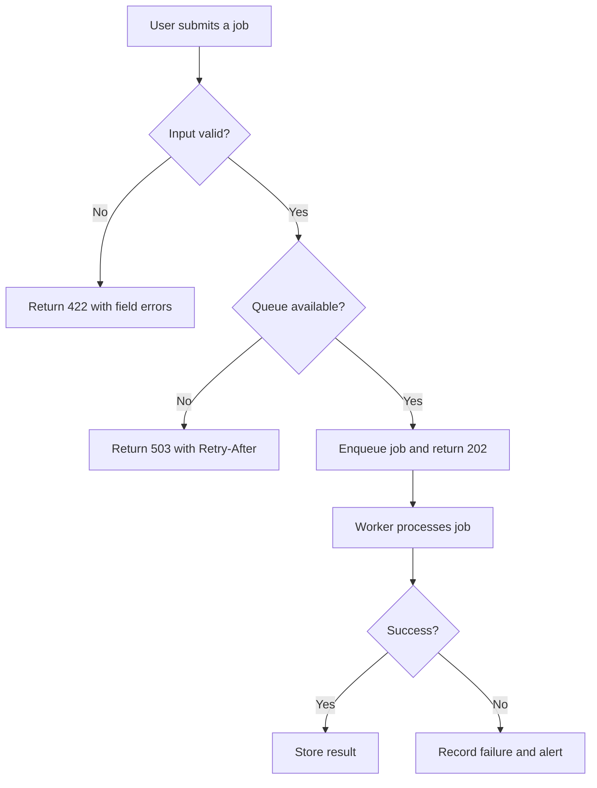
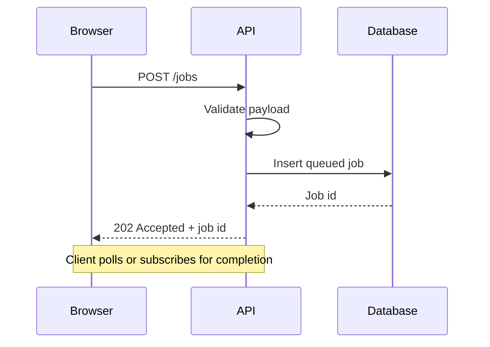
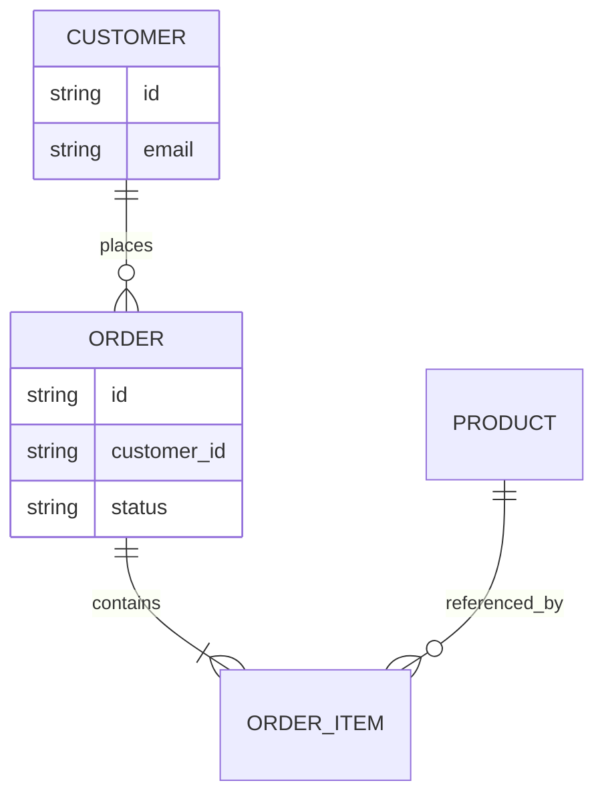
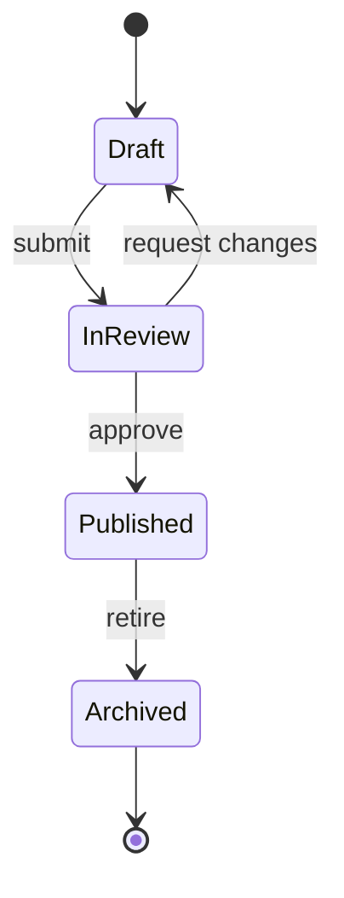

A diagram is often the fastest way to explain a system. But a diagram trapped in a binary image is hard to review, diff, update, or search. Mermaid takes a different approach: describe the diagram in text, render it where needed, and keep the source beside the explanation.

This site renders Mermaid diagrams in articles and provides a local [Mermaid editor](/tools/mermaid-editor/) for experiments. The source is always available; the rendered SVG is an enhancement.

## Why text diagrams earn their place

Text-based diagrams fit engineering workflows:

- changes appear in a normal diff
- the diagram can be reviewed in the same pull request as the code it describes
- labels are searchable in the repository
- rendering can happen in documentation tools, IDEs, and websites
- no binary export is required to change one label

They are not a replacement for careful visual design. A dense architecture diagram may still need a designer, a larger canvas, or a different medium. Mermaid is strongest for structured relationships, flows, and sequences.

## A flowchart for decisions

A good flowchart uses verbs for actions and questions for decisions. If every box is a noun and every arrow says "data", the diagram is probably not explaining behaviour.

## A sequence diagram for a request

Sequence diagrams are useful when the interesting information is the order of messages and the boundaries between systems. They make retries, acknowledgements, and failure responses visible.

## Entity relationships

An entity diagram is not a full database design. It shows cardinality and relationships; constraints, indexes, and lifecycle rules still belong in prose or schema definitions.

## State machines

State diagrams are excellent for lifecycle rules. They force you to name the events that cause transitions. If an engineer cannot draw the states, the feature may not have a shared model yet.

## Accessibility and fallbacks

An SVG diagram is not automatically accessible. Screen readers may read individual text labels in unpredictable order, and color-only distinctions disappear. Practical mitigations:

1. Explain the important relationship in prose before or after the diagram.
2. Provide the Mermaid source in a details block, as this site does.
3. Avoid relying on color alone to distinguish paths or states.
4. Keep labels meaningful when read in isolation.
5. Add a useful title or caption that states the diagram's purpose.
6. Test the rendered page with a screen reader when the diagram carries essential information.

The accessible fallback should not be an afterthought. If the source is available and the surrounding text explains the system, a failed render is an inconvenience rather than a loss of meaning.

## Rendering trade-offs

Mermaid can be rendered at build time, client-side, or in a separate documentation pipeline. This site chooses client-side rendering only on pages that contain diagrams. Pages without diagrams do not load the Mermaid runtime.

That decision keeps ordinary pages fast, but it means a diagram needs JavaScript to appear visually. The source fallback remains available. A build-time renderer would remove the runtime dependency, but it adds a browser or headless rendering step to every build and can be slower or more fragile. Each choice is a trade-off between runtime cost and build complexity.

Security matters when a diagram syntax can include links or styling. This site renders with Mermaid's strict security level and sanitizes the resulting SVG. If you accept diagrams from untrusted visitors, do not treat Mermaid as a trusted markup language. Prefer a server-side or sandboxed renderer and make the trust boundary explicit.

## Keeping diagrams honest

A diagram should not imply a system is simpler than it is. Common problems:

- omitted failure paths
- arrows with no defined direction of dependency
- a box labelled "API" that hides five services
- stale diagrams that contradict the code
- diagrams without dates or ownership

When a diagram becomes the reference model, assign it an owner and update it alongside the system. A diagram in a README is documentation, not decoration.

## Try the editor

The [Mermaid editor](/tools/mermaid-editor/) renders flowcharts, sequence diagrams, state diagrams, class diagrams, and more in your browser. It can export the SVG, and it reports syntax errors rather than leaving you with a blank canvas. If you are learning the syntax, start with one relationship and add detail only when it buys clarity.

Text diagrams are not automatically good diagrams. The medium simply removes an excuse for letting them drift out of version control.
