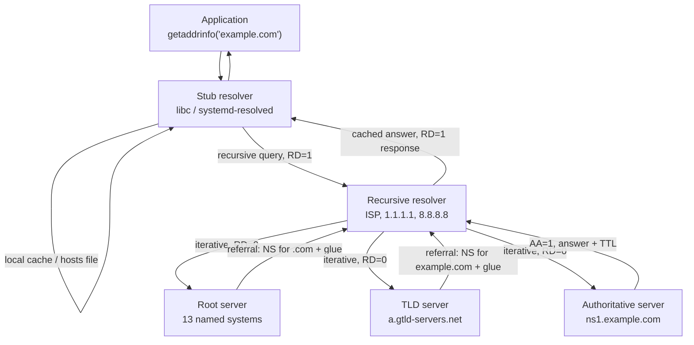
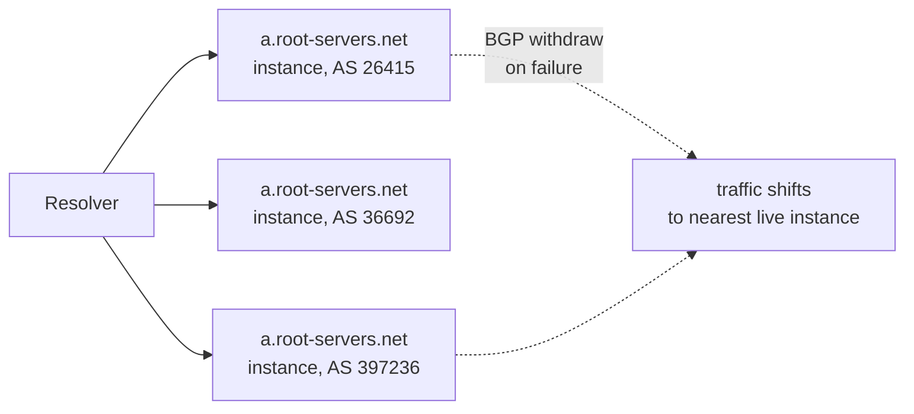
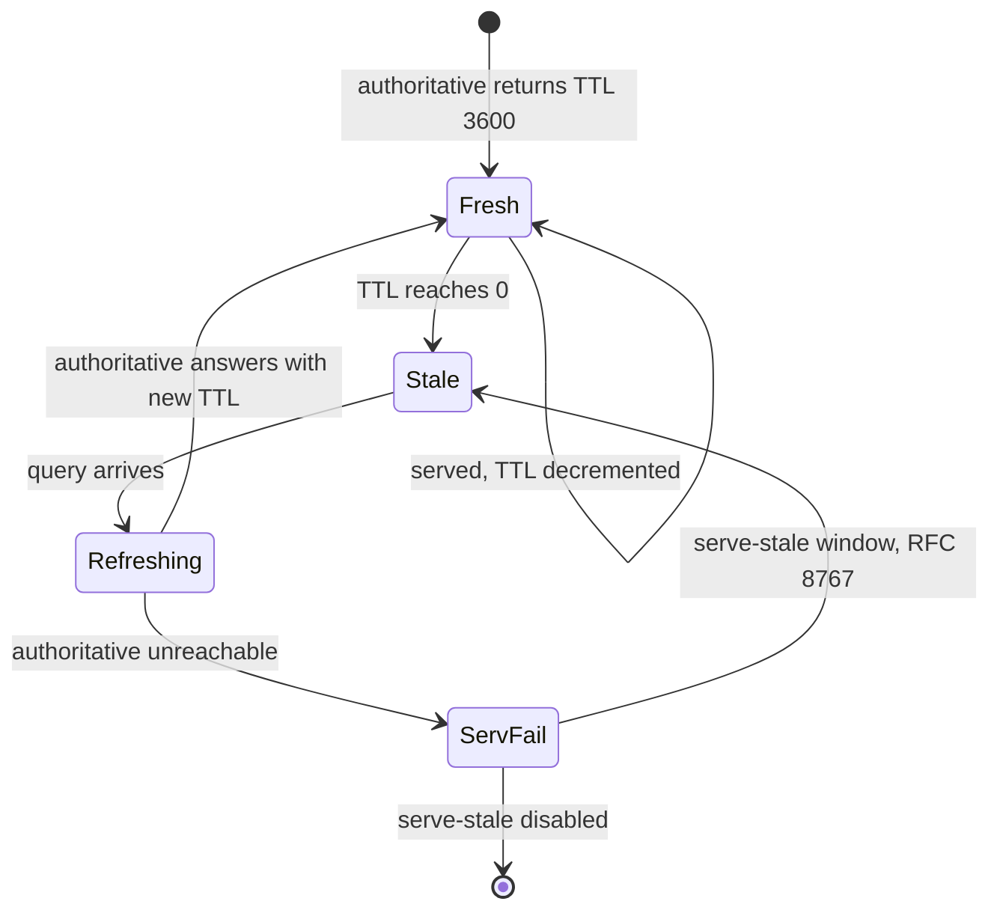
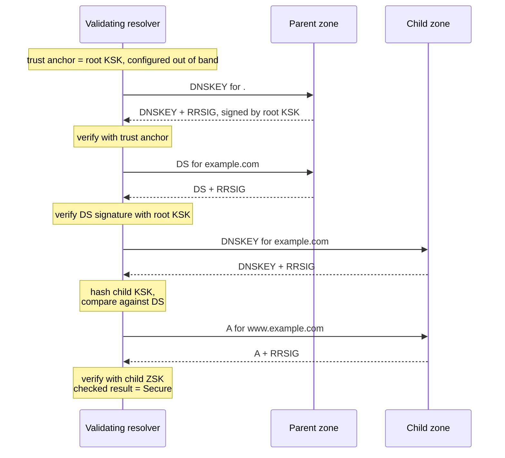
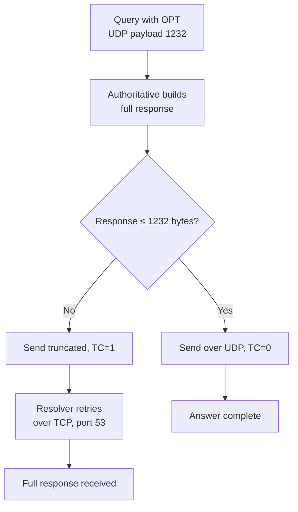
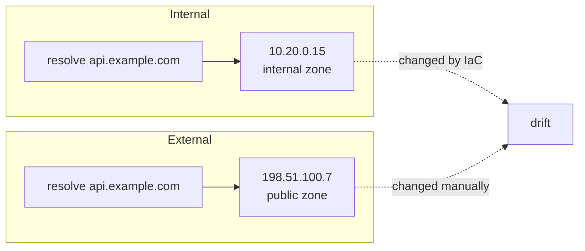

The domain name system is the most heavily cached distributed system you depend on and the one you have the least
control over. You publish a record, set a TTL, and assume clients will honour it. They will not — not exactly, not
always, and in some cases not at all. The gap between what authoritative servers publish and what stub resolvers
actually observe is where most DNS outages are born.

This article follows one query from a process calling `getaddrinfo` down to the root zone and back, then examines
the caching semantics and failure modes that documentation tends to skip.

## The resolution path, named precisely

A single `curl https://example.com` triggers at least four distinct components.



Three properties distinguish the layers:

| Component | Recursion desired | Caches | Answers authoritatively |
| --- | --- | --- | --- |
| Stub resolver | Sets `RD=1` | Sometimes, at OS level | Never |
| Forwarder | Passes `RD=1` through | Depends | Never |
| Recursive resolver | Sets `RD=0` upward | Yes, the large shared caches | Never |
| Authoritative server | Ignores `RD` | No (except minimal) | Yes, `AA=1` |

The stub resolver's role is smaller than people assume: it reads `/etc/hosts`, applies `search` domains from
`/etc/resolv.conf`, and forwards. It does not walk the delegation tree. Everything interesting happens inside the
recursive resolver, which is usually operated by someone else and configured with policy you cannot see.

## The 13 root server systems and anycast

There is a persistent misconception that there are 13 root *servers*. There are 13 named **server systems**
(`a.root-servers.net` through `m.root-servers.net`), a limit inherited from the original DNS packet design:
13 IPv4 addresses fit in a single 512-byte UDP response, which was the maximum size in RFC 1035.

In practice each letter is operated by a different organisation — Verisign for `a` and `j`, ICANN for `l`, NASA
Ames for `k`, RIPE NCC for `k` in some regions, ISC for `f`, Cogent for `c`, and so on — and each letter is
deployed on hundreds of anycast instances worldwide. The current count is well over 1,500 instances across all
letters.

Anycast changes the failure model fundamentally:



The consequences matter operationally:

- **The nearest instance wins, not the geographically closest country.** BGP path selection decides.
- **A single instance can see disproportionate traffic** when routing is asymmetric; root operators publish
  per-instance traffic graphs and occasionally observe large imbalances.
- **Anycast does not guarantee session continuity.** A route flap moves subsequent queries to another instance,
  which is harmless for DNS (connectionless, stateless) but is a real problem for anycasted TCP.

Root servers do not answer queries for names. They return referrals. Asking a root server anything other than a
root-level NS, DS, or A/AAAA record yields either a referral or `REFUSED`. This is why "DNS amplification" attacks
spoof the source address of a query to a root server: the referral response is larger than the query.

## Record types and the rules that bite

| Type | Purpose | Critical constraint |
| --- | --- | --- |
| `A` | IPv4 address | Multiple records round-robin; order is not a priority |
| `AAAA` | IPv6 address | Absent `AAAA` is not `NODATA` failure — it is normal |
| `CNAME` | Alias to another name | **Illegal at zone apex**; cannot coexist with other types |
| `MX` | Mail exchanger | Target must be a name, never an IP; preference is priority |
| `TXT` | Arbitrary text | Multi-string records must be concatenated; SPF/DKIM depend on it |
| `SOA` | Zone authority | Carries negative-caching TTL in `MINIMUM` |
| `NS` | Delegation | Requires glue when target is inside the child zone |
| `SRV` | Service location | `priority weight port target`; clients implement weighted selection |
| `CAA` | Allowed CAs | Restricts issuance, inherited down the tree, blocks by default |

### Why CNAME at the apex is illegal

The apex of a zone (`example.com` as opposed to `www.example.com`) must carry `SOA` and `NS` records. RFC 1034
states that a `CNAME` record must not coexist with any other data at the same owner name. Since the apex
literally cannot avoid carrying `SOA` and `NS`, a `CNAME` there is a contradiction. Zone files that attempt it
either fail to load or the provider silently converts it to a proprietary alias mechanism.

The practical consequence: you cannot `CNAME` `example.com` to a CDN endpoint. Providers work around this with
non-standard record types — `ALIAS` at DNSimple, `ANAME` at easyDNS, `CNAME` flattening at Cloudflare — which
resolve the target at query time and return an `A`/`AAAA` record instead. These are *not* DNS protocol features,
they are resolver-side tricks, and they interact badly with DNSSEC because the returned signature covers a record
the client did not ask for.

A `CNAME` also forbids coexistence with `MX` and `TXT`, which is why mail at the apex must be an `MX` pointing to
a subdomain, never an alias.

### CAA restricts issuance, and inheritance is subtle

`CAA` records tell certificate authorities which CAs may issue for a name. The rule is that a CA walks up the
tree from the requested name to the root, and the **first** `CAA` RRset found is authoritative for the whole
subtree. If `example.com` has `CAA 0 issue "letsencrypt.org"` and `shop.example.com` has no `CAA` record, then
`shop.example.com` inherits the restriction and only Let's Encrypt may issue.

```bash
dig +short CAA example.com
dig +noall +answer CAA _acme-challenge.example.com
```

A `CAA` RRset that contains only `iodef` and no `issue` property means **no CA may issue at all**. This is a
documented foot-gun: adding an `iodef` record for incident reporting without an accompanying `issue` record
breaks certificate renewal for the entire subtree.

## TTL semantics and the negative cache

TTL is a 32-bit unsigned integer of seconds, and the authoritative server sets it. Two things are commonly
misunderstood.

**First, TTL is decremented by caching resolvers.** A resolver that receives a record with TTL 3600 and serves it
470 seconds later returns TTL 3130. This is what `dig` shows when you query a resolver. If you see a suspiciously
round-looking TTL after the first query, you are reading a cached answer.

**Second, negative answers are cached.** RFC 2308 defines how. When a server returns `NXDOMAIN` or `NODATA`, the
resolver caches the absence using:

$$
T_{\text{neg}} = \min(\text{SOA.MINIMUM},\ \text{SOA.TTL})
$$

That is the *corrected* rule. RFC 1035 originally said the negative cache TTL was `SOA.MINIMUM` alone, and many
implementations — including some large ones — implemented the older reading for years. The difference is material:
if you set `SOA TTL 300` and `SOA MINIMUM 86400`, RFC 2308 gives you a 300-second negative cache, while the
RFC 1035 reading gives you a full day of `NXDOMAIN` for a name you may have just created.

| Scenario | Record TTL | Cached by resolver as |
| --- | --- | --- |
| `A` record positive answer | 3600 | 3600 s, decremented on each serve |
| `NXDOMAIN` with SOA TTL 60, MINIMUM 3600 | 60 | 60 s (RFC 2308) |
| `NXDOMAIN` with SOA TTL 3600, MINIMUM 60 | 3600 | 60 s (RFC 2308) |
| `NODATA` for `AAAA` on IPv4-only host | per SOA | Same rule as `NXDOMAIN` |
| No SOA in authority section | — | **Not cacheable** |

This is the single most common cause of "I created the record and nothing happened": someone queried the name
while it did not exist, the negative answer was cached, and the creation is invisible until the negative TTL
expires. The fix is to query the authoritative server directly and bypass the cache.

```bash
# Bypass the recursive resolver entirely
dig +norecurse @ns1.example.com newhost.example.com A
# Ask for the SOA to read MINIMUM
dig +short SOA example.com
```

### Authoritative vs recursive TTL handling

Authoritative servers do not cache. They serve the literal configured TTL on every answer. Recursive resolvers
cache and decrement. Stub resolvers may cache independently and, in the case of `systemd-resolved`, keep a
separate cache with its own policy.



Serve-stale (RFC 8767) is worth knowing about because it silently violates TTL. A resolver that supports it may
continue returning an expired record for a bounded window (commonly 1 day) when the authoritative server is
unreachable. Unbound, BIND, and Knot Resolver all implement it and several distributions enable it by default.
From a client's perspective, stale data now has an unbounded-by-TTL lifetime bounded only by the resolver's
`serve-expired-ttl`.

## DNSSEC: the chain of trust

DNSSEC adds four record types and one validation procedure.

| Record | Role |
| --- | --- |
| `DNSKEY` | Public key for the zone, either KSK or ZSK |
| `DS` | Delegation Signer, a hash of the child's KSK, published in the **parent** zone |
| `RRSIG` | Signature over an RRset, with validity window |
| `NSEC` / `NSEC3` | Authenticated denial of existence |

The chain runs from a trust anchor (the root KSK, distributed via the root zone's `trust-anchors` file) down
through each delegation.



A zone that is signed but whose `DS` record is not present in the parent is **islanded**: it validates only for
resolvers configured with that zone as a local trust anchor. Getting the order of operations wrong during
DNSSEC enablement — publishing `DS` before the child serves signed answers — produces `SERVFAIL` for every name
in the zone for the duration of the parent's TTL.

### NSEC, NSEC3 and zone walking

Denial of existence requires proving that a name does not exist. `NSEC` does this by listing the next existing
name in canonical order:

```text
alpha.example.com. 3600 IN NSEC delta.example.com. A RRSIG NSEC
```

This proves that no name sorts between `alpha` and `delta`. It also **enumerates the zone**: an attacker can
request a fabricated name, receive the `NSEC` covering it, learn the next existing name, and repeat. That is zone
walking, and it was demonstrated in 2010 against `com`-sized signed zones.

`NSEC3` replaces the plaintext owner name with a salted hash:

$$
H_{\text{owner}} = \text{Base32hex}\left(\text{SHA-1}(\text{name} \| \text{salt})\right)
$$

This defeats straightforward enumeration, but a dictionary attack over candidate names remains feasible because
the salt and iteration count are public. Opt-out — a flag that allows unsigned delegations to be skipped from the
chain — further leaks information about which delegations are signed.

```bash
dig +dnssec example.com DNSKEY
dig +dnssec nonexistent.example.com A     # observe NSEC/NSEC3 in authority
dig +dnssec +multi ds example.com @a.gtld-servers.net
```

## EDNS0 and the TCP fallback

RFC 1035 capped UDP DNS at 512 bytes. Modern responses routinely exceed that: DNSSEC signatures are large, and
so are `TXT` records and large `MX` sets. EDNS0 (RFC 6891) solves this via a pseudo-record in the additional
section advertising a buffer size.

A resolver sending `OPT` with a 1232-byte payload announces its capacity. The authoritative server computes the
full response, and if it exceeds that capacity it sets the `TC` (truncated) bit and sends what fits.



The 1232 number is not arbitrary. It is the largest payload that avoids IP fragmentation on IPv6 minimum MTU
(1280) minus 40 bytes of IPv6 header and 8 bytes of UDP header. Common path MTU issues and misconfigured
middleboxes make fragmentation unreliable, so 1232 has become the de facto standard recommendation, encoded in
DNS flag day in 2020. Older 4096-byte advertisements are still common and still cause fragmentation drops.

The failure mode is concrete: a firewall that blocks TCP/53 will allow a small `A` query to succeed and make a
large DNSSEC-signed query fail. Symptom is `SERVFAIL` on names with DNSSEC and success on names without.

```bash
dig +bufsize=4096 +dnssec example.com A
dig +ignore +bufsize=512 example.com A      # forces truncation, shows TC bit
dig +tcp +dnssec example.com A              # forces TCP path
```

## Resolver behaviours you inherit

You cannot configure the resolver, but you can predict it.

| Behaviour | What it does | Operational impact |
| --- | --- | --- |
| TTL caching | Honours TTL, decrements on serve | Baseline — usually correct |
| **TTL clamping** | Enforces a minimum TTL floor | Breaks fast failover |
| **Prefetching** | Refreshes popular names before expiry | Hides TTL from you |
| **Query minimisation** | Sends only the TLD label, walking down | Reduces leakage, more round trips |
| **0x20 encoding** | Randomises case of the QNAME | Defeats cache-poisoning; some nameservers break |
| Aggressive NSEC | Caches NSEC/NSEC3 proofs for existence | Answers `NXDOMAIN` without upstream query |
| Serve-stale | Returns expired data on upstream failure | Violates TTL by design |

### Query minimisation (RFC 9156)

Instead of asking `www.example.com A` at the root, a minimising resolver asks the root for `com NS`, then the
`com` server for `example.com NS`, then the authoritative server for the full name. This limits the amount of the
query name leaked to each level of the tree.

The cost is latency: a cold query needs one round trip per label. The benefit is that a resolver does not have to
disclose the full name to any party except the authoritative server that already knows it. Most public resolvers
implement it as of RFC 9156 (2021); some do not, and some make it conditional.

### 0x20 encoding

The DNS name is case-insensitive for matching, but the wire encoding preserves case. A resolver can randomly
convert letters in the queried name to upper case and verify that the response echoes the same pattern. An
off-path attacker guessing the transaction ID must now also guess the case pattern, multiplying the search space
by $2^{n}$ for $n$ alphabetical characters:

$$
P(\text{blind forgery}) = \frac{1}{2^{16} \cdot 2^{\,n_{\text{letters}}}}
$$

This is a defence against cache poisoning, not a protocol requirement. A minority of authoritative servers
normalise the QNAME to lower case in their response, which causes validating resolvers with 0x20 enabled to
discard the answer and re-query, or fail. When a domain resolves from one resolver but not another, and the
serving infrastructure is a homegrown nameserver, case normalisation is a candidate cause.

```bash
dig +qid=##### example.com A          # inspect response case echo
dig +noidnin +noidnout example.com A
```

## Real failure modes

### Stale negative cache

The most frequent DNS "outage" is not an outage. A name was published, but a negative answer from before the
publication is still cached. Because negative TTL derives from `SOA MINIMUM` and not from the record TTL,
lowering the record TTL does nothing to help.

Mitigations:
- Keep `SOA MINIMUM` low (60–300) from the beginning of a zone's life.
- Pre-create records with placeholder values before cutover, avoiding `NXDOMAIN` ever being cached.
- Query authoritative servers directly to prove the record exists.

### Split-horizon drift

Split-horizon DNS serves different answers to internal and external clients. The failure is drift: the internal
zone and external zone are separate copies, and record changes land in one and not the other.



Symptoms read like a subtle bug rather than a DNS problem: works from the laptop, fails from the container;
works over VPN, fails in CI. The container is using the internal resolver, the laptop is using the ISP resolver,
and the two zones disagree.

Verification requires querying each view explicitly:

```bash
dig @10.0.0.53 api.example.com A     # internal view
dig @1.1.1.1 api.example.com A       # public view
dig +trace api.example.com A          # walk from root, no view applied
```

### Delegation vs glue records

When you delegate `sub.example.com` to `ns1.sub.example.com` — a nameserver *inside* the delegated zone — the
parent must publish an `A`/`AAAA` for `ns1.sub.example.com` alongside the `NS` record. This is glue, and it exists
to break the circular dependency: you cannot resolve `ns1.sub.example.com` without asking `ns1.sub.example.com`.

| Delegation shape | Glue required | Why |
| --- | --- | --- |
| `sub.example.com` → `ns1.example.com` | No | Server is in parent zone, resolvable normally |
| `sub.example.com` → `ns1.sub.example.com` | Yes | Circular dependency |
| `sub.example.com` → `ns1.other.net` | No | Unrelated zone |
| Apex `example.com` → `ns1.example.com` | No | In-zone, resolvable through the delegation itself |

The failure appears as a hard `NXDOMAIN` or `SERVFAIL` for the entire delegated zone, with the parent's delegation
visible but the child unreachable. `dig +trace` shows the referral arriving without a glue `A` record — that is
the diagnosis.

### DNS-based failover and TTL clamping

Health-check-driven DNS failover is a common architecture: two `A` records, one primary and one standby, managed
by a provider that withdraws the primary's record when a health check fails. It is also routinely disappointing.

The reason is **resolver TTL clamping**. Many recursive resolvers enforce a minimum TTL floor, typically between
30 and 300 seconds, applied to records with shorter TTLs. Some enforce a maximum too, capping at several hours or
days. Both defeat your configuration:

| Resolver | Minimum TTL behaviour | Effect on a 30 s failover TTL |
| --- | --- | --- |
| BIND with `min-cache-ttl` | Configurable floor, often 300 | Record cached 300 s regardless |
| Unbound with `cache-min-ttl` | Configurable floor | Same |
| Public resolvers | Provider-specific, unpublished | Unpredictable |
| Stub / OS cache | Independent, sometimes hours | Failover invisible |

Worse, prefetching resolvers refresh popular names before expiry, which is fine for latency and catastrophic for
failover: the resolver fetches the record milliseconds before expiry, gets the *old* primary (health check has not
yet flipped), and caches it for another full period.

The practical conclusion is that DNS failover converges in minutes, not seconds, and its actual convergence time
is set by the least cooperative resolver in the path. Use DNS for coarse failover — region selection, DR
cutover — and solve sub-minute failover at the load balancer or anycast layer, where the switch is not cached by
a third party.

## Summary

1. **The stub resolver does almost nothing.** Delegation walking happens in the recursive resolver, which is
   usually not under your control.
2. **There are 13 root *systems*, not 13 machines.** Each letter is anycast across hundreds of instances and BGP
   decides who sees which.
3. **Negative caching uses the SOA.** `min(SOA.MINIMUM, SOA.TTL)` per RFC 2308 governs how long your absence is
   remembered, and lowering record TTLs does not change it.
4. **CNAME at the apex is structurally illegal**, and provider "flattening" record types break DNSSEC's
   assumptions because they return records the client did not request.
5. **CAA inherits down the tree.** An RRset with `iodef` but no `issue` blocks all issuance for the subtree.
6. **EDNS0 buffer size decides whether TCP is needed**, and a firewall blocking TCP/53 silently breaks DNSSEC
   while leaving plain queries working.
7. **DNSSEC is a parent-to-child chain via DS**, and publishing DS before the child is signed makes the whole
   zone `SERVFAIL`.
8. **DNS failover is bounded by resolver TTL clamping**, so it converges in minutes; treat DNS as coarse traffic
   steering and do fast failover elsewhere.
