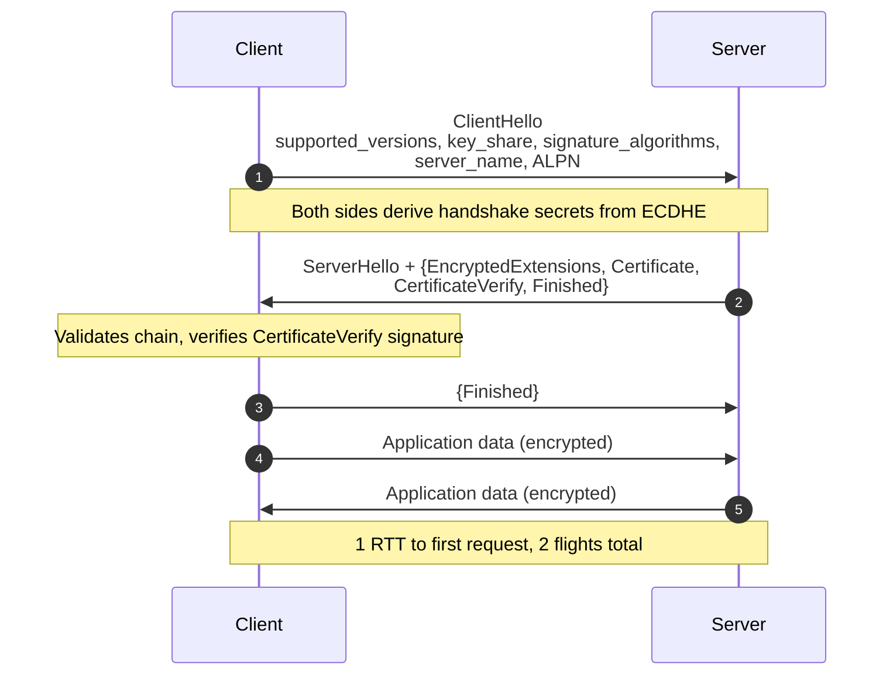
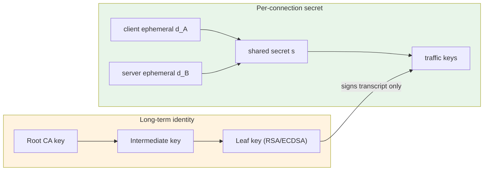
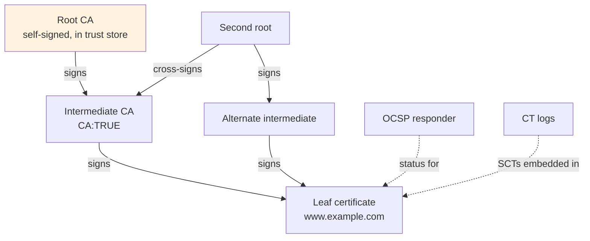
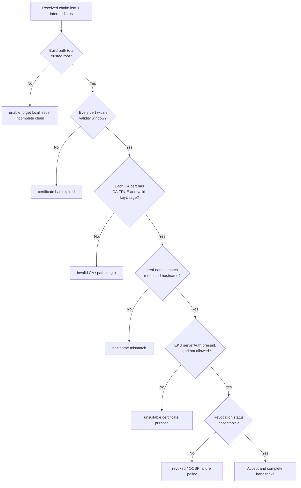
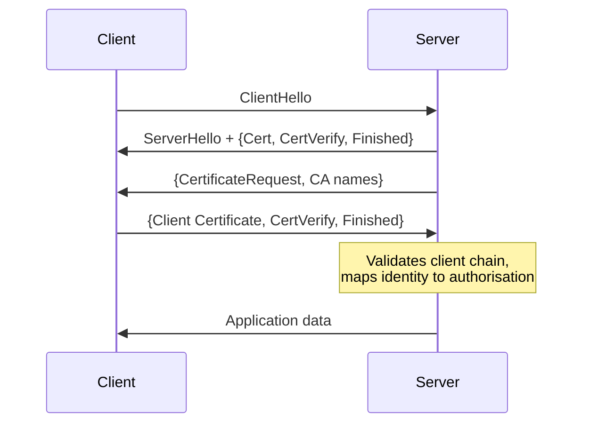

TLS failures are almost never cryptographic. Cipher negotiation problems largely disappeared when TLS 1.3
removed the configurability that produced them. What remains is trust: a chain one certificate short, an
intermediate that expired eleven minutes ago, a clock off by four minutes, or an inspection proxy that rewrote
the chain under a client that had a pin. This article treats TLS as two machines — a key agreement protocol and
a public key infrastructure — and examines where each one breaks.

## TLS 1.3 reduces the handshake to one round trip

TLS 1.2 full handshake costs two round trips before the client can send application data. TLS 1.3 (RFC 8446)
sends the key share in the ClientHello, so the server can derive keys and return everything it needs in a single
flight. The client can encrypt application data in the very next flight.



Three structural changes make the improvement possible:

- **The entire handshake after ServerHello is encrypted.** Certificate, CertificateVerify, and the server's
  Finished are inside EncryptedExtensions. An on-path observer sees a ServerHello and then ciphertext.
- **Ephemeral key exchange is mandatory.** There is no RSA key transport in TLS 1.3 and no static (EC)DH.
- **Compression, renegotiation, and CBC-mode ciphers are gone.** Each removed feature was a source of both
  implementation bugs and oracle attacks.

| Property | TLS 1.2 | TLS 1.3 |
| --- | --- | --- |
| Full handshake latency | 2 RTT | 1 RTT |
| Resume / PSK | Session ID or ticket, up to 1 RTT | PSK or PSK+DHE, 0 RTT possible |
| Server certificate sent in clear | Yes | No, encrypted |
| Key exchange | RSA transport or (EC)DHE | (EC)DHE or PSK, ephemeral mandatory |
| Cipher suites defined | 300+, most weak | 5 RFC 8446 suites |
| Forward secrecy | Optional | Always |
| Renegotiation | Supported | Removed (KeyUpdate instead) |
| Server Finished integrity | MAC over transcript, weaker ordering | HMAC over full transcript hash |

### 0-RTT and the replay problem

Session resumption in TLS 1.3 uses a pre-shared key (PSK) established in a previous connection, distributed
inside a NewSessionTicket. If the client offers a PSK and also sends early data, it achieves 0-RTT: application
data travels in the first flight.

The cost is that early data has **no replay protection inherent to TLS**. The client is guessing the server will
accept the ticket, and it is sending data before proving possession of anything the server has just challenged.
An attacker who captures a 0-RTT flight can replay it verbatim; the server cannot distinguish the replay from
the original because both are valid under the same PSK and client nonce.

$$\text{replay risk exists} \iff \text{early\_data} \land \lnot \text{application-level idempotency}$$

The operational rule is narrow and absolute: 0-RTT may carry only requests safe to execute twice, enforced by
rejecting early data on non-idempotent methods. Most stacks implement this at the reverse proxy for anything but
`GET`/`HEAD`, and RFC 8470 (`Early-Data: 1`) lets an origin distinguish an early request from a retried one.
Early data is also not forward secret — it is encrypted under a key derived from the ticket, so compromise of the
ticket key exposes it.

## Key exchange, forward secrecy, and why RSA transport died

TLS 1.2 RSA key transport had a fatal property: the client encrypted the premaster secret with the server's
long-term RSA public key, so anyone who recorded the traffic and later obtained that private key could decrypt
every past session. TLS 1.3 separates authentication from key agreement. The server proves identity by signing
the transcript with its long-term key, but traffic keys come from an ephemeral ECDHE exchange whose private
scalars are destroyed when the connection ends.

For the common X25519 exchange, each side picks a scalar and publishes a point:

$$
s = \text{X25519}(d_A, Q_B) = \text{X25519}(d_B, Q_A), \qquad Q = d \cdot G
$$

The shared secret is uniform only if both public values are contributed independently, which is why TLS 1.3
mandates DHE or PSK+DHE rather than plain PSK for resumption. Forward secrecy is then a statement about what an
attacker can do after the fact:

$$H(\text{traffic keys} \mid \text{server private key}) = H(\text{traffic keys})$$

The server's long-term private key carries no information about a completed session's traffic keys. A stolen key
permits impersonation *from that moment forward* until revocation propagates, and nothing earlier.



The diagram is the whole argument: the leaf key never touches the traffic keys, it only signs a transcript that
binds them to the identity.

## Cipher suites in TLS 1.3 versus 1.2

TLS 1.2 suite names pack four independent decisions into one identifier — key exchange, authentication, bulk
cipher, and MAC — which is how `TLS_RSA_WITH_AES_128_CBC_SHA` and `TLS_ECDHE_RSA_WITH_AES_256_GCM_SHA384` came to
coexist. TLS 1.3 names only the AEAD and the hash; key exchange and authentication are negotiated independently
through `supported_groups` and `signature_algorithms`.

| Suite | AEAD | Hash | Status |
| --- | --- | --- | --- |
| `TLS_AES_128_GCM_SHA256` | AES-128-GCM | SHA-256 | Mandatory to implement, widely preferred for speed |
| `TLS_AES_256_GCM_SHA384` | AES-256-GCM | SHA-384 | Common with P-384 groups |
| `TLS_CHACHA20_POLY1305_SHA256` | ChaCha20-Poly1305 | SHA-256 | Preferred on hardware without AES acceleration |
| `TLS_AES_128_CCM_SHA256` | AES-128-CCM | SHA-256 | Constrained devices (IoT) |
| `TLS_AES_128_CCM_8_SHA256` | AES-128-CCM-8 | SHA-256 | Truncated tag, constrained devices only |

`TLS_AES_128_GCM_SHA256` is not weaker than AES-256 in any realistic threat model; the larger key buys nothing and
costs throughput. The HKDF key schedule also derives per-stage secrets, so handshake and application traffic use
different keys.

## The certificate chain is a delegation graph

A leaf certificate is a signed statement binding a public key to a set of names. That signature is only useful if
the signing key is itself trusted, and trust is bootstrapped from a small set of self-signed roots shipped in the
OS or browser trust store.



**Leaf.** The end-entity certificate. `basicConstraints` has no `CA:TRUE`, and `keyUsage` should be
`digitalSignature` (and `keyEncipherment` only if RSA key transport is still needed for TLS 1.2). `extendedKeyUsage`
should include `serverAuth`.

**Intermediate.** `CA:TRUE` with a `pathLenConstraint`. There may be one or several; chains deeper than four are
unusual and a sign of a management problem. The intermediate is the certificate people most often forget to
serve.

**Root.** Self-signed, long-lived, present in the client's trust anchor store. The server must **not** send the
root in its chain — clients already have it, and including it wastes bytes and can confuse path builders.

**Cross-signing.** When a CA creates a new root, clients on older trust stores do not have it. The CA has its new
intermediate signed by a second, older root that everyone already trusts. The same intermediate certificate can
therefore be reached from two different roots, and the server can serve a chain for either. This is exactly how
Let's Encrypt's ISRG Root X1 reached clients whose stores still lacked it: an intermediate cross-signed by IdenTrust's
DST Root CA X3, whose expiry in September 2021 broke a long tail of Android and embedded clients.

## Validation: the steps a client must perform

Chain building is not a single check. A conforming client walks an ordered set of verification steps and stops
at the first failure — which is precisely why the error message you see often names the wrong problem.



| Validation step | Field or mechanism | Typical failure |
| --- | --- | --- |
| Path building | issuer/subject DN, AKI/SKI | Missing intermediate |
| Signature verification | Algorithm and public key of issuer | Cross-sign selection error |
| Validity window | `notBefore` / `notAfter` | Expired intermediate, clock skew |
| Basic constraints | `CA:TRUE`, `pathLenConstraint` | Leaf used as issuer |
| Key usage | `keyUsage`, `extendedKeyUsage` | `clientAuth`-only cert on a server |
| Name matching | `subjectAltName`, then CN fallback | CN-only cert modern clients reject |
| Algorithm policy | SHA-1, RSA key size, curve | Legacy client refusal |
| Revocation | OCSP, CRL, stapling | Soft-fail masking a revocation |
| Certificate Transparency | SCT count and log list | Policy-only, not enforced by all clients |

### Name matching uses SAN, not CN

The Common Name field was deprecated for hostname verification by RFC 2818 and formally removed in RFC 9525.
Modern clients — Chrome since 58, Safari, and the Go and Rust stacks — ignore CN entirely and require a matching
`dNSName` in `subjectAltName`. A certificate with `CN=example.com` and no SAN entry is rejected outright.

Wildcards match exactly one label: `*.example.com` matches `api.example.com` but not `example.com` and not
`a.b.example.com`. Wildcards are permitted only in the leftmost label, and clients reject patterns like
`a*.example.com` or `*.co.uk`-style public-suffix wildcards.

### Revocation: OCSP, CRLs, and the privacy problem

A certificate can be compromised before it expires, so the client needs a way to ask "is this certificate still
good?". Two mechanisms exist and both have significant problems.

**CRLs** are signed lists of revoked serial numbers. They are complete but grow monotonically, so a busy CA's CRL
can be tens of megabytes. Clients mostly stopped blocking on them; partitioned CRLs and delta CRLs help but add
configuration complexity.

**OCSP** asks a responder for the status of one certificate, which is cheap — and leaks. Because the request
identifies the certificate, the responder (and anyone observing the connection to it) learns which site the user
is visiting. This is the privacy problem: OCSP converts a private TLS session into a query that reveals the
destination, often to a third party the user never chose to trust.

**OCSP stapling** inverts the model: the *server* fetches its own OCSP response and staples it into the handshake.
The client never contacts the responder, so no leak occurs, and the client gets a fresher answer with no extra
round trip. In TLS 1.3 the stapled response arrives inside the encrypted Certificate message, which also stops a
network observer from seeing it.

**Soft-fail versus hard-fail.** Most clients soft-fail: if OCSP is unreachable, they accept the certificate. This
dramatically weakens revocation, because an attacker who can block the responder also blocks enforcement. The
2016 revocation of certificates for `posteo.de` illustrated the failure: a revoked certificate remained usable for
clients that soft-failed. The industry's answer has been to shrink certificate lifetimes (90 days is now normal,
with shorter lifetimes proposed) so that revocation matters less, and to lean on CT for detection.

| Mechanism | Who fetches | Privacy leak | Freshness | Cost |
| --- | --- | --- | --- | --- |
| CRL | Client, periodically | Low | Stale between downloads | Large downloads |
| OCSP, client-fetched | Client, per handshake | High — responder learns target | Real time | Extra latency and availability dependency |
| OCSP stapling | Server, before handshake | None | Server-refreshed | Server must manage refresh |
| Must-staple extension | Server must staple | None | Enforced | Breaks handshake if stapling fails |
| Short lifetimes | Nobody | None | N/A | Frequent renewal |

### Certificate Transparency

CT (RFC 6962) addresses a different problem: a CA that misissues a certificate for your domain. Validation alone
cannot detect this, because a misissued certificate from a trusted CA is perfectly valid. CT makes issuance
public. Every certificate a participating CA issues is submitted to append-only, cryptographically verifiable
logs, and the resulting signed certificate timestamps (SCTs) are returned to the subscriber.

Chrome requires SCTs for publicly trusted certificates, so an unlogged certificate is rejected by the largest
client population. Detection is the mechanism: monitors watch the logs for certificates covering names they own.
A misissuance is therefore visible within minutes rather than being discovered when traffic is intercepted.
Log integrity rests on Merkle tree hashing, so a log cannot silently rewrite history:

$$\text{root} = H\big(H(H(L_1 \| L_2) \| H(L_3 \| L_4)) \dots\big)$$

Any single leaf can be proven present via an inclusion proof of size $O(\log n)$, which is how a client validates
an SCT without downloading the log.

## Connection-level metadata and what leaks

Three extensions shape everything beyond the certificate:

**SNI** carries the hostname in the ClientHello in cleartext, because the server must select a certificate before
it can decrypt anything. This means every connection advertises its destination to any on-path observer. Encrypted
Client Hello (ECH, drafted in RFC 9180-adjacent work and deployed by Cloudflare and Firefox) splits the ClientHello:
an outer one with a public name and a real inner one encrypted to a key published in DNS HTTPS records. The cost
is DNS dependency and a new set of failure modes when the ECH config is stale.

**ALPN** negotiates the application protocol inside the handshake. `h2` and `http/1.1` are the common values, and
`h3` rides QUIC rather than TCP TLS. A server that supports `h2` but has a misconfigured ALPN list falls back
silently to `http/1.1`, which is a common cause of "HTTP/2 mysteriously missing in production" reports.

**HSTS** is not part of TLS at all — it is a response header (`Strict-Transport-Security: max-age=31536000;
includeSubDomains; preload`) that instructs the browser to refuse plaintext for a period. Preload submission
embeds the domain in a list shipped with the browser, closing the first-visit downgrade window. The preload list
is difficult to exit and `includeSubDomains` applies to every subdomain at once, so preloading a large
organisation's apex domain is a decision with blast radius.

## Mutual TLS

In mTLS both endpoints present certificates. During the handshake the server sends a CertificateRequest with
acceptable signature algorithms and CA names, and the client responds with its own chain plus a
CertificateVerify signature over the transcript.



Mechanically, the client's certificate must chain to a CA the *server* trusts, and `extendedKeyUsage` must permit
`clientAuth`. Two operational facts: mTLS certificates are usually issued from a private CA with a shorter validity
and an automated renewal path, because manual renewal at machine scale does not survive; and mTLS authenticates
a *certificate*, not a user, so authorisation still requires a mapping from certificate identity (typically a SAN
URI or an SPIFFE ID) to permissions.

## Failure modes and how to diagnose them

These are the failures that actually occur. Each has a specific `openssl` invocation that identifies it in seconds.

### Incomplete chain

The server sends only the leaf. Browsers often recover because they cache intermediates or fetch them via AIA,
so the failure appears only on clients with cold caches — Java, Go, `curl`, mobile apps, and IoT devices. This is
the single most common TLS misconfiguration in the wild.

```bash
# Is the server sending the intermediates?
openssl s_client -connect example.com:443 -servername example.com -showcerts </dev/null

# Does verification succeed with an explicit CA file (proves the chain, not the store)?
openssl s_client -connect example.com:443 -servername example.com \
  -CAfile /etc/ssl/certs/ca-certificates.crt -verify_return_error </dev/null

# Fingerprint the served chain and count certificates
openssl s_client -connect example.com:443 -servername example.com </dev/null 2>/dev/null \
  | openssl x509 -noout -subject -issuer -dates
```

If `Verify return code` is `21 (unable to verify the first certificate)`, the intermediate is missing.

### Expired intermediate

The leaf is valid but the intermediate in the chain is not. Because the intermediate belongs to the CA, the site
operator may not even be the party who caused it — but the handshake fails all the same. Check every certificate
in the served chain, not just the leaf:

```bash
openssl s_client -connect example.com:443 -servername example.com -showcerts </dev/null \
  | awk '/BEGIN CERT/,/END CERT/' | csplit -z -f /tmp/cert- - '/BEGIN CERT/' '{*}'
for f in /tmp/cert-*; do openssl x509 -in "$f" -noout -subject -dates; done
```

### Name mismatch

The certificate is valid and chains correctly, but the requested name is absent from the SAN list. Two common
causes: the SAN contains only the apex domain while the request went to `www`, or an internal service was reached
by IP address and the certificate has no `iPAddress` SAN.

```bash
openssl s_client -connect example.com:443 -servername example.com </dev/null 2>/dev/null \
  | openssl x509 -noout -text | grep -A2 "Subject Alternative Name"
# Verify a specific name rather than the connection name
openssl s_client -connect example.com:443 -servername example.com -verify_hostname api.example.com </dev/null
```

A silent variant exists: a client that connects without setting SNI gets the server's default certificate, which
may be for an entirely different name. `-servername` is mandatory when testing virtual hosts.

### Clock skew

Certificate validity is checked against the local clock. A host with a clock outside the certificate's window
fails with `certificate is not yet valid` (clock behind) or `certificate has expired` (clock ahead). In container
fleets the usual causes are a VM restored from a suspended snapshot, `hwclock` drift on virtualised hosts without
a working NTP client, and NTP being blocked by a firewall rule someone added for an unrelated reason.

```bash
timedatectl status            # confirms NTP sync state
date -u                       # compare against a known-good source
# Check the certificate's actual window in UTC
openssl s_client -connect example.com:443 </dev/null 2>/dev/null | openssl x509 -noout -dates
```

Short-lived certificates make this worse. With 90-day or 7-day certificates, a drifted clock is far more likely
to fall outside the window, and a fleet-wide skew event becomes an outage rather than an inconvenience.

### TLS inspection proxies

An enterprise proxy that terminates and re-originates TLS presents a locally issued certificate in place of the
real one. If the corporate root CA is installed in the client trust store, validation succeeds and the proxy reads
everything. If the client is a pinned application — a mobile app using a pinned public key, or a Go binary with
its own root pool — the handshake fails with `x509: certificate signed by unknown authority`.

The recommended diagnostic is to compare what the client sees with what is actually served from outside:

```bash
# What the client is really receiving: print the leaf public key
openssl s_client -connect api.example.com:443 -servername api.example.com </dev/null 2>/dev/null \
  | openssl x509 -noout -fingerprint -sha256 -pubkey

# Compare against the known-good public key hash
openssl s_client -connect api.example.com:443 </dev/null 2>/dev/null \
  | openssl x509 -pubkey -noout | openssl pkey -pubin -outform der | openssl dgst -sha256 -binary | base64
```

If the observed issuer is your own CA rather than the expected public CA, an inspection proxy is on-path.

### Failure-mode summary

| Symptom in logs | Root cause | Fastest check |
| --- | --- | --- |
| `unable to verify the first certificate` | Intermediate not served | `-showcerts` shows one cert |
| `certificate has expired` | Leaf or intermediate expiry | Check all certs in chain |
| `certificate is not yet valid` | Clock behind | `timedatectl status` |
| `Hostname/IP does not match` | SAN lacks the name or SNI unset | `-servername` and SAN dump |
| `certificate signed by unknown authority` | Inspection proxy or missing root | Compare issuer and pubkey |
| `no suitable key share` | Client group policy mismatch | `-groups X25519:P-256` |
| `revoked` at handshake | Hard-fail OCSP | Check stapled response freshness |
| `alert protocol version` | Server TLS 1.3-only, client old | Force `-tls1_2` to confirm |

## Summary

1. **TLS 1.3 costs one round trip** because the key share travels in the ClientHello and everything after
   ServerHello is encrypted.
2. **0-RTT trades replay safety for latency.** Restrict early data to idempotent requests and treat it as
   non-forward-secret.
3. **Ephemeral ECDHE is why forward secrecy exists.** In TLS 1.3 the leaf key only signs a transcript; it never
   protects an old session.
4. **TLS 1.3 cipher suites name only AEAD and hash.** Key exchange and authentication are negotiated separately,
   which removed the entire class of misconfiguration that produced downgrade attacks.
5. **Serve the full chain but never the root.** A leaf-only chain works in browsers with warm caches and fails
   everywhere else, which is why the bug escapes testing.
6. **Verify against SAN, not CN**, and remember wildcards match exactly one label.
7. **OCSP leaks destinations; stapling fixes it.** Soft-fail default policy means revocation is weak, so short
   lifetimes are the practical mitigation.
8. **Certificate Transparency makes misissuance detectable** rather than merely auditable, and its Merkle-tree
   structure prevents logs from rewriting history.
