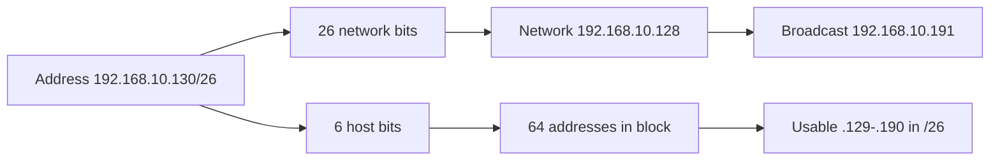

Subnetting looks like arithmetic because it is. Under the notation is a 32-bit address, a prefix length, and two simple operations: a bitwise AND to find the network, and a bitwise OR with the inverted mask to find the broadcast address. Once you can see those operations, the tables stop feeling arbitrary.

The [IPv4 subnet calculator](/tools/subnet-calculator/) performs the calculations for a specific address. This article explains how to reason about the result.

## An IPv4 address is 32 bits

The familiar dotted-decimal form is a convenience:

```text
192.168.10.130
```

Written in binary, each octet becomes eight bits:

```text
11000000 . 10101000 . 00001010 . 10000010
```

A CIDR prefix says how many leading bits belong to the network. The notation `192.168.10.130/24` means the first 24 bits are the network prefix and the final 8 bits identify a host within it.

The subnet mask for `/24` is 24 ones followed by eight zeros:

```text
11111111 . 11111111 . 11111111 . 00000000
255      . 255      . 255      . 0
```

## Network and broadcast in three steps

For the address `192.168.10.130/26`:

**1. Find the block size.** The prefix is 26, so 6 bits remain for hosts. The number of addresses in the block is \(2^6 = 64\).

**2. Find the network address.** Clear the host bits with a bitwise AND:

```text
IP:      11000000 10101000 00001010 10000010
Mask:    11111111 11111111 11111111 11000000
Network: 11000000 10101000 00001010 10000000
         192.168.10.128
```

**3. Find the broadcast address.** Set all host bits:

```text
Broadcast: 11000000 10101000 00001010 10111111
           192.168.10.191
```

The host range is `192.168.10.129` through `192.168.10.190`. That is 62 usable addresses in the traditional model: 64 total minus the network and broadcast addresses.



## The prefix table worth knowing

| Prefix | Mask | Addresses | Usable (traditional) |
| --- | --- | --- | --- |
| /24 | 255.255.255.0 | 256 | 254 |
| /25 | 255.255.255.128 | 128 | 126 |
| /26 | 255.255.255.192 | 64 | 62 |
| /27 | 255.255.255.224 | 32 | 30 |
| /28 | 255.255.255.240 | 16 | 14 |
| /29 | 255.255.255.248 | 8 | 6 |
| /30 | 255.255.255.252 | 4 | 2 |
| /31 | 255.255.255.254 | 2 | 2 on point-to-point links |
| /32 | 255.255.255.255 | 1 | 1 host route |

You do not need to memorise every mask. Learn the pattern: one fewer prefix bit doubles the block size. Move from `/24` to `/25` and each block halves.

## /31 and /32 are special

In the traditional subnet model, a `/31` has two addresses: one for the network and one for broadcast, leaving no usable hosts. RFC 3021 defines a way to use both addresses on point-to-point links. Many network devices and cloud networks support this convention; not every tool or platform does.

A `/32` describes a single address, often as a host route or a loopback assignment. It has no broadcast address in the usual sense. The calculator reports these conventions explicitly rather than pretending they follow the normal network-and-broadcast rule.

## Private and special-purpose space

Some address ranges are not globally routable in the public internet. The common private IPv4 ranges are:

- `10.0.0.0/8`
- `172.16.0.0/12`
- `192.168.0.0/16`

There are also loopback (`127.0.0.0/8`), link-local (`169.254.0.0/16`), documentation, and other special-purpose ranges. A calculator can tell you whether an address falls within a common private range, but network design requires more context than arithmetic. Overlapping private ranges across a VPN or merger cause routing confusion that no subnet calculator can fix.

## Common mistakes

1. **Treating the first address as usable.** It is the network address. In a `/24`, `.0` is not a host.
2. **Forgetting the broadcast address.** The last address in the block is reserved in the traditional model.
3. **Mixing the prefix with the mask.** `/26` is `255.255.255.192`, not `.224`. Count the bits or use a table.
4. **Assuming every platform allows /31.** Some do, some do not. Check the network stack and provider.
5. **Confusing the address the machine has with the network it belongs to.** A host can be configured with a bad mask and still have a valid-looking IP address.
6. **Ignoring route tables.** Subnet calculation tells you about a block. It does not tell you where traffic will actually go.

## Why this still matters in a cloud world

Cloud networks abstract much of the configuration, but they still ask for CIDR ranges. VPCs, security groups, VPNs, allowlists, and peering rules all operate on address blocks. A CIDR typo can make a database reachable from the wrong network or make a VPN tunnel fail in a way that looks like an application problem.

When you see an address and a prefix, ask three questions:

- What is the network boundary?
- Which addresses can be hosts?
- Is the block overlapping something else?

The [subnet calculator](/tools/subnet-calculator/) gives you the first two answers and shows the binary. The third requires a map of your actual network; keep one.
