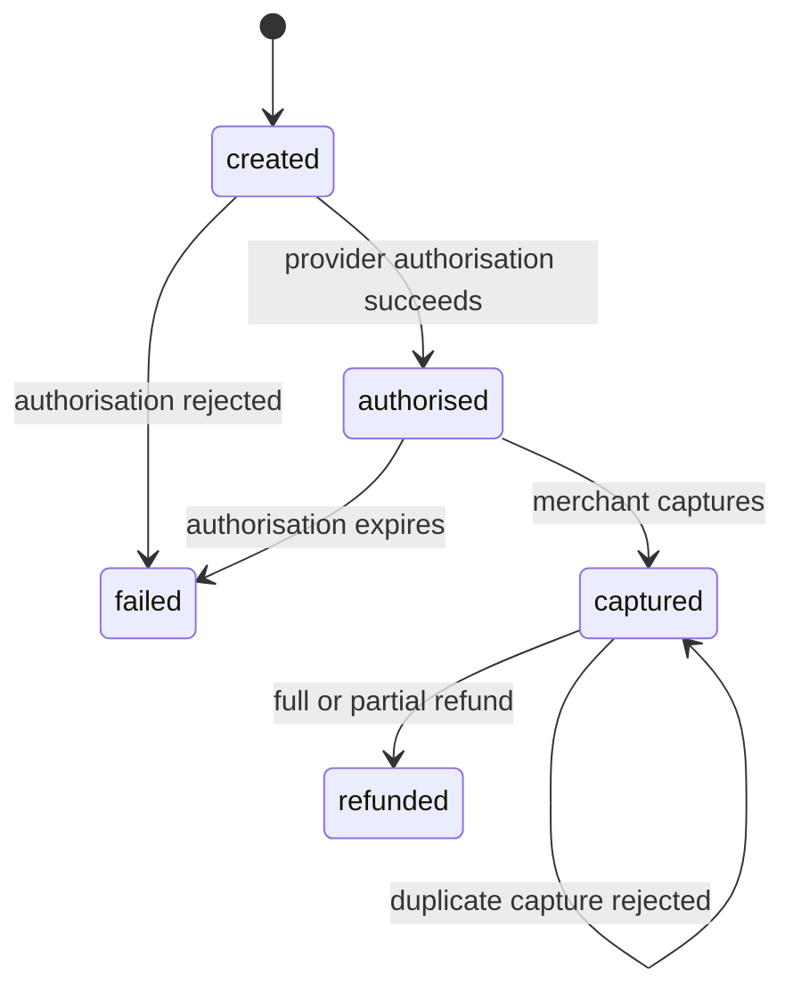

A payment flow is a good stress test for a type system because the expensive mistakes are not exotic. They are ordinary: a refund applied to a payment that never succeeded, a capture attempted twice, rupees passed where paise were expected, or a webhook body trusted because it “looks like our object”. TypeScript cannot prevent every one of these, but it can make several of them difficult to write by accident.

The important caveat comes first: TypeScript is a compile-time tool. Your types are erased when the code becomes JavaScript. A type annotation is not a validation rule, a database constraint, or an authorization check. The value of the type system is that it moves certain reasoning earlier, into the editor and the build, where mistakes are cheap.

## What “structural” actually means

TypeScript is structurally typed. A value is compatible with a type when it has the required shape, not when it was declared with a particular class name. This is different from Java or C#, where a nominal type often has to be named explicitly.

```ts
type RefundRequest = {
  paymentId: string;
  amountPaise: number;
  reason: string;
};

function refund(request: RefundRequest) {
  // ...
}

const payload = {
  paymentId: 'pay_8f21',
  amountPaise: 49900,
  reason: 'duplicate charge',
  requestedBy: 'ops-team',
};

refund(payload);
```

The extra `requestedBy` property does not cause an error when the object is passed through a variable. TypeScript checks that the required properties exist with compatible types; it does not require an exact match. Excess-property checking only applies to fresh object literals passed directly.

This is usually pleasant, especially when adapting third-party objects. It also means two unrelated types with the same shape are interchangeable. If every string identifier in your code is a `string`, the compiler cannot tell a payment ID from a customer ID.

## Model the states, not just the fields

A common first attempt models a payment as a flat bag of optional fields:

```ts
type Payment = {
  id: string;
  status: 'created' | 'authorised' | 'captured' | 'failed' | 'refunded';
  authorisedAt?: string;
  capturedAt?: string;
  failureCode?: string;
  refundedAmountPaise?: number;
};
```

Nothing stops this object from claiming `status: 'captured'` while `capturedAt` is missing, or carrying a `failureCode` on a successful payment. The type permits combinations the business never permits.

A discriminated union makes the state carry its own evidence:

```ts
type Money = { amountPaise: number; currency: 'INR' };

type Payment =
  | { status: 'created'; id: string; amount: Money }
  | { status: 'authorised'; id: string; amount: Money; authorisedAt: string }
  | { status: 'captured'; id: string; amount: Money; authorisedAt: string; capturedAt: string }
  | { status: 'failed'; id: string; amount: Money; failureCode: string }
  | { status: 'refunded'; id: string; amount: Money; capturedAt: string; refundedPaise: number };
```

Now `payment.capturedAt` is only accessible after the status has been narrowed. The compiler enforces the relationship between the state and its data. The cost is that constructing a payment requires deciding its state up front, which is exactly the decision that should not be implicit.



The diagram is not decoration. Every arrow should have a server-side rule, an idempotency key, and an audit event. The union is a compact representation of the same rules.

## Exhaustiveness is the payoff

A discriminated union becomes much more useful when you switch on the discriminant:

```ts
function settlementState(payment: Payment): string {
  switch (payment.status) {
    case 'created':
      return 'not yet authorised';
    case 'authorised':
      return 'authorised, awaiting capture';
    case 'captured':
      return `captured at ${payment.capturedAt}`;
    case 'failed':
      return `failed: ${payment.failureCode}`;
    case 'refunded':
      return `refunded ${payment.refundedPaise} paise`;
    default: {
      const unreachable: never = payment;
      return unreachable;
    }
  }
}
```

If someone later adds a `'disputed'` state to the union, the assignment to `never` fails to compile. Without the default branch, a function with an explicit return type also fails when a case is unhandled. This is one of the few places where a `default` clause is valuable: it converts an unknown future state into a build error instead of a silent fallback.

Be careful with `default` in ordinary switches. A default that returns a plausible string can hide a new case forever. Exhaustiveness checks work because the default is impossible by construction, not because defaults are generally good.

## Branded types for money

The Indian payments context makes a specific bug easy: rupees and paise are both “an amount”. A ₹499 charge is 49,900 paise. If one function accepts rupees and another accepts paise, a factor-of-100 error can survive review because both values are numbers.

A branded type attaches a compile-time identity to a primitive:

```ts
declare const paiseBrand: unique symbol;
type Paise = number & { readonly [paiseBrand]: 'Paise' };

function paiseFromRupees(rupees: number): Paise {
  if (!Number.isInteger(rupees * 100)) {
    throw new Error('Rupee amount has more than two decimal places');
  }
  return Math.round(rupees * 100) as Paise;
}

function formatInr(amount: Paise): string {
  return new Intl.NumberFormat('en-IN', {
    style: 'currency',
    currency: 'INR',
  }).format(amount / 100);
}

const total = paiseFromRupees(499);
formatInr(total);        // fine
// formatInr(499);       // type error: number is not Paise
```

The brand is a fiction enforced by the compiler. At runtime, `Paise` is just a number, and a cast can bypass it. That is acceptable when casts are confined to a small constructor function. It is not acceptable to sprinkle `as Paise` through a codebase; the brand then documents an intention rather than enforcing one.

The same technique works for other identifiers that share a primitive representation:

```ts
type PaymentId = string & { readonly __brand: 'PaymentId' };
type CustomerId = string & { readonly __brand: 'CustomerId' };
```

This prevents `getCustomer(paymentId)` from compiling. The overhead is a constructor or parser at the boundary where raw strings enter the system. In a small codebase that overhead may not be worth it; in a payments codebase with many ID types, it often is.

## Generics: one envelope, many payloads

Generic types are most useful when they preserve a relationship rather than when they merely avoid repeating a type. An API envelope is a reasonable example:

```ts
type ApiSuccess<T> = {
  ok: true;
  data: T;
  requestId: string;
};

type ApiFailure = {
  ok: false;
  error: { code: string; message: string; retryable: boolean };
  requestId: string;
};

type ApiResponse<T> = ApiSuccess<T> | ApiFailure;

async function getPayment(id: PaymentId): Promise<ApiResponse<Payment>> {
  const response = await fetch(`/api/payments/${encodeURIComponent(id)}`);
  const body: unknown = await response.json();
  return parseApiResponse(body); // runtime validation, defined below
}
```

The caller must check `ok` before touching `data`:

```ts
const result = await getPayment(paymentId);
if (!result.ok) {
  if (result.error.retryable) {
    scheduleRetry(result.requestId);
  }
  return;
}

console.log(result.data.status);
```

The relationship that matters is “if `ok` is true, `data` exists; if false, `error` exists”. A generic envelope without the discriminant would still require a cast or a null check at every call site.

Avoid generics that only move a type parameter around without expressing a constraint. A function like `function identity<T>(value: T): T` is a teaching example, not a design pattern. Prefer the concrete type until a real relationship needs to be preserved.

## `unknown` is the honest boundary type

`JSON.parse` returns `any` in TypeScript's standard library. That is a hole: `any` disables checking and spreads silently through everything it touches. Immediately assign parsed JSON to `unknown`:

```ts
const body: unknown = JSON.parse(rawBody);
```

Then validate. A schema library such as Zod, Valibot, or ArkType can produce both a runtime check and a static type from one definition:

```ts
import { z } from 'zod';

const refundWebhookSchema = z.object({
  event: z.literal('payment.refunded'),
  paymentId: z.string().min(1),
  refundedPaise: z.number().int().positive(),
  occurredAt: z.string().datetime(),
});

const parsed = refundWebhookSchema.safeParse(body);

if (!parsed.success) {
  // Return 400, log the request id, and do not touch the database.
  throw new Error('Invalid webhook payload');
}

const webhook = parsed.data; // typed from the schema
```

Three rules keep this honest:

1. **Validate at the boundary, not in every function.** Parse HTTP bodies, environment variables, local storage, CSV imports, and third-party SDK responses once.
2. **Derive types from the schema.** Do not maintain a hand-written interface beside a validator that can drift.
3. **Treat validation failure as a normal outcome.** A webhook endpoint that throws a 500 because a field is missing will trigger provider retries for a permanently invalid payload.

The same discipline applies to environment variables. A missing `DATABASE_URL` should fail at startup with a clear message, not at 2 a.m. when the first request arrives.

## Compiler options that pull their weight

`strict: true` is the baseline, but several flags catch bugs that `strict` leaves open:

| Flag | What it catches | Cost |
| --- | --- | --- |
| `noUncheckedIndexedAccess` | `array[0]` may be `undefined` | More explicit checks |
| `exactOptionalPropertyTypes` | `undefined` is not the same as an absent property | Some library friction |
| `noImplicitOverride` | Missing `override` on subclass methods | Small annotation effort |
| `noFallthroughCasesInSwitch` | Accidental switch fallthrough | None worth mentioning |
| `verbatimModuleSyntax` | Type-only imports that confuse emit | Requires `import type` discipline |
| `noPropertyAccessFromIndexSignature` | `obj.key` hiding an index signature | Slightly more verbose access |

`noUncheckedIndexedAccess` is especially useful when processing CSV rows or webhook arrays. It forces the code to acknowledge that an array can be empty, which is often the actual production condition.

```ts
const firstFailure = failures[0];
if (!firstFailure) {
  return { ok: true, failures: [] };
}
// firstFailure is now narrowed
```

The flag does not make code longer for its own sake; it makes the empty case visible at the point where the decision belongs.

## Types do not authorise anything

It is tempting to model authorization with types:

```ts
type AdminUser = User & { role: 'admin' };
function deleteCustomer(actor: AdminUser, customerId: CustomerId) { /* ... */ }
```

This is useful documentation inside a trusted code path, but it is not a security control. An HTTP request does not carry a TypeScript type. A caller can forge a JSON body claiming `role: 'admin'`, and at runtime the annotation is gone. The server must load the actor's role from a trusted store and check the permission on every request.

The same distinction applies to validation. Zod can tell you that `amountPaise` is a positive integer. It cannot tell you that this merchant is allowed to refund that payment, that the refund does not exceed the captured amount, or that the operation is idempotent. Those are domain rules backed by database constraints, authorisation checks, and transaction boundaries.

A useful shorthand: **types make illegal programs harder to write; runtime checks make illegal requests harder to execute.** A payment system needs both.

## Where the type system gets expensive

TypeScript's type system is powerful enough to encode entire parsers and arithmetic. That does not mean it should. Deep conditional types, recursive mapped types, and long template-literal chains can slow the editor and produce error messages that no one can read.

Prefer a simple type plus a runtime parser over a type-level program that proves a property once and is maintained by nobody. Keep type-level tests for public library APIs; keep ordinary unit tests for business rules. If a type error takes ten minutes to decode, the abstraction is probably wrong for a small team.

The other common failure is `as`. A cast is a request to stop checking. Some casts are legitimate at validated boundaries. Many are shortcuts that move a bug from the compiler to production. A useful rule: every `as` needs a nearby runtime check or an explanation that a reader can verify.

## A migration path for an existing JavaScript codebase

You do not need to convert everything at once. A sequence that tends to work:

1. Enable `allowJs` and `checkJs` with a permissive configuration, then turn on `strict` for new files.
2. Add types to the boundaries first: API clients, environment configuration, and shared data models.
3. Replace `any` with `unknown` at parse points and introduce schemas.
4. Convert leaf utilities, then work inward toward the framework code.
5. Add `tsc --noEmit` to CI before changing build tooling.
6. Enable stricter flags one at a time, fixing the resulting errors in small batches.

The goal is not 100% annotation coverage. It is to make the highest-consequence paths typed and validated, and to keep the compiler honest about the rest.

## India-specific checks worth typing and validating

A useful exercise is to model the identifiers that appear in an Indian product:

| Value | Type-level treatment | Runtime treatment |
| --- | --- | --- |
| Money | Branded `Paise` | Integer, minimum, maximum |
| UPI ID | `string` brand | Format check, never proof of ownership |
| IFSC | `string` brand | 11-character format check |
| GSTIN | `string` brand | 15-character format and checksum where applicable |
| Mobile number | `string` brand | Normalise to E.164, verify with OTP |
| Pincode | `string` brand | Six digits, not a number |

Storing a phone number as a number is a classic Indian bug because leading digits and formatting disappear. Storing a pincode as a number is similar. Types can document the decision, but the runtime schema and database column types must agree.

None of these format checks establish that an identifier is genuine. An IFSC code can match the pattern and belong to a different bank branch; a GSTIN can be well-formed and inactive. Validation reduces malformed input, not fraud.

## A short review checklist

Before trusting a TypeScript codebase with money or access control, ask:

- Are external inputs parsed as `unknown` and validated at the boundary?
- Do state models prevent impossible combinations, or are they bags of optional fields?
- Are switches over states exhaustive?
- Are rupees and paise distinct types, or merely two numbers?
- Are authorization decisions loaded from a trusted server-side source?
- Do CI and the build run `tsc --noEmit` with `strict` and the stricter flags that fit the project?
- Are casts rare, local, and explained?

The type system will not design the payment flow, and it will not secure the endpoint. It will, however, keep a team from re-learning the same state-machine mistakes in every pull request. That is a modest and durable return.
