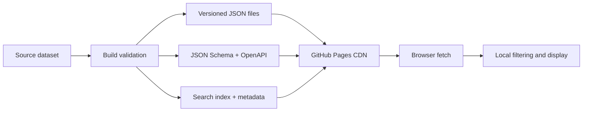

Not every useful API needs a server. A small public dataset that changes occasionally can be published as versioned JSON files, served from a static host, and consumed directly by browsers. The trade-off is simple: you give up dynamic queries and writes, and you gain a system with no runtime to maintain and no server bill.

I have been building a family of these small APIs under the Oriz name. This article describes the pattern honestly, including the parts that are still unfinished.

## The architecture

Each API publishes a few predictable files:

```text
api/v1/
  data.json              the complete dataset
  individual/{id}.json   one record
  search-index.json      a compact client-side index
  meta.json              counts, update dates, license
schemas/
  data.json              JSON Schema for records
openapi.yaml             endpoint description
index.html               human-readable documentation
```

The project is then deployed by GitHub Pages. A static host can return JSON with the correct content type and, in GitHub Pages' case, a permissive CORS header. No application server is involved.



The important idea is not GitHub specifically. Any static host that can serve JSON and set CORS headers can play the same role. The repository becomes both the source and the deployment artifact.

## Why the metadata file matters

A JSON array without context is hard to trust. A `meta.json` file can answer:

- how many records exist
- when the dataset was last updated
- where the source data came from
- what license applies
- which schema version is in use
- when the next review is due

Our [developer resources page](/developers/) documents the same principle for the ORIZ.IN data endpoints, which are generated from the site's own registries.

Metadata also prevents a subtle failure: a client that requests a dataset and receives `[]` cannot tell whether the dataset is empty, the build failed, or the path is wrong. A successful HTTP status is not enough context.

## Schemas are part of the interface

Publishing a JSON Schema gives consumers a machine-readable description of field names and types. It also gives you a build-time validation target. Validate records before deployment; do not rely on manual inspection.

A schema cannot guarantee that content is correct, but it catches a large class of accidental breakage: a field renamed, a value becoming a string instead of a number, or a required field disappearing in a rebuild.

Version the schema alongside the data. If the shape must change, add a new path such as `/api/v2/` and keep the old one for a documented period. A static file cannot inspect an `Accept` header or negotiate a response, so URL versioning is the clearest option.

## Search without a search server

If the dataset is small, a client can download the full dataset and filter it locally. If it is larger, publish a compact search index containing only what is needed for discovery, then fetch individual records on demand.

This is not full-text search at server scale. It is a deliberate compromise: the API is a distribution format, not a database. Document the size of the index, the maximum number of records a client should load, and the fact that filtering happens locally.

## CORS and browser access

Browsers block cross-origin reads unless the response permits them. GitHub Pages includes `Access-Control-Allow-Origin: *`, and I verified that behavior for the example APIs in this family. A static host without CORS would make the API useless from JavaScript on another origin, regardless of how clean the JSON is.

CORS is not authentication or authorization. A public dataset is public. Do not put secrets, private records, or signed URLs in a static JSON file and assume an obscure path protects them.

## What this pattern is good for

- reference lists that change slowly
- small public datasets with a clear license
- documentation examples and educational projects
- prototypes that need a stable URL before a backend exists
- data that consumers can reasonably download and cache

## When not to use it

Use a real service when you need:

- authentication or per-user authorization
- writes, mutations, or user accounts
- server-side search over large data
- strict freshness or transactional guarantees
- per-request filtering that would otherwise require downloading everything
- availability commitments beyond a static host's ordinary behavior
- audit logs, rate limiting by user, or abuse prevention

Static hosting has usage limits and a different failure model. Check GitHub Pages' current published limits before publishing large datasets or expecting production-grade bandwidth. Free hosting is not a substitute for a service-level agreement.

## The honest status of my API family

I have more than 80 public repositories with an API-sounding name. Most are scaffolds: a schema, a metadata file, a generated documentation page, and one fixture record. A few are more substantial. The HTTP Status Codes API has a small starter dataset, the India PIN Code API has pilot records, and some data-pipeline projects are still being hardened before I promote them.

That is an important engineering truth: generating a consistent repository skeleton is easy; maintaining a trustworthy dataset is not. The skeleton is valuable because it reduces the cost of doing the next one properly. It is not evidence that eighty datasets are complete.

The live starter APIs and the complete repository list are linked from [my author page](/author/chirag-singhal/). I would rather publish an accurate status than inflate the catalogue. The same standard applies to ORIZ.IN's own tools: a formatter that works is more useful than fifty planned tools with disabled buttons.

## A checklist before publishing

1. Define the record shape in a schema.
2. Validate every generated record in the build.
3. Publish metadata with source, license, version, and update date.
4. Use URL versioning and keep old paths when feasible.
5. Set the correct content type and CORS behavior.
6. Provide a small search index instead of forcing a full download for discovery.
7. Test from a different origin, not just `localhost`.
8. Document limits and freshness honestly.
9. Decide what will happen when the upstream source changes or disappears.
10. Remove or label scaffold data instead of calling it complete.

A static JSON API is a small promise: here is a stable URL, here is the shape, and here is what the data means. Keeping that promise is mostly about discipline and honest labels, not infrastructure.
